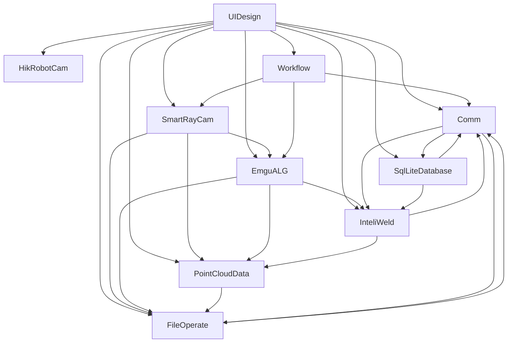

# AdaWeldSystem 项目知识库

> 本文档由 `/wiki` 工作流自动生成，梳理项目结构、模块依赖、UI调用逻辑和设计意图。
> 生成时间：2026-07-01（基于 history.md [1]~[47] 条修改记录 + 全源码扫描）

---

## 第1章：项目概览

### 项目简介

AdaWeldSystem（自适应焊接系统）是基于 .NET Framework 4.8 + WinForms + SunnyUI 的工业自适应焊接控制软件。系统集成了工业相机（SmartRay/HikRobot）、3D点云处理（HelixToolkit）、图像算法（EmguCV/OpenCV）、焊接工艺控制、运动控制、数据库管理等模块，实现焊缝跟踪、自适应参数调整、3D表面重建等功能。

### 技术栈

| 层级 | 技术 |
|------|------|
| 框架 | .NET Framework 4.8（C# 7.3 语法约束，编译器不支持 C# 6.0+ auto-property initializer 和 expression-bodied property） |
| UI | WinForms + SunnyUI |
| 3D渲染 | HelixToolkit.Wpf.SharpDX（WPF控件通过 ElementHost 嵌入 WinForms） |
| 图像算法 | Emgu.CV（OpenCV .NET 封装） |
| 工业相机 | SmartRay SRAPI CSharp + 海康 Mv3dLpNet |
| 数据库 | SQLite（System.Data.SQLite） |
| 文件配置 | 自研 INIFile 类（FileOperate/） |
| 设计模式 | 单例（Lazy<T>）、事件驱动、Step 状态机、三层 UI 容器 |

### 项目结构概览

```
AdaWeldSystem/
├── EmguALG/                    图像算法模块（算法+配置+Job管理）
│   ├── AlgorithmJob.cs           Job 数据结构
│   ├── JobManager.cs             Job CRUD + 切换 + INI 持久化
│   ├── AlgorithmManager.cs       PipelineConfig + PipelineManager 调度
│   ├── ImageAlgorithm.cs         纯算法静态类（唯一算法文件）
│   └── ImageRoiTools.cs         ROI 绘制工具
├── PointCloudData/             3D点云数据处理
│   ├── 3DModel/                  点云数据结构（Point3D, PointCloudData）
│   ├── DataIO/                   点云文件读写（PLY/OBJ/Assimp Scene）
│   │   ├── PointCloudReader.cs
│   │   └── PointCloudWriter.cs
│   ├── Render/                   3D渲染引擎（PointCloudViewer, RenderConfig）
│   │   ├── PointCloudViewer.cs   Viewport3DX 封装 + 相机控制 + 表面重建
│   │   ├── RenderConfig.cs       渲染全局静态配置（INI 持久化）
│   │   └── SurfaceTriangulator.cs
│   └── RunFileRecord/            运行记录管理
│       ├── RecordFrame.cs
│       ├── RunRecordManager.cs
│       ├── SmartRayConverter.cs
│       └── WeldActionRecord.cs
├── SmartRayCam/                SmartRay 工业3D相机驱动
│   ├── ApiCore/                  SDK 封装（Sensor, SensorManager, SensorHelper 等）
│   ├── CameraRun.cs              相机运行控制（采集→ROI→算法→记录+回调通知）
│   └── CameraPresetManager.cs    10 组相机参数预设 INI 持久化
├── HikRobotCam/                海康机器人2D相机驱动
│   ├── ApiCore/                  SDK 封装（HikCameraManager, HikCameraDevice）
│   └── HikCameraRun.cs           相机运行控制
├── InteliWeld/                 焊接工艺模块
│   └── WeldProcess.cs            焊缝跟踪 + 自适应调整 + 记录
├── Workflow/                   工作流模块
│   └── LineLaserWorkflow.cs      线激光工作流状态机（10态 + 7步 Step 枚举）
├── FileOperate/                文件操作工具库
│   ├── IniFile.cs                INI 读写
│   ├── Log.cs                    日志
│   └── XMLfile.cs                XML 配置
├── Comm/                       通讯模块
│   ├── GlobalCommData.cs         全局数据通讯中心
│   ├── SystemStatus.cs           全局状态定义中心（枚举+事件参数）
│   └── TCPIPComm.cs             TCP 通讯
├── SqlLiteDatabase/            SQLite 数据库模块
│   ├── AuthManager.cs            用户认证
│   ├── AutoParamManager.cs       自动参数
│   ├── ConfigManager.cs          配置管理
│   ├── ProductDatabaseManager.cs 产品数据库
│   ├── DatabaseManagerBase.cs    基类
│   └── SQLiteDataBase.cs         底层封装
├── UIDesign/                   UI 界面模块
│   ├── ParentUI/                 主窗体（FormMain）
│   ├── Sub1UI/                   一级页面
│   │   ├── MainPage.cs           主页面（Chart + 日志 + 状态）
│   │   ├── ImagePage.cs          图像页容器（LLCamWorkJob + Helix3Drender）
│   │   ├── ParamPage.cs          参数页容器
│   │   ├── DataReview.cs         数据回看
│   │   └── FormLogin.cs         登录弹窗
│   ├── Sub2UI/                   二级页面（继承 UIPage）
│   │   ├── LLCamWorkJob.cs       线激光算法作业页（显示+Job管理+手动调试+Workflow 联动）
│   │   ├── Helix3Drender.cs      3D追溯页
│   │   ├── ParamConfigPage.cs    工艺配置
│   │   ├── XMLEditor.cs          XML 编辑器
│   │   ├── TCPServer.cs / TCPClinet.cs 通讯配置
│   │   └── UserEdit.cs           用户管理
│   └── Sub3UI/                   三级弹窗（继承 UIForm）
│       ├── LLCameraSetting.cs    线激光相机设置弹窗（原 ParamLaserPage）
│       ├── ConfigForm.cs         系统配置
│       ├── AutoParamForm.cs      自动参数
│       ├── FileTraceForm.cs      文件追溯
│       ├── RecordConfigForm.cs   记录配置
│       └── RenderParamForm.cs    渲染参数
├── Skills/                     开发团队架构 Skill 体系
│   ├── 00-Root/                  SkillRoot.md
│   ├── 01-Team/                  架构师 + QA
│   ├── 02-Development/           8 大技术专员
│   ├── 03-Workflow/              工作流地图
│   ├── 04-Style/                 C# 代码风格规范
│   └── Knowledge/                EmguCV / HelixToolkit 知识库 HTML（RAG 源）
├── Docs/                       文档目录
│   └── AdaWeldSystem_Wiki.md     本知识库
├── Program.cs                  程序入口
├── AdaWeldSystem.csproj        项目文件
└── bin/Debug/Config/           运行时配置文件目录
    ├── AlgorithmParams.ini       算法参数
    ├── RenderConfig.ini          渲染配置
    ├── ImageRoi.ini              ROI 配置
    ├── CameraPresets.ini         10 组相机预设
    └── Record.ini                记录配置
```

### 模块清单

| 模块 | 核心文件数 | 命名空间 | 职责简述 |
|------|-----------|---------|---------|
| EmguALG | 5 | `AdaWeldSystem.EmguALG` | 图像算法唯一入口、算法配置管理、Job 多配置管理、ROI 工具 |
| PointCloudData | 10 | `PointCloudLibrary.*` | 3D点云数据结构、文件读写（PLY/OBJ/Assimp）、渲染引擎、运行记录、SmartRay 转换器 |
| SmartRayCam | 10 | `AdaWeldSystem.SmartRayCameraRun` / `Smartray.Sample` | SmartRay 3D 轮廓传感器 SDK 封装与运行控制、相机预设管理、Workflow 回调通知 |
| HikRobotCam | 3 | `AdaWeldSystem.HikRobotCam` | 海康机器人 2D 相机 SDK 封装与运行控制 |
| InteliWeld | 1 | `AdaWeldSystem.WeldingData` | 焊接工艺核心逻辑（自适应调整、焊缝跟踪、记录） |
| Workflow | 1 | `AdaWeldSystem.Workflow` | 线激光工作流状态机（10 态 + 7 Step 枚举，回调等待取图） |
| FileOperate | 3 | `AdaWeldSystem.FileOperate.*` | INI/Log/XML 文件操作工具库 |
| Comm | 3 | `AdaWeldSystem.Comm` | 全局数据通讯中心、TCP 通讯、系统状态定义中心 |
| SqlLiteDatabase | 6 | `AdaWeldSystem.SQLiteDB` | 用户认证、配置管理、自动参数管理 |
| UIDesign | 26 | `AdaWeldSystem.Sub{N}UI` | 全部 UI 界面（主窗体 + 5 个一级页面 + 7 个二级页面 + 6 个弹窗） |

### 统计数据

| 指标 | 数值 |
|------|------|
| 模块总数 | 10 个（不含 Skills/Knowledge/Docs） |
| C# 源文件数 | 约 60+ 个 |
| UI 页面数 | 18 个（含弹窗） |
| 单例类数 | 8 个 |
| 历史修改记录 | 47 条（[1]~[47]） |
| 开发专员数 | 10 个（3D / 相机 / 图像算法 / UI / 焊接工艺 / 数据库 / 运动控制 / 通用技术 / 架构师 / QA） |
| 工作流状态 | 10 态（LineLaserWorkflowState） |
| 工作流步骤 | 7 个（WorkflowStep 枚举） |
| 相机参数预设组 | 10 组（CameraPresetManager） |

---

## 第2章：模块依赖关系

### 依赖关系图



### 依赖方向说明

| 依赖方 | 被依赖方 | 依赖类型 | 说明 |
|--------|---------|---------|------|
| EmguALG | PointCloudData/3DModel | 强依赖 | PointCloudData 作为算法 Execute() 的输入参数 |
| EmguALG | FileOperate/INIFile | 强依赖 | 算法参数持久化、ROI 配置、Job 配置 |
| SmartRayCam/CameraRun | EmguALG | 强依赖 | 采集完成后调用 ImageAlgorithm.DrawPointsDefaultRange 静态方法 |
| SmartRayCam/CameraRun | PointCloudData/RunFileRecord | 强依赖 | 采集帧写入 RunRecordManager.Instance.AddSmartRayFrame |
| SmartRayCam/CameraRun | FileOperate/INIFile | 强依赖 | ROI 配置读取（ImageRoi.ini） |
| InteliWeld | EmguALG | 强依赖 | 订阅 AlgorithmCompleted 事件获取焊缝特征 |
| InteliWeld | PointCloudData/RunFileRecord | 强依赖 | 写入运行记录 |
| InteliWeld | Comm | 强依赖 | 使用 GlobalCommData 事件和数据 |
| Workflow | Comm | 强依赖 | 使用 SystemStatus 中定义的状态枚举和事件参数 |
| Workflow | SmartRayCam | 强依赖 | 调用 CameraRun.Instance 获取 CurrentMat；通过 AcquisitionCompletedSignal（AutoResetEvent）等待回调 |
| Workflow | EmguALG | 强依赖 | 调用 PipelineManager.Execute 执行算法分析 |
| Comm | SqlLiteDatabase | 强依赖 | 数据库操作 |
| Comm | InteliWeld | 强依赖 | 引用焊接数据类型（形成循环依赖） |
| UIDesign/Sub2UI/LLCamWorkJob | EmguALG + SmartRayCam + HikRobotCam + Workflow | 强依赖 | 最复杂的 UI 页面，直接引用 4 个后端模块 |
| UIDesign/Sub2UI/Helix3Drender | PointCloudData（全部子模块） | 强依赖 | 点云读写、渲染引擎、运行记录 |
| UIDesign/Sub3UI/LLCameraSetting | SmartRayCam + EmguALG | 强依赖 | 加载/保存 10 组相机参数预设；使用 ImageRoiTools |
| UIDesign/Sub3UI/RenderParamForm | PointCloudData/Render | 强依赖 | RenderConfig 渲染配置读写 |

### 循环依赖分析

当前存在 3 组循环依赖，均属于历史遗留，尚未造成编译错误，但增加维护成本：

| 循环依赖 | 涉及文件 | 形成原因 | 风险等级 | 建议改进 |
|---------|---------|---------|---------|---------|
| Comm <-> InteliWeld | `Comm/GlobalCommData.cs` 引用 `WeldingData`；`WeldProcess.cs` 引用 `Comm` | GlobalCommData 作为全局数据中心，被所有业务模块引用；InteliWeld 又需要写入通讯数据 | 低 | 将 InteliWeld 的数据模型提取到独立共享层，或 InteliWeld 通过事件反向通知 Comm |
| Comm <-> SqlLiteDatabase | `Comm/GlobalCommData.cs` 引用 `SQLiteDB`；数据库管理器引用 `Comm` 数据 | 数据库操作需要全局状态判断，全局状态又依赖数据库配置 | 低 | 引入依赖注入或接口隔离；数据库层不直接引用 Comm |
| FileOperate <-> Comm | `FileOperate` 的日志写入可能触发 Comm 事件；Comm 引用 FileOperate 工具 | 日志系统与通讯系统耦合 | 低 | 日志系统独立为只写接口，Comm 订阅日志事件而非反向依赖 |

---

## 第3章：UI 调用逻辑

### UI 层级结构（最新）

```
FormMain（主窗体，含导航栏+状态栏）
├── MainPage（主页面：Chart图表显示、日志、操作等级）
├── ImagePage（图像页面容器）
│   ├── LLCamWorkJob（线激光算法作业页，Sub2UI）
│   │   └── [静态按钮] btnCameraSetting → LLCameraSetting（弹窗，Sub3UI）
│   └── Helix3Drender（3D渲染页，Sub2UI）
├── ParamPage（参数页面容器）
│   ├── XMLEditor（文件配置）
│   ├── TCPServer（通讯配置-服务端）
│   ├── TCPClinet（通讯配置-客户端）
│   └── ParamConfigPage（工艺配置）
├── DataReview（数据回看页）
└── FormLogin（登录弹窗，由 FormMain 按需弹出）
```

> 变更历史：[40] LineLaserPage -> LLCamWorkJob, ParamLaserPage -> LLCameraSetting; [41] LLCameraSetting 从 Sub2UI Tab 迁移为 Sub3UI 弹窗; [44] btnCameraSetting 从 ImagePage 动态注入改为 LLCamWorkJob.Designer.cs 静态定义。

### MainPage — 主页面

| UI 事件/方法 | 调用的后端类 | 调用方式 | 功能说明 |
|-------------|-------------|---------|---------|
| 构造函数（LoadComponent） | GlobalCommData | 事件订阅 | 订阅 EventInfoHandler、EventRobotInfoHandler、EventLineLaserInfoHandler |
| CommenData_EventInfoHandler | LogAppend | 静态方法 | 全局日志写入 |
| GlobalCommData_EventLineLaserInfoHandler | FreshChartLine() | 私有方法 | 刷新 Chart 线激光数据 |
| AddLaserOptionData | WeldProcess.Instance.Trigger | 单例属性 | 读取工艺调整触发状态 |
| FormMain_FormClosing | — | — | 反订阅事件 |

### ImagePage — 图像页面容器

| UI 事件/方法 | 调用的后端类 | 调用方式 | 功能说明 |
|-------------|-------------|---------|---------|
| 构造函数 | LLCamWorkJob, Helix3Drender | new | 创建 2 个子页面实例，配置 Tab 导航 |
| ImagePage_FormClosing | 各子页面.Dispose() / DisposeComponents() | 实例方法 | 释放所有子页面资源 |

> [44] 后 ImagePage 不再负责 btnCameraSetting 的创建和 LLCameraSetting 的打开。btnCameraSetting 已在 LLCamWorkJob.Designer.cs 中静态定义，Click 事件在 LLCamWorkJob.cs 中处理。

### LLCamWorkJob — 线激光算法作业页

| UI 事件/方法 | 调用的后端类 | 调用方式 | 功能说明 |
|-------------|-------------|---------|---------|
| 构造函数（InitializeJobSelect） | JobManager.Instance | 单例 | 遍历 Jobs 填充下拉框 |
| 构造函数（SubscribeEvents） | CameraRun/HikCameraRun 静态事件 | 事件订阅 | 订阅图像采集完成事件 |
| SubscribeEvents | LineLaserWorkflow.Instance 5 个事件 | 事件订阅 | StateChanged / Completed / ErrorAborted / ManualStopped / AnalysisImageDisplayEvent |
| CameraRun_AcqusitionMatCompletedEvent | CameraRun.Instance.CurrentMat | 单例属性 | 获取 SmartRay 采集图像并显示 |
| HikCameraRun_AcqusitionMatCompletedEvent | HikCameraRun.Instance.CurrentMat | 单例属性 | 获取海康采集图像并显示 |
| cmbJobSelect_SelectedIndexChanged | JobManager.Instance.SwitchJob(jobId) | 单例方法 | 切换当前 Job 配置 |
| btnManualRun_Click | LineLaserWorkflow.Instance.StartManualMode/StopManualMode | 单例方法 | 手动调试模式启动/停止 |
| btnAddJob/DeleteJob/EditJob/SaveJob | JobManager.Instance | 单例方法 | Job CRUD（增删改保存） |
| btnCameraSetting_Click | LLCameraSetting | new + ShowDialog | 弹出相机设置对话框（using 模式释放） |
| Workflow_StateChanged | GetStateDisplayText | 私有方法 | 状态中文映射 + UI 状态更新（带 InvokeRequired） |
| Workflow_DisplayEvent | CameraRun.CurrentMat / 算法结果 Mat | 单例属性 | 显示采集图像或分析结果图像（带 InvokeRequired） |
| StatusTimer_Tick | CameraRun/HikCameraRun/JobManager | 单例属性 | 500ms 定时刷新状态栏 |
| LLCamWorkJob_HandleDestroyed | UnsubscribeEvents / StopStatusTimer | 私有方法 | 页面销毁时取消所有事件订阅和定时器 |

> 所有 Workflow 事件处理均带 InvokeRequired 跨线程保护。[41][42] 新增手动调试模式、Job CRUD、Workflow 联动。[44] 新增 btnCameraSetting_Click 静态处理。

### ParamPage — 参数页面容器

| UI 事件/方法 | 调用的后端类 | 调用方式 | 功能说明 |
|-------------|-------------|---------|---------|
| 构造函数 | XMLEditor, TCPServer, TCPClinet, ParamConfigPage | new | 创建 4 个二级页面实例，配置 Tab 导航 |
| ParamPage_FormClosing | 各子页面.Dispose() | 实例方法 | 释放所有子页面资源 |

### DataReview — 数据回看页

| UI 事件/方法 | 调用的后端类 | 调用方式 | 功能说明 |
|-------------|-------------|---------|---------|
| 构造函数 | SqlLiteDatabase / ProductDatabaseManager | 单例 | 加载历史焊接记录列表 |
| 数据筛选 | DatabaseManagerBase | 基类方法 | 按时间/产品/结果筛选记录 |
| 导出按钮 | FileOperate/Log / PointCloudWriter | 静态方法 | 导出日志或点云文件 |

### FormLogin — 登录弹窗

| UI 事件/方法 | 调用的后端类 | 调用方式 | 功能说明 |
|-------------|-------------|---------|---------|
| btnLogin_Click | AuthManager.Instance | 单例 | 验证用户名密码，返回 OperateLevel |
| 登录成功 | GlobalCommData.mOperateLevel | 静态属性 | 设置全局操作等级 |

### Helix3Drender — 3D 追溯页

| UI 事件/方法 | 调用的后端类 | 调用方式 | 功能说明 |
|-------------|-------------|---------|---------|
| 构造函数（CreatCamereDir） | PointCloudViewer | new | 创建渲染引擎并嵌入 ElementHost |
| btnTraceFile_Click | RunRecordManager.Instance / PointCloudReader | 单例+静态方法 | 文件追溯：加载临时记录或 PLY 文件 |
| btnAssimpImport_Click | PointCloudReader.LoadSceneFromFile() | 静态方法 | Assimp 导入外部 3D 模型（PLY/OBJ 等） |
| btnZColor_Click | RenderConfig.ZColorEnabled | 静态属性 | 切换 Z 高度着色 |
| btnSurface_Click | _viewer.GenerateSurface*() / ExecuteSurfaceRender | 实例方法+私有方法 | 执行表面重建（6 种算法，通过 RenderConfig.SelectedAlgorithm 分派） |
| btnClearData_Click | _viewer.ClearAll() | 实例方法 | 清空 3D 场景 |
| btnRotate/Move/Round_Click | _viewer.SetCameraMode() | 实例方法 | 切换相机控制模式 |
| SavePointCloud() | PointCloudWriter.SaveToFile() | 静态方法 | 导出点云文件 |
| btnRecordConfig_Click | RecordConfigForm | new | 弹出记录配置窗口 |
| btnRenderParam_Click | RenderParamForm | new | 弹出渲染参数窗口 |
| DisposeComponents() | _viewer.Dispose() | 实例方法 | 释放渲染引擎资源 |

### LLCameraSetting — 线激光相机设置弹窗（Sub3UI）

| UI 事件/方法 | 调用的后端类 | 调用方式 | 功能说明 |
|-------------|-------------|---------|---------|
| 构造函数 | CameraPresetManager.Instance | 单例 | 加载 10 组预设列表到 cmbPreset |
| cmbPreset_SelectedIndexChanged | CameraPresetManager.Instance.LoadPreset | 单例方法 | 切换预设自动加载参数到控件 |
| btnSavePreset_Click | CameraPresetManager.Instance.SavePreset | 单例方法 | 将当前控件值保存到选中预设组 |
| ReadControlsToData | — | 私有方法 | 安全读取数值型控件（防空值/异常） |
| FormClosing | CameraRun.Instance.ChangeMode(false) | 单例方法 | 关闭弹窗时切换回 PIL 模式 |

> [41] 从 Sub2UI Tab 页迁移为 Sub3UI 弹窗；左侧 ImageBox 显示 LiveImage，右侧参数面板。

### FormMain — 主窗体

| UI 事件/方法 | 调用的后端类 | 调用方式 | 功能说明 |
|-------------|-------------|---------|---------|
| 构造函数（LoadPage） | MainPage, ParamPage, ImagePage, DataReview | new | 创建 4 个一级页面 |
| uiMillisecondTimer1_Tick | GlobalCommData.mOperateLevel | 静态属性 | 定时刷新操作等级显示 |
| OperateLevelControl() | GlobalCommData.mOperateLevel | 静态属性 | Admin/Engineer/Operator 三级权限控制页面可见性 |
| FormMain_FormClosed | CameraRun.Instance.Dispose() | 单例方法 | 退出时释放相机资源 |
| uiHeaderButton6_Click | FormLogin | new | 弹出登录窗口 |
| GlobalCommData.ShowLog() | Log | 静态方法 | 写入系统日志 |

---

## 第4章：设计意图与历史决策

### 4.1 线激光工作流状态机详解

LineLaserWorkflow 是系统的核心编排器，负责将相机、算法、焊接工艺串联为可控的自动化流程。

#### 10 个状态定义

| 状态 | 说明 | 触发条件 |
|------|------|---------|
| Uninitialized | 未初始化 | 实例创建后默认状态 |
| Initializing | 初始化中 | 调用 Start() 或 StartManualMode() 后，后台线程执行 InitializeWorker |
| Standby | 待机 | 初始化成功，等待外部启动指令 |
| Starting | 启动中 | 收到外部"Go"指令或手动模式触发 |
| Acquiring | 采集中 | 调用 CameraRun.SensorRunContinue，等待 AcquisitionCompletedSignal 回调 |
| Analyzing | 分析中 | 调用 PipelineManager.Execute，对 Mat 执行算法流水线 |
| Adjusting | 调整中 | 算法成功，调用 RunAutoAdjust（预留 TODO） |
| Completed | 完成 | 单次工作循环正常结束，自动返回 Standby |
| ErrorAborted | 异常终止 | 连续失败超限或失败距离超限 |
| ManualStopped | 手动停止 | 用户点击停止按钮或手动模式结束 |

#### 7 个 Step 枚举（[45] 新增）

| Step | 说明 | 后续流转 |
|------|------|---------|
| Idle = 0 | 空闲/待机，等待启动 | — |
| CheckJob = 1 | 检查并加载 Job | -> AcquireImage |
| AcquireImage = 2 | 获取图像（点云转 Mat） | 成功->AnalyzeImage；失败->停留重试 |
| AnalyzeImage = 3 | 分析图像（执行算法） | 成功->Display；失败->回退 AcquireImage |
| Display = 4 | 显示分析结果 | -> Adjust |
| Adjust = 5 | 自动调整 | 成功->Complete；失败->回退 AcquireImage；手动模式->Complete |
| Complete = 6 | 完成，回到待机 | -> Idle |

#### 状态转换规则

```
Uninitialized --Start()--> Initializing
Initializing --成功--> Standby
Initializing --失败--> ErrorAborted
Standby --Go指令--> Starting
Starting --自动--> Acquiring
Acquiring --成功--> Analyzing
Acquiring --失败--> ErrorAborted（累计检查）
Analyzing --成功--> Adjusting
Analyzing --失败--> ErrorAborted（累计检查）
Adjusting --成功--> Completed
Adjusting --跳过/预留--> Completed
Completed --自动--> Standby
任意状态 --Stop()--> ManualStopped
ManualStopped --Reset()--> Standby
ErrorAborted --Reset()--> Uninitialized
```

> 所有状态转换均通过 `IsValidTransition` 验证，非法转换抛出 `InvalidOperationException`。

#### 工作循环流程（[45][46] 更新）

```
WorkflowLoopWorker (工作线程循环)
  └── switch(_workflowStep)
        ├── ExecuteStep_CheckJob()
        │     └── 加载当前 Job 配置
        ├── ExecuteStep_AcquireImage()
        │     └── AcquireImage() [46] 回调等待模式：
        │           ├── AcquisitionCompletedSignal.Reset()
        │           ├── CameraRun.Instance.SensorRunContinue()
        │           ├── AcquisitionCompletedSignal.WaitOne(5000ms)
        │           ├── 检查 LastAcquisitionSuccess
        │           └── CameraRun.Instance.CurrentMat.Clone()
        ├── ExecuteStep_AnalyzeImage()
        │     └── PipelineManager.Instance.Execute(_lastAcquiredMat)
        ├── ExecuteStep_Display()
        │     └── 触发 AnalysisImageDisplayEvent
        ├── ExecuteStep_Adjust()
        │     └── [TODO] RunAutoAdjust(result)
        └── ExecuteStep_Complete()
              └── WorkflowCompleted 事件
```

#### 回调等待取图机制（[46][47] 新增）

```
CameraRun (SmartRay SDK 连续采集循环)
  └── OnCompletedAcqEvent (回调)
        ├── if (!IsLiveMode)          // 仅 PIL 模式
        │     ├── 处理点云数据 -> Mat
        │     ├── LastAcquisitionSuccess = true/false
        │     └── AcquisitionCompletedSignal.Set()  // 通知 Workflow
        └── if (IsLiveMode)           // Live 模式不通知 Workflow
              └── 处理实时图像（独立流程）

LineLaserWorkflow.AcquireImage()
  ├── AcquisitionCompletedSignal.Reset()
  ├── CameraRun.Instance.SensorRunContinue()
  ├── AcquisitionCompletedSignal.WaitOne(5000ms)
  ├── if (!signaled) → _lastAcquiredMat = null（停留重试）
  ├── if (!LastAcquisitionSuccess) → _lastAcquiredMat = null（停留重试）
  └── _lastAcquiredMat = CameraRun.Instance.CurrentMat.Clone()
```

> 关键设计：CameraRun 首次调用 SensorRunContinue 后进入连续采集模式，后续回调自动触发。Workflow 通过 AutoResetEvent 等待每次回调完成。WaitOne 超时 5000ms 后停留在 AcquireImage Step 重试。Live 模式完全不参与 Workflow 回调流程 [47]。

### 4.2 核心架构决策

| # | 决策 | 来源 | 设计意图 |
|---|------|------|---------|
| 1 | Designer.cs Dispose 不可修改 | [31] | WinForms 设计器生成代码不可手动修改，自定义释放在 .cs 中通过 DisposeComponents() |
| 2 | C# 7.3 语法硬约束 | 全局 | .NET Framework 4.8 限制 + MSBuild v4.0 不支持 C# 6.0+ auto-property initializer 和 expression-bodied property；禁止 switch 表达式、using 声明、records、init、nullable reference types、range operators 等 |
| 3 | ImageAlgorithm.cs 为唯一算法文件 | [14] | 算法集中管理，禁止其他文件包含图像处理算法 |
| 4 | AlgorithmManager.cs 仅负责配置+调度 | [14] | 配置管理与算法实现严格分离 |
| 5 | 算法返回原始值不做平滑 | [12] | 算法模块保持纯计算语义，平滑由 WeldProcess 处理 |
| 6 | Viewport3DX 由 PointCloudViewer 内部创建 | [33][34] | 渲染控件生命周期由引擎管理，UI 层仅通过公共属性访问 |
| 7 | RenderConfig 统一渲染配置 | [34] | 所有渲染参数集中管理，避免散落在 Helix3Drender 各处 |
| 8 | INIFile 统一持久化方案 | [3][13] | 全项目使用同一个 INI 操作库，替代各模块自实现 |
| 9 | WorkflowState 归属 Comm 模块 | [22][42] | SystemStatus.cs 是全局状态定义中心，Workflow 层引用 Comm 层定义，避免重复 |
| 10 | Lazy<T> 统一单例实现 | [20][24] | 线程安全+延迟初始化，避免手动双重检查锁定 |
| 11 | Job 层抽象 | [36] | 运行时算法参数集切换，支持多任务配置；持久化到 Config/Jobs/ |
| 12 | UI 页面拆分（显示/配置分离） | [36][40][41] | LLCamWorkJob 纯显示+算法作业，LLCameraSetting 纯相机参数配置，职责单一 |
| 13 | 线激光工作流 Step 状态机 | [45][46] | 7 个 WorkflowStep 枚举替代顺序流程，每步独立可控；AcquireImage 封装回调等待 |
| 14 | 10 组相机参数预设 | [42] | 通过 CameraPresetManager 单例管理 10 组预设，INI 持久化，支持快速切换 |
| 15 | Assimp 导入整体添加根节点 | [37] | scene.Root 整体附加到 GroupNode，禁止遍历 Items 逐个 AddChildNode |
| 16 | Bounds 退化值过滤 | [38][39] | AccumulateBounds 检查 Minimum>=Maximum + Infinity/NaN 过滤，防止相机参数异常导致黑屏 |
| 17 | 事件参数对象复用 | [42] | 高频触发的事件参数声明为类级 readonly 字段，避免 GC 压力 |
| 18 | UI 跨线程安全 | [42] | 所有 Workflow 事件处理均检查 InvokeRequired，WinForms 控件更新必须在 UI 线程 |
| 19 | 控件静态定义优先 | [44][updateskill] | UI 控件优先在 Designer.cs 中静态定义；仅在运行时条件依赖时允许动态生成 |
| 20 | 相机回调与 Workflow 解耦 | [46][47] | Live 模式不通知 Workflow；AcquisitionCompletedSignal 仅 PIL 模式触发 |

### 4.3 模块设计约束

| 模块 | 设计约束 | 违反后果 |
|------|---------|---------|
| EmguALG | 所有图像算法必须在 ImageAlgorithm.cs 中实现，其他文件禁止包含算法逻辑 | 算法分散，维护困难 |
| EmguALG | AlgorithmManager.cs 仅负责配置管理和调度，禁止混入算法实现 | 配置与算法耦合，难以扩展 Job 层 |
| PointCloudData/Render | PointCloudViewer 内部创建并管理 Viewport3DX，外部禁止直接操作 | 生命周期混乱，内存泄漏或渲染异常 |
| PointCloudData/Render | Assimp Scene 导入时必须整体添加 scene.Root，禁止逐个 AddChildNode | "already attach to a different node" 异常 |
| PointCloudData/Render | Bounds 计算必须过滤 Minimum>=Maximum 和 Infinity/NaN | 相机位置变为 Infinity，渲染管线失败，界面纯黑 |
| SmartRayCam | CameraRun 为单例，外部通过 Instance 访问，禁止 new CameraRun() | 多实例导致 SDK 资源冲突 |
| SmartRayCam | AcquisitionCompletedSignal 是实例字段（非 static），通过 CameraRun.Instance 访问 | 静态访问导致多实例信号混乱 |
| SmartRayCam | Live 模式不触发 AcquisitionCompletedSignal.Set() | Workflow 被误通知，Step 流转异常 |
| SmartRayCam | CameraPresetManager 管理 10 组预设，索引范围 1-10，超出抛异常 | 预设越界访问 |
| Workflow | LineLaserWorkflow 状态转换必须通过 IsValidTransition 验证 | 非法状态转换导致状态机崩溃 |
| Workflow | 手动模式下 CanAcceptExternalCommand 返回 false | 手动调试时外部通讯指令干扰运行 |
| Workflow | AutoResetEvent 使用后备字段模式（不用 auto-property initializer） | MSBuild v4.0 编译器报 CS1519 错误 |
| Comm | SystemStatus.cs 为全局状态定义中心，所有 Workflow 状态和事件参数定义在此 | 状态定义分散，各模块重复定义 |
| UIDesign | Sub2UI 页面继承 UIPage，Sub3UI 弹窗继承 UIForm | 混入错误基类导致 SunnyUI 样式异常 |
| UIDesign | Designer.cs 禁止修改 Dispose 和 InitializeComponent 中的流程控制语句 | 设计器报错，必须回滚 |
| UIDesign | 控件优先在 Designer.cs 静态定义；动态生成仅用于运行时条件依赖场景 | 不必要的动态生成增加耦合和调试难度 |

### 4.4 历史教训

| 教训 | 来源 | 说明 |
|------|------|------|
| Designer.cs 不可修改 | [30]->[31] | 修改后导致设计器报错，必须回滚；自定义释放在 .cs 中通过 DisposeComponents() 实现 |
| 开发前必须加载对应专员 Skill | [35.1] | 未加载 UISpecialist 导致按钮布局错误 |
| INIFile 命名空间与类名冲突 | [36] | 使用完全限定名 `AdaWeldSystem.FileOperate.INIFile.INIFile` 解决 |
| 算法模块不做业务逻辑 | [10]->[12] | Execute 中的失败计数/终止迁移到 WeldProcess |
| CameraMode 不可混用 | [27] | HelixToolkit CameraMode != PointCloudViewer CameraControlMode |
| 文件过滤严格按扩展名 | [34] | pDat 文件混入 PLY 列表导致错误 |
| Assimp 子节点已有父节点 | [37] | scene.Root.Items 子节点已被附加到 scene.Root，逐个 AddChildNode 触发异常；改为整体添加根节点 |
| Bounds 哨兵值导致黑屏 | [38][39] | HelixToolkit 内部节点返回 `Minimum=float.MaxValue, Maximum=0` 等哨兵值；改为检查 `Minimum>=Maximum` 并过滤 Infinity/NaN |
| 相机参数赋值前验证 | [39] | radius/center/distance 赋值前验证有效性，异常时安全返回不调整相机 |
| 状态定义应集中 | [42] | WeldWorkflowManager 与 LineLaserWorkflow 重复定义状态枚举；合并到 SystemStatus.cs |
| UI 跨线程更新 | [42] | Workflow 事件在后台线程触发，直接操作 UI 控件导致异常；必须 InvokeRequired |
| 事件参数避免局部 new | [42] | 高频事件每次 new EventArgs 导致 GC 压力；改为类级 readonly 字段复用 |
| 工作流职责单一 | [42] | WeldWorkflowManager 删除，功能被 LineLaserWorkflow 完全覆盖 |
| auto-property initializer 不兼容 | [46] | `public bool Prop { get; private set; } = false;` 在 MSBuild v4.0 报 CS1519；改为后备字段模式 |
| 控件动态注入增加耦合 | [43][44] | ImagePage 动态创建 btnCameraSetting 注入 LLCamWorkJob.panelRight；改为 LLCamWorkJob.Designer.cs 静态定义，解耦 ImagePage 与 LLCameraSetting |

---

## 第5章：开发规范速查

### 5.1 文件与类结构

| 规范 | 要求 |
|------|------|
| 三文件结构 | `.cs` + `.Designer.cs` + `.resx`（Designer.cs 禁止修改 Dispose） |
| DisposeComponents() | `.cs` 中定义公共方法，释放自定义 IDisposable 资源；禁止在 Designer.cs 中修改 Dispose |
| 命名空间 | UI 页面按层级：`AdaWeldSystem.Sub1UI` / `Sub2UI` / `Sub3UI`；PointCloudData 保持 `PointCloudLibrary.*` |
| 类名 | PascalCase；UI 页面后缀统一：`Page` / `Job` / `Form` |

### 5.2 单例与线程安全

| 规范 | 要求 |
|------|------|
| 单例实现 | `Lazy<T>` + 私有构造函数，禁止手动双重检查锁定 |
| 线程可见性 | 工作流状态字段标记 `volatile`，保证多线程可见性 |
| 跨线程 UI | WinForms 控件更新必须检查 `InvokeRequired`，使用 `Invoke/BeginInvoke` |
| 回调信号 | AutoResetEvent 用作实例字段（非 static），通过 `Instance` 访问 |

### 5.3 事件与参数

| 规范 | 要求 |
|------|------|
| 事件参数复用（强制） | 高频触发的事件参数必须在构造函数或字段声明处创建为类级 `readonly` 字段，禁止在事件触发时 new |
| 事件订阅与反订阅 | 页面/组件构造函数中订阅，HandleDestroyed/FormClosing/Dispose 中必须反订阅，防止内存泄漏 |
| 状态变更事件 | 必须包含 OldState、NewState、Reason、Timestamp 字段 |

### 5.4 INI 与持久化

| 规范 | 要求 |
|------|------|
| INIFile 使用 | 完全限定名 `AdaWeldSystem.FileOperate.INIFile.INIFile`，避免命名空间与类名冲突 |
| Job 配置路径 | `Config/Jobs/Job_{id:D3}.ini` + `JobIndex.ini` |
| 相机预设路径 | `Config/CameraPresets.ini`，10 组预设，索引 1-10 |
| ROI 配置路径 | `Config/ImageRoi.ini`，Section = ImageROI |
| 写入后保存 | 调用 `_ini.SaveToFile()` 确保落盘 |

### 5.5 相机与图像

| 规范 | 要求 |
|------|------|
| CameraMode | PointCloudViewer 使用 `CameraControlMode`（Rotate/Move/Round），禁止与 HelixToolkit `CameraMode` 混用 |
| 相机模式切换 | LLCameraSetting 关闭时切换回 PIL 模式（`ChangeMode(false)`） |
| LiveImage/PILImage | LiveImage 用于相机参数调试（实时显示，不通知 Workflow）；PILImage 用于算法作业（轮廓采集，通知 Workflow） |
| Mat 图像传递 | 通过 `CurrentMat` 属性或事件参数传递，Clone 后再异步处理，避免引用竞争 |
| 回调等待 | Workflow 取图使用 Reset -> SensorRunContinue -> WaitOne(5000ms) 模式，禁止同步轮询 |

### 5.6 UI 控件规范

| 规范 | 要求 |
|------|------|
| 按钮尺寸 | 常规 100x35 ~ 140x35，Symbol 按钮 86x35 |
| 输入框尺寸 | 150x29 |
| 字体 | 宋体 12 号（`new System.Drawing.Font("宋体", 12F)`） |
| 控件前缀 | btn / cmb / lbl / txt / uiPanel / uiNavBar |
| 设计器兼容性 | InitializeComponent 中禁止使用 for/while/if 等流程控制语句，必须展开为独立语句 |
| Margin/Padding | GroupBox 内嵌 TableLayoutPanel，统一 Margin = 5, Padding = 5 |
| 控件生成方式 | 优先在 Designer.cs 静态定义（推荐用于固定布局）；仅在运行时条件依赖时允许代码动态生成；动态控件必须遵循相同的属性标准（Cursor.Hand, MinSize, 字体） |

### 5.7 工作流状态机

| 规范 | 要求 |
|------|------|
| 状态转换 | 必须通过 `IsValidTransition` 验证，非法转换抛 `InvalidOperationException` |
| Step 流转 | WorkflowLoopWorker 使用 switch-case 分派 ExecuteStep_* 方法，每步完成推进 _workflowStep |
| 手动模式 | `IsManualMode=true` 时 `CanAcceptExternalCommand` 返回 false |
| 工作线程 | 使用专用 `Thread`（非线程池），`volatile bool` 控制退出信号 |
| 异常终止 | 连续失败超限或失败距离超限时，触发 `ErrorAborted` 并携带 `WorkflowSignalCode` |

### 5.8 属性语法限制（MSBuild v4.0 兼容）

| 规范 | 要求 |
|------|------|
| 禁止 auto-property initializer | `public bool Prop { get; private set; } = false;` 不支持，必须用后备字段 |
| 禁止 expression-bodied property | `public Type Prop => _field;` 不支持，必须用 `{ get { return _field; } }` |
| 禁止 C# 8.0+ 特性 | switch expressions, using declarations, records, init, nullable reference types, range operators |

### 5.9 异常处理规范

| 规范 | 要求 |
|------|------|
| 空值检查 | 公共方法入口必须检查 null，抛出 `ArgumentNullException` |
| 范围检查 | 索引、预设组号等必须在有效范围内，抛出 `ArgumentOutOfRangeException` |
| 非法状态 | 状态机非法转换抛出 `InvalidOperationException`，携带原因说明 |
| 资源释放 | IDisposable 实现必须遵循 Dispose 模式，禁止在终结器中访问托管对象 |
| 日志记录 | 所有异常必须记录到 Log 系统，包含上下文信息（标签、时间戳、堆栈） |

### 5.10 注释与文档

| 规范 | 要求 |
|------|------|
| XML 注释 | 所有公共类/方法/属性必须包含 `<summary>` 注释 |
| 复杂逻辑 | 算法步骤、状态转换、边界条件必须加行内注释 |
| 历史引用 | 重大修改在注释中引用 history.md 记录编号，如 `[45] Step 状态机重构` |
| TODO 标记 | 预留实现使用 `// TODO:` 标记，注明负责人和预计完成时间 |

---

## 第6章：已知架构问题与改进方向

### 6.1 循环依赖

| 问题 | 现状 | 改进方向 |
|------|------|---------|
| Comm <-> InteliWeld | GlobalCommData 引用 WeldingData，WeldProcess 引用 Comm | 提取共享数据模型到独立项目/目录；或通过事件总线解耦 |
| Comm <-> SqlLiteDatabase | 数据库层引用 Comm，Comm 引用数据库层 | 数据库层改为纯数据访问，不依赖 Comm；上层通过回调/事件获取结果 |
| FileOperate <-> Comm | 日志系统与通讯系统双向引用 | 日志系统独立为只写接口，Comm 订阅日志事件而非直接引用 |

### 6.2 GlobalCommData 耦合

| 问题 | 现状 | 改进方向 |
|------|------|---------|
| 全局静态类膨胀 | GlobalCommData 包含静态事件、静态 XML 文档、静态状态、静态自动参数，职责过多 | 按职责拆分为多个专门的静态/单例类：LogBroker、ConfigBroker、StatusBroker |
| 事件参数类定义散落 | MachineStatusMessageArgs、MessageArgs 等定义在 GlobalCommData.cs | 统一迁移到 SystemStatus.cs，与 LineLaserWorkflow 事件参数保持一致 |
| 命名不规范 | `EevetStatusHandler`（拼写错误）、`mAutoParam`（匈牙利命名残留） | 逐步重构为 PascalCase 规范命名 |

### 6.3 MotionControl 缺失

| 问题 | 现状 | 改进方向 |
|------|------|---------|
| 运动控制模块未创建 | Skills/02-Development/MotionControlSpecialist.md 已存在，但项目中无对应代码模块 | 按 Skill 规范创建 MotionControl/ 目录，封装雷赛控制卡 API，实现轴控制、设备流程控制 |
| WeldProcess 直接控制缺失 | 当前 WeldProcess 未与运动控制卡对接 | 通过 MotionControl 模块提供轴移动接口，WeldProcess 调用接口而非直接调用 SDK |

### 6.4 UI 层直接引用后端

| 问题 | 现状 | 改进方向 |
|------|------|---------|
| UIDesign 引用几乎所有后端模块 | LLCamWorkJob 直接引用 EmguALG、SmartRayCam、HikRobotCam、Workflow | 引入 ViewModel 层或接口隔离；UI 只引用抽象接口，通过依赖注入获取实例 |
| 弹窗直接 new | LLCameraSetting、RecordConfigForm 等直接 new | 对于需要参数传递的弹窗，通过构造函数注入依赖；统一弹窗管理器 |

### 6.5 算法与相机耦合

| 问题 | 现状 | 改进方向 |
|------|------|---------|
| SmartRayCam -> EmguALG 直接调用 | CameraRun 直接调用 ImageAlgorithm 静态方法 | 改为事件驱动：CameraRun 触发 AcquisitionCompleted，算法模块订阅执行 |
| 算法结果回写耦合 | PipelineManager.Execute 完成后通过事件通知 WeldProcess | 当前已使用事件，但事件参数可考虑标准化为共享数据结构 |

### 6.6 3D 渲染健壮性

| 问题 | 现状 | 改进方向 |
|------|------|---------|
| Assimp 导入边界框异常 | 已修复 [38][39]，但依赖运行时过滤 | 在 PointCloudReader 层增加预检查，提前拒绝异常文件 |
| 相机参数赋值分散 | FitViewToScene、ResetCameraToCenter 多处赋值相机参数 | 提取统一的 `ApplyCameraParameters(center, radius)` 方法，集中验证逻辑 |
| SceneNodeGroupModel3D 生命周期 | _sceneModel 作为类级字段，Clear 时未彻底释放 | 增加 Dispose 路径，确保 Assimp 场景资源完全释放 |

### 6.7 配置管理分散

| 问题 | 现状 | 改进方向 |
|------|------|---------|
| 多种配置格式并存 | INI（算法参数、相机预设、Job 配置、ROI 配置、RenderConfig）、XML（通讯配置） | 评估统一为 JSON 或保留分层：运行时参数用 INI（易人工编辑），结构化数据用 JSON |
| 配置路径硬编码 | CameraRun 中 `liveParamFile` / `pilParamFile` 硬编码为桌面路径 | 迁移到 Config/ 目录，通过配置管理器读取 |

---

## 附录：历史记录索引速查

| 记录 | 日期 | 主题 |
|------|------|------|
| [40] | 06-29 | 页面重命名：LineLaserPage -> LLCamWorkJob，ParamLaserPage -> LLCameraSetting |
| [41] | 06-29 | UI 架构调整：LLCameraSetting 迁移为 Sub3UI 弹窗，LineLaserWorkflow 状态机创建（10态），LLCamWorkJob 增加 Job CRUD + 手动调试 |
| [42] | 06-29 | 工作流核心整合：SystemStatus.cs 合并状态和事件，WeldWorkflowManager 删除，工作循环填充，10 组相机参数预设 INI 持久化，LLCamWorkJob UI 与 Workflow 联动 |
| [43] | 06-29 | UI 专员审查：UISpecialist.md 文件清单同步（LineLaserPage->LLCamWorkJob, ParamLaserPage->LLCameraSetting 迁移 Sub3UI），按钮布局合规性审查 |
| [44] | 06-30 | 静态按钮：btnCameraSetting 从 ImagePage 动态注入改为 LLCamWorkJob.Designer.cs 静态定义，ImagePage 解耦 |
| [45] | 06-30 | Step 状态机：LineLaserWorkflow 工作循环改为 7 个 WorkflowStep 枚举 + switch-case 分派 |
| [46] | 06-30 | 回调取图：CameraRun 新增 AcquisitionCompletedSignal（AutoResetEvent）+ LastAcquisitionSuccess；Workflow AcquireImage 改为触发+等待回调模式 |
| [47] | 06-30 | Live 模式排除：OnCompletedAcqEvent 中 Live 模式不设置 LastAcquisitionSuccess 也不触发 AcquisitionCompletedSignal |

---

*本文档共覆盖 10 个模块、47 条历史修改记录、18 个 UI 页面/弹窗调用链、20 条核心设计决策、7 类已知架构问题。最后更新：2026-07-01*
