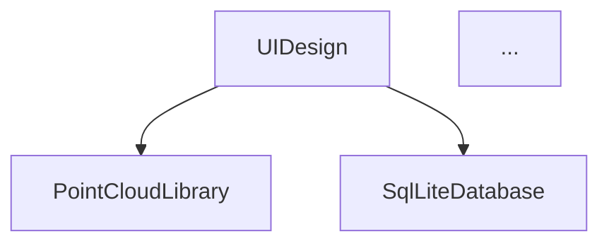

# AdaWeldSystem 开发团队架构与专员职责（根 Skill）

## 描述

本 Skill 是 AdaWeldSystem 项目的顶层团队架构定义。它提供团队总览和跨模块协作框架，并动态引用 `d:\AdaWeldSystem0623\AdaWeldSystem\Skills\` 文件夹中的各专员子 skill。当进行任务分配、模块设计或跨团队协作时，先通过本 skill 确定架构，再按需调用对应的专员子 skill。

## 版本变更记录

| 版本 | 更新时间 | 变更级别 | 变更内容 |
|------|---------|---------|---------|
| V1.0~V7.0 | 2026-06-12~19 | — | 原 monolithic skill 的历史版本（详见备份记录） |
| V8.260623.1711 | 2026-06-23 | 结构级 | 整体重构：将 monolithic skill 拆分为 10 个专员子 skill + /workmap skill，统一保存到项目 Skills/ 文件夹，本 skill 作为根 skill 动态引用子 skill |
| V9.260623.1744 | 2026-06-23 | 结构级 | 新增 C# 代码风格规范 skill 到 Skills/04-Style/；Skills 文件夹分级为 4 层目录结构（00-Root/01-Team/02-Development/03-Workflow/04-Style），更新所有引用路径 |
| V10.260623.2235 | 2026-06-23 | 结构级 | 新增 Workflow 模块（与 InteliWeld 同级别）到项目代码和 skill 规范；更新焊接工艺专员和通用技术专员 skill 的负责文件清单；根 skill 强制调度子 skill 执行 /updateskill 和 /vibeCoding 工作流 |
| V11.260623.2340 | 2026-06-23 | 结构级 | 新增"调度时临时加载子 skill"机制：/vibeCoding 和 /updateskill 调度时，必须通过 Read 工具将对应专员子 skill 和 CSharpStyle.md 的完整文件内容加载到上下文参考信息中，确保调度过程可被用户观察；修复 trae 技能系统编码损坏问题（UTF-8 BOM） |
| V12.260624.1015 | 2026-06-24 | 文件级 | 通用技术专员子 skill 更新至 V4：新增西门子S7通讯和Profinet通讯（含GSD文件编写）职责领域；新增 SiemensS7/ 和 Profinet/ 模块文件清单；更新协作关系（S7对接焊接工艺/运动控制/相机，Profinet对接3D传感器） |
| V13.260624.1030 | 2026-06-24 | 结构级 | 通用技术专员子 skill 更新至 V5：统一三种通讯方式（TCP/IP/S7/Profinet）协作职责为"触发工作流程+反馈设备状态"；WorkflowState 增加 Paused/Resetting；新增 DeviceErrorCode 设备错误码体系（分段分配）和 DeviceRunningState 枚举；新增 WorkflowCommand 枚举；重构协作关系为统一通讯协作模型 |
| V14.260624.1030 | 2026-06-24 | 结构级 | /workmap 子 skill 更新至 V2：生成文件名固定为 AdaWeldSystem_WorkMap.xlsx（不含时间戳）；支持增量更新（已存在则更新，不存在则新建）；更新模块列表为 11 个（新增 Workflow、HikRobotCam）；更新项目结构图、模块状态/进度、任务清单、交付标准检测表；已生成首版 AdaWeldSystem_WorkMap.xlsx |
| V15.260624.1045 | 2026-06-24 | 结构级 | /workmap 子 skill 完全重写至 V3：核心原则改为"不主动生成 Excel，只更新已有文件"；工作流改为读取已有 WorkMap 文件→理解结构→增量更新；Sheet1 更新文件夹结构图（结构+模块名称+编写进度）；Sheet2 更新模块任务清单（新模块按原格式追加，已有模块更新日期/状态/交付物/修改记录索引，修改记录索引来源于 history.md 解析） |
| V16.260624.1420 | 2026-06-24 | 结构级 | /vibeCoding 工作流新增步骤1.5"history.md 历史要求检索"：在需求解析后、代码审查前强制检索 history.md 中相关功能的历史修改记录，防止前后矛盾、新增功能删除旧功能 |
| V17.260624.1510 | 2026-06-24 | 结构级 | 新增 /wiki 工作流：梳理项目结构、模块依赖、UI调用逻辑；更新 /vibeCoding 步骤1：分配任务前强制读取 wiki 理解项目设计意图 |
| V18.260626.0956 | 2026-06-26 | 结构级 | 版本命名规则更新：强制使用 PowerShell `Get-Date -Format "yyMMdd.HHmm"` 命令获取准确时间，严禁估算或手动填写 |
| V19.260626.2332 | 2026-06-26 | 结构级 | /vibeCoding 步骤1 新增"子 Skill 加载完整性检查"：在临时加载子 skill 后，根据【涉及模块】反查所有应加载的子 skill，发现遗漏时强制补加载并输出告警，防止漏加载 |
| V19.260629.0852 | 2026-06-29 | 结构级 | 新增 Knowledge/ 知识库体系：图像算法专员和3D开发专员在涉及 EmguCV/HelixToolkit API 的代码开发前，必须强制从知识库抽取知识（RAG模式）；Skills 文件夹层级增加 Knowledge 说明；/vibeCoding 步骤1 和代码审查增加知识库 RAG 检查项 |

### 版本命名规则

- 格式：`V{大版本}.{小版本}`
- **大版本**：结构级修改时+1
- **小版本**：日期格式`yyMMdd.HHmm`

#### 时间获取强制规范（严格执行）

**所有 Skill 文件（根 skill + 子 skill）在更新版本时，必须通过以下 PowerShell 命令获取准确时间，严禁估算、手动填写或使用静态时间：**

```powershell
Get-Date -Format "yyMMdd.HHmm"
```

**执行要求**：
1. **每次 `/updateskill` 触发时**，在执行步骤3（版本号修改）之前，必须先执行上述 PowerShell 命令获取当前系统时间
2. **禁止行为**：
   - 禁止使用估算时间（如根据对话时间推测）
   - 禁止手动填写固定时间字符串
   - 禁止复用历史版本号或在旧版本号上+1
3. **沙盒环境**：在 TRAE 沙盒中执行此命令，返回的格式直接作为小版本号
4. **验证方式**：版本变更记录中的"更新时间"列必须与 PowerShell 命令返回的时间一致

---

## Skills 文件夹层级结构

```
Skills/
├── 00-Root/                          ← 根层级：项目总览、架构定义
│   └── SkillRoot.md                  ← 本文件：团队架构总览、工作流定义
│
├── 01-Team/                          ← 团队层级：架构与QA
│   ├── Architect.md                  ← 架构开发员
│   └── QASpecialist.md               ← QA/测试专员
│
├── 02-Development/                   ← 开发层级：各模块开发专员
│   ├── CameraSpecialist.md           ← 工业相机开发专员
│   ├── ImageAlgorithmSpecialist.md   ← 图像算法开发专员
│   ├── 3DSpecialist.md               ← 3D开发专员
│   ├── GeneralTechSpecialist.md      ← 通用技术开发专员
│   ├── DatabaseSpecialist.md         ← 数据库开发专员
│   ├── WeldProcessSpecialist.md      ← 焊接工艺开发专员
│   ├── MotionControlSpecialist.md    ← 运动控制开发专员
│   └── UISpecialist.md               ← UI开发专员
│
├── 03-Workflow/                      ← 工作流层级：工具与流程
│   └── WorkMap.md                    ← /workmap 工作地图生成
│
├── 04-Style/                         ← 规范层级：编码与风格
│   └── CSharpStyle.md                ← C# 代码风格规范
│
└── Knowledge/                        ← 知识库层级：第三方技术知识图谱（RAG源）
    ├── emgu-cv-knowledge-base/       ← EmguCV 5.0 代码编写手册（图像算法专员强制参考）
    │   └── emgu-cv-knowledge-base.html
    └── helixtoolkit-knowledge-base/  ← HelixToolkit 知识库（3D开发专员强制参考）
        └── helixtoolkit-knowledge-base.html
```

## 子 Skill 引用清单

本根 Skill 自动引用以下项目 Skills 文件夹中的子 skill 文件。当需要特定专员的工作流时，动态加载对应的子 skill：

| 子 Skill | 文件路径 | 唤醒词 |
|----------|----------|--------|
| 架构开发员 | `Skills/01-Team/Architect.md` | — |
| 工业相机开发专员 | `Skills/02-Development/CameraSpecialist.md` | `/vibeCoding Camera` |
| 图像算法开发专员 | `Skills/02-Development/ImageAlgorithmSpecialist.md` | `/vibeCoding ImageAlg` |
| 3D开发专员 | `Skills/02-Development/3DSpecialist.md` | `/vibeCoding 3D` |
| 通用技术开发专员 | `Skills/02-Development/GeneralTechSpecialist.md` | `/vibeCoding General` |
| 数据库开发专员 | `Skills/02-Development/DatabaseSpecialist.md` | `/vibeCoding Database` |
| 焊接工艺开发专员 | `Skills/02-Development/WeldProcessSpecialist.md` | `/vibeCoding Weld` |
| 运动控制开发专员 | `Skills/02-Development/MotionControlSpecialist.md` | `/vibeCoding Motion` |
| UI开发专员 | `Skills/02-Development/UISpecialist.md` | `/vibeCoding UI` |
| QA/测试专员 | `Skills/01-Team/QASpecialist.md` | `/vibeCoding QA` |
| /workmap 工作地图 | `Skills/03-Workflow/WorkMap.md` | `/workmap` |
| C# 代码风格规范 | `Skills/04-Style/CSharpStyle.md` | 自动引用 |

### 调用规则

1. **任务分配时**：通过本根 skill 确定负责专员，然后加载对应的专员子 skill 获取详细职责和文件清单
2. **代码实现时**：加载对应专员子 skill 和 `Skills/04-Style/CSharpStyle.md`
3. **/workmap 触发时**：直接加载 `Skills/03-Workflow/WorkMap.md` 子 skill
4. **/vibeCoding 触发时**：**根 skill 强制调度** → 加载本根 skill 的 6 步工作流 + 对应专员子 skill + CSharpStyle.md，**不允许绕过根 skill 直接执行**
5. **/updateskill 触发时**：**根 skill 强制调度** → 本根 skill 先读取所有子 skill，确定更新范围，然后按专员职责分派到对应子 skill 执行自更新，**不允许子 skill 独立执行自更新**

### 调度时临时加载子 Skill 机制（强制）

**目的**：确保调度过程透明可观察，用户能在参考信息中看到被加载的子 skill 内容。

**触发时机**：
- `/vibeCoding` 步骤1（需求解析与专员指派）确定负责专员后
- `/updateskill` 步骤1（读取所有子 skill）时

**执行方式**：
1. 根 skill 确定需要调度的专员后，**必须使用 Read 工具**读取对应子 skill 文件的完整内容
2. 读取的文件内容将自动出现在上下文的参考信息中，用户可观察到加载了哪些 skill
3. **必须同时加载 CSharpStyle.md**（代码风格规范），确保代码实现时遵循规范

**加载文件路径映射**：

| 专员 | 子 Skill 文件路径 |
|------|-------------------|
| 焊接工艺专员 | `d:\AdaWeldSystem0623\AdaWeldSystem\Skills\02-Development\WeldProcessSpecialist.md` |
| 通用技术专员 | `d:\AdaWeldSystem0623\AdaWeldSystem\Skills\02-Development\GeneralTechSpecialist.md` |
| 工业相机专员 | `d:\AdaWeldSystem0623\AdaWeldSystem\Skills\02-Development\CameraSpecialist.md` |
| 图像算法专员 | `d:\AdaWeldSystem0623\AdaWeldSystem\Skills\02-Development\ImageAlgorithmSpecialist.md` |
| 3D开发专员 | `d:\AdaWeldSystem0623\AdaWeldSystem\Skills\02-Development\3DSpecialist.md` |
| 数据库专员 | `d:\AdaWeldSystem0623\AdaWeldSystem\Skills\02-Development\DatabaseSpecialist.md` |
| 运动控制专员 | `d:\AdaWeldSystem0623\AdaWeldSystem\Skills\02-Development\MotionControlSpecialist.md` |
| UI开发专员 | `d:\AdaWeldSystem0623\AdaWeldSystem\Skills\02-Development\UISpecialist.md` |
| 架构开发员 | `d:\AdaWeldSystem0623\AdaWeldSystem\Skills\01-Team\Architect.md` |
| QA/测试专员 | `d:\AdaWeldSystem0623\AdaWeldSystem\Skills\01-Team\QASpecialist.md` |
| C# 代码风格规范（始终加载） | `d:\AdaWeldSystem0623\AdaWeldSystem\Skills\04-Style\CSharpStyle.md` |

**禁止行为**：
- 禁止不读取子 skill 文件就直接开始代码实现
- 禁止仅读取子 skill 的部分内容（必须读取完整文件）
- 禁止跳过 CSharpStyle.md 的加载

---

## /updateskill：Skill 自更新工作流

### 唤醒方式

用户输入 `/updateskill` 或明确表达"优化 skill"、"更新 skill"、"修改 skill 规范"等意图时触发。

### 执行步骤

#### 步骤1：读取当前根 skill 和所有子 skill

读取以下文件：
- `C:\Users\27720\.trae-cn\skills\adaweldsystem-开发团队架构与专员职责\SKILL.md`（trae 系统中的根 skill）
- `d:\AdaWeldSystem0623\AdaWeldSystem\Skills\**\*.md`（所有子 skill，含层级子目录）

#### 步骤2：根据用户反馈确定更新内容

用户可能提出的更新类型：
- **团队架构更新**：如新增/移除专员角色、调整模块分配
- **协作规范更新**：如数据流调整、审批流程变更
- **根 skill 引用更新**：如新增/移除子 skill 引用
- **层级结构调整**：如新增/移除/重命名 Skills 子目录

#### 步骤3：在最新版本上修改

**重要原则**：
- 必须在最新版本上修改
- **版本号生成公式（强制执行）**：
  ```
  小版本 = 执行 PowerShell 命令 Get-Date -Format "yyMMdd.HHmm" 获取的当前系统时间
  ```
  **执行方式**：在 TRAE 沙盒中运行 `Get-Date -Format "yyMMdd.HHmm"`，将返回结果直接作为小版本号。严禁估算或手动填写。
- 结构级修改：大版本+1
- 文件级/文档级修改：大版本不变

#### 步骤4：保存备份

备份路径：`d:\AdaWeldSystem0623\AdaWeldSystem\Backup\Skills\SkillRoot_V{版本号}.md`

#### 步骤5：同步更新 trae 技能系统

将修改后的根 skill 写回 trae 技能系统路径：
```
C:\Users\27720\.trae-cn\skills\adaweldsystem-开发团队架构与专员职责\SKILL.md
```

#### 步骤6：通知用户变更

---

## 使用场景

- 架构开发员分配开发任务给各专员
- 确定新功能属于哪个模块、由哪位专员负责
- 跨模块接口设计和数据流规划
- 代码审查时确认修改是否在专员职责范围内
- 测试计划制定和 Bug 责任归属

## 团队架构总览

```
┌─────────────────────────────────────────────────────────────────┐
│                       架构开发员 (Architect)                      │
│                负责整体架构设计、模块划分、接口定义                 │
└─────────────────────────────────────────────────────────────────┘
                                │
        ┌─────────┬─────────────┼─────────────┬─────────┐
        ▼         ▼             ▼             ▼         ▼
   ┌────────┐ ┌────────┐   ┌────────┐   ┌────────┐ ┌────────┐
   │ 工业相机 │ │ 图像算法 │   │ 3D开发  │   │ 通用技术 │ │ 数据库  │
   │ 开发专员 │ │ 开发专员 │   │ 开发专员 │   │ 开发专员 │ │ 开发专员 │
   └────────┘ └────────┘   └────────┘   └────────┘ └────────┘
        │                                        │
        │         ┌──────────────┐               │
        │         ▼              │               │
        │    ┌──────────┐        │               │
        │    │ 焊接工艺 │        │               │
        │    │ 开发专员 │        │               │
        │    └──────────┘        │               │
        │         │              │               │
        │    ┌──────────┐        │               │
        │    │ 运动控制 │        │               │
        │    │ 开发专员 │        │               │
        │    └──────────┘        │               │
        │         │              │               │
        └─────────┼──────────────┼───────────────┘
                  ▼              ▼
            ┌──────────┐
            │ UI开发专员 │
            │ (UIDesign)│
            └──────────┘
                  │
                  ▼
            ┌────────┐
            │ 测试专员 │
            │ (QA)   │
            └────────┘
```

## 多分支工作流

### 唤醒词结构

| 唤醒词 | 工作分支 | 用途 |
|--------|---------|------|
| `/updateskill` | Skill 自更新 | 根据用户反馈自动更新 skill 规范并同步至 trae 技能系统 |
| `/vibeCoding` | 氛围编程工作流 | 按团队架构固定化的完整开发工作流，从需求到交付 |
| `/workmap` | 工作地图生成 | 生成 Excel 表格，展示项目结构、模块职责、工作进度 |
| `/wiki` | 项目知识库生成 | 梳理项目结构、模块依赖关系、UI调用逻辑，结合 history 总结项目设计意图 |

**使用方式**：
- 用户输入 `/updateskill` → 触发 Skill 自更新分支。
- 用户输入 `/vibeCoding` → 触发氛围编程工作流分支。
- 用户输入 `/workmap` → 加载 `Skills/03-Workflow/WorkMap.md` 执行工作地图生成。
- 用户输入 `/wiki` → 触发项目知识库生成分支，输出项目结构、依赖关系、调用逻辑、设计意图总结。

---

## /wiki：项目知识库生成工作流

### 唤醒方式

用户输入 `/wiki` 或明确表达"梳理项目结构"、"项目依赖关系"、"模块调用逻辑"、"总结设计意图"等意图时触发。

### 工作流说明

本分支用于梳理 AdaWeldSystem 项目的整体知识结构，包括模块作用、库间依赖、UI对库的调用关系，并结合 history.md 修改记录总结项目的设计意图和演进逻辑。生成的知识库用于帮助开发团队（包括 AI 助手）正确理解项目架构，避免在后续开发中出现违背原始设计意图的修改。

### 执行步骤

```
┌─────────────────────────────────────────────────────────────────────────────────┐
│                           /wiki 工作流总览                                         │
├─────────────────────────────────────────────────────────────────────────────────┤
│  步骤1: 扫描项目结构 → 步骤2: 分析模块依赖 → 步骤3: 梳理UI调用逻辑              │
│       ↓                                                                        │
│  步骤5: 生成知识库文档  ←  步骤4: 结合history总结设计意图                        │
└─────────────────────────────────────────────────────────────────────────────────┘
```

#### 步骤1：扫描项目结构

**输入**：项目根目录 `d:\AdaWeldSystem0623\AdaWeldSystem\`
**输出**：项目结构树 + 模块清单

1. **扫描文件夹结构**：使用 LS/Glob 工具扫描项目根目录，识别所有模块文件夹
2. **识别模块类型**：根据文件夹名称和文件内容，判断模块属于以下哪类：
   - **UI 模块**：`UIDesign/` 及其子文件夹（ParentUI/Sub1UI/Sub2UI/Sub3UI）
   - **3D 数据处理**：`PointCloudData/`、`PointCloudLibrary/`
   - **工业相机**：`SmartRayCam/`、`HikRobotCam/`
   - **图像算法**：`EmguALG/`
   - **焊接工艺**：`InteliWeld/`
   - **运动控制**：`MotionControl/`
   - **通用技术**：`FileOperate/`、`Comm/`
   - **数据库**：`SqlLiteDatabase/`
   - **工作流**：`Workflow/`
3. **列出每个模块的核心文件**：.cs 文件清单，按功能分类

**输出格式**：
```
【项目结构概览】
- 模块总数：X 个
- UI 页面数：X 个
- 类库文件数：X 个

【模块清单】
| 模块名 | 文件夹路径 | 核心文件数 | 职责简述 |
```

#### 步骤2：分析模块依赖关系

**输入**：步骤1的模块清单
**输出**：模块依赖关系图 + 依赖方向说明

1. **读取关键类的 using 语句**：扫描每个模块核心文件的 using 命名空间
2. **识别跨模块引用**：
   - 哪些模块引用了 `PointCloudLibrary`（3D 数据处理）
   - 哪些模块引用了 `SqlLiteDatabase`（数据库）
   - 哪些模块引用了 `MotionControl`（运动控制）
   - 哪些模块引用了 `Comm`（通讯）
   - UI 模块引用了哪些后端模块
3. **绘制依赖关系**：
   - 使用 Mermaid 语法或文本表格展示依赖图
   - 标明依赖方向（A → B 表示 A 依赖 B）
   - 标明依赖强度（强依赖/弱依赖/仅事件订阅）

**输出格式**：
```
【模块依赖关系】


【依赖说明】
| 依赖方 | 被依赖方 | 依赖类型 | 说明 |
```

#### 步骤3：梳理 UI 对库函数的调用逻辑

**输入**：步骤2的依赖关系
**输出**：UI 调用链清单

1. **按 UI 页面梳理**：
   - 每个 Sub2UI 页面调用了哪些后端模块的公共方法
   - 每个 Sub3UI 弹窗使用了哪些配置/数据类
2. **识别关键调用链**：
   - 例如：`Helix3Drender.btnTraceFile_Click` → `FileTraceForm` → `RunRecordManager.ParseFromTempFile` → `PointCloudReader.LoadFromFile`
   - 例如：`Helix3Drender.btnSurface_Click` → `ExecuteSurfaceRender` → `RenderConfig.SelectedAlgorithm` → `_viewer.GenerateSurface`
3. **标注调用方式**：
   - 直接实例化调用（`new Xxx()`）
   - 单例模式调用（`Xxx.Instance`）
   - 静态方法调用（`Xxx.Method()`）
   - 事件订阅/回调

**输出格式**：
```
【UI 调用逻辑】

### Helix3Drender 页面
| UI 事件/方法 | 调用的后端类 | 调用方式 | 功能说明 |

### MainPage 页面
| UI 事件/方法 | 调用的后端类 | 调用方式 | 功能说明 |
```

#### 步骤4：结合 history.md 总结设计意图

**输入**：`history.md` 完整内容
**输出**：设计意图总结报告

1. **读取 history.md**：使用 Read 工具读取完整内容
2. **按模块分类历史记录**：将 history.md 中的记录按模块归类
3. **提取设计决策**：
   - 每个模块的核心设计决策是什么（如：为什么使用 DisposeComponents 而不是修改 Designer.cs Dispose）
   - 关键接口为什么这样设计（如：为什么 Helix3Drender 的按钮模式使用 PointCloudViewer.CameraControlMode 而不是 HelixToolkit.CameraMode）
   - 有哪些历史教训需要避免（如：Designer.cs Dispose 不可修改）
4. **总结项目演进逻辑**：
   - 项目从初始版本到当前版本的核心演进路径
   - 哪些功能是后期追加的，哪些是核心架构
   - 当前版本的设计约束和边界条件

**输出格式**：
```
【设计意图总结】

### 核心架构决策
1. **资源释放模式**：使用 DisposeComponents() 公共方法，由父页面关闭时调用。Designer.cs 的 Dispose(bool) 保持原始设计器生成代码，不可修改。
2. **相机控制模式**：UI 按钮模式（Round/Move/Rotate）是 PointCloudViewer 的自定义枚举，不是 HelixToolkit 的 CameraMode。按钮功能借助 CameraMode 实现，但不是直接等于关系。
3. ...

### 模块设计约束
| 模块 | 设计约束 | 来源历史记录 |

### 历史教训
| 教训 | 说明 | 相关历史记录 |
```

#### 步骤5：生成知识库文档

**输入**：步骤1~4的所有输出
**输出**：`AdaWeldSystem_Wiki.md` 文件

1. **整合所有信息**：将项目结构、依赖关系、调用逻辑、设计意图整合为一份 Markdown 文档
2. **保存路径**：`d:\AdaWeldSystem0623\AdaWeldSystem\Docs\AdaWeldSystem_Wiki.md`
3. **文档结构**：
   - 第1章：项目概览（结构树 + 模块清单）
   - 第2章：模块依赖关系（Mermaid 图 + 表格）
   - 第3章：UI 调用逻辑（按页面梳理）
   - 第4章：设计意图与历史决策（结合 history.md）
   - 第5章：开发规范速查（Dispose 模式、CameraMode 等）

**输出格式**：
```
【知识库生成结果】
- 文件路径：`Docs/AdaWeldSystem_Wiki.md`
- 章节数：5 章
- 模块覆盖：X/Y
- 历史记录引用：X 条
```

### /wiki 与 /vibeCoding 的协作关系

**触发时机**：
- `/wiki` 可以独立触发（用户主动要求梳理项目）
- `/vibeCoding` 步骤1 会自动调用 `/wiki` 的输出（如果 wiki 文件已存在）

**协作方式**：
1. 当用户输入 `/vibeCoding` 时，步骤1 会先检查 `Docs/AdaWeldSystem_Wiki.md` 是否存在
2. 如果存在，**强制读取** wiki 文件内容，作为需求解析的上下文参考
3. 如果不存在，跳过 wiki 读取，继续执行原有步骤1 流程
4. wiki 内容用于帮助正确理解用户的设计意图，避免做出违背原始架构的修改

---

## /vibeCoding：氛围编程工作流

### 工作流说明

本分支定义了 AdaWeldSystem 项目从需求输入到代码交付的完整开发工作流。所有开发任务必须按此流程执行。

### 执行步骤

```
┌─────────────────────────────────────────────────────────────────────────────────┐
│                             /vibeCoding 工作流总览                               │
├─────────────────────────────────────────────────────────────────────────────────┤
│  步骤1: 需求解析与专员指派 → 步骤1.5: history历史检索 → 步骤2: 备份与代码审查   │
│       ↓                                                                        │
│  步骤6: history.md 更新  ←  步骤5: 测试与验证  ←  步骤4: 代码审查 ← 步骤3: 代码实现│
└─────────────────────────────────────────────────────────────────────────────────┘
```

#### 步骤1：需求解析与专员指派

**输入**：用户的功能需求或 Bug 描述
**输出**：任务分配方案

1. **项目知识库读取（强制，如果存在）**：
   - 检查 `Docs/AdaWeldSystem_Wiki.md` 是否存在
   - 如果存在，**必须使用 Read 工具读取完整内容**到上下文中
   - wiki 内容包含项目结构、模块依赖、UI调用逻辑、设计意图总结，是正确理解用户需求的关键上下文
   - 如果 wiki 不存在，记录提示"未找到项目知识库，建议执行 /wiki 生成"

2. **需求总结**：用一句话概括用户核心需求

3. **模块定位**：根据需求确定涉及的功能模块
   - **结合 wiki 中的模块依赖关系**，判断需求影响的模块范围
   - **结合 wiki 中的 UI 调用逻辑**，判断需求涉及的调用链

4. **专员指派**：对照本 skill 的"团队架构总览"和"子 Skill 引用清单"，确定负责专员
   - **结合 wiki 中的设计意图总结**，判断需求是否符合原始架构设计
   - 如果需求可能违背设计意图（如要求修改 Designer.cs Dispose），标记为"高风险，需用户确认"

5. **临时加载子 skill（强制）**：根据负责专员，使用 Read 工具读取对应的子 skill 文件完整内容到上下文中，同时读取 `Skills/04-Style/CSharpStyle.md`。用户可在参考信息中观察到加载的 skill 内容。

6. **子 Skill 加载完整性检查（强制）**：在临时加载完成后，必须根据【涉及模块】反查所有应加载的子 skill，与【加载子Skill】实际加载列表进行比对，确保无遗漏。

   **检查逻辑**：
   1. 根据【涉及模块】确定所有被修改或依赖的模块
   2. 对照"子 Skill 引用清单"和"变更范围控制"表，确定每个模块对应的负责专员
   3. 检查该专员的子 skill 是否已在【加载子Skill】列表中
   4. 如有遗漏，**必须立即使用 Read 工具补加载**，并在输出中标记为 **【Skill 补加载告警】**

   **常见遗漏场景**：
   - 主导专员已加载，但配合专员（如 UI 专员配合 3D 专员做按钮）未加载
   - 跨模块修改时，只加载了主导模块的专员，未加载被修改模块的专员
   - 后端接口变更时，只加载了后端专员，未加载调用方的 UI 专员

   **输出格式补充**：
   ```
   【Skill 加载检查】
   - 应加载子Skill：3DSpecialist.md, UISpecialist.md, CSharpStyle.md
   - 实际已加载：3DSpecialist.md, CSharpStyle.md
   - [ ] 全部加载完成 / [x] 发现遗漏：UISpecialist.md — 已补加载
   ```

**输出格式**：
```
【项目知识库状态】已加载 / 未找到
【需求总结】...
【涉及模块】...
【负责专员】...
【加载子Skill】Skills/{层级}/{专员文件1}.md, Skills/{层级}/{专员文件2}.md, ...
【Wiki 设计意图参考】...
【知识库 RAG 状态】（如涉及 EmguCV/HelixToolkit）
  - 图像算法专员：Knowledge/emgu-cv-knowledge-base/ 已加载 / 待加载
  - 3D开发专员：Knowledge/helixtoolkit-knowledge-base/ 已加载 / 待加载
【允许修改范围】...
【跨模块风险】...
【设计意图冲突警告】（如有）...
```

#### 步骤1.5：history.md 历史要求检索（强制）

**输入**：步骤1的任务分配方案（需求总结 + 涉及模块 + 负责专员）
**输出**：历史要求检索报告

**目的**：防止新增功能与已有功能矛盾、新增功能删除旧功能、前后需求不一致。

**执行方式**：
1. **读取 history.md**：使用 Read 工具读取 `history.md` 文件完整内容
2. **关键词匹配**：根据步骤1的【需求总结】和【涉及模块】提取关键词，在 history.md 中检索相关历史修改记录
3. **相关性筛选**：筛选出与当前需求相关的历史记录（同一模块、同一功能、同一文件）
4. **冲突检测**：对比当前需求与历史记录，检测以下冲突类型：
   - **功能矛盾**：当前需求与历史实现的功能逻辑冲突
   - **功能删除**：当前需求要求删除/替换历史已实现的功能
   - **接口变更**：当前需求修改了历史已稳定的公共接口
   - **范围越界**：当前需求超出了该专员的历史职责范围
5. **输出报告**：将检索结果和冲突检测结论写入报告

**输出格式**：
```
【历史检索结果】
- 相关历史记录：[序号] TASK-ID（日期）- 一句话概括
- 相关历史记录：[序号] TASK-ID（日期）- 一句话概括
...

【冲突检测】
- [ ] 无冲突 — 当前需求与历史记录一致或互补
- [ ] 功能矛盾 — 当前需求与历史实现冲突（详见下方）
- [ ] 功能删除 — 当前需求将删除/替换已有功能（详见下方）
- [ ] 接口变更 — 当前需求修改了已有公共接口（详见下方）
- [ ] 范围越界 — 当前需求超出专员职责范围（详见下方）

【处理建议】
- 如有冲突：暂停代码实现，向用户确认需求意图，必要时调整需求
- 如无冲突：继续执行步骤2
```

**冲突处理原则**：
- **功能矛盾**：必须向用户确认，明确以哪个需求为准。若用户确认覆盖旧功能，需在 history.md 新记录中明确说明"覆盖 [序号] 历史功能"
- **功能删除**：必须向用户确认删除意图。若确认删除，需在代码中保留向后兼容的废弃标记（ObsoleteAttribute），并在 history.md 中记录删除原因
- **接口变更**：公共接口变更必须保持向后兼容，或提供迁移路径。禁止直接删除已有公共方法/属性
- **范围越界**：如涉及非本专员负责的文件修改，必须由架构开发员审批

**禁止行为**：
- 禁止跳过历史检索直接开始代码实现
- 禁止发现冲突后不向用户确认就继续实现
- 禁止删除已有公共接口而不保留兼容层

---

#### 步骤2：备份与代码审查

**输入**：步骤1的任务分配方案
**输出**：备份文件路径 + 现有代码审查意见

1. **项目备份（强制门禁）**：将项目文件夹打包为 zip
2. **现有代码审查**：审查现有代码，确认是否存在明显问题
3. **依赖检查**：确认涉及文件的所有依赖关系

#### 步骤3：代码实现

**输入**：步骤2的审查结果
**输出**：新增/修改的代码文件

1. **按专员职责执行**：由对应专员负责具体代码实现
2. **遵循 C# 代码风格规范**：自动加载 `Skills/04-Style/CSharpStyle.md`
3. **最小化变更**：仅修改直接相关的类库和 UI
4. **跨模块审批**：如需修改非本专员负责的文件，必须由架构开发员审批

#### 步骤4：代码审查

**输入**：步骤3的代码实现
**输出**：审查报告

1. **风格检查**：检查是否符合 `Skills/04-Style/CSharpStyle.md`
2. **范围检查**：确认变更范围是否符合规范
3. **UI 完整性检查**（如涉及 UI）：执行 5 环节检查清单（字段声明→实例化→属性设置→事件绑定→加入父容器）
4. **文件清单同步检查（强制）**：对照子 skill 的"负责文件清单"，检查文件增减是否同步更新

#### 步骤5：测试与验证

**输入**：步骤4审查通过的代码
**输出**：测试报告

1. **编译验证**：执行 MSBuild 编译，确认无编译错误
2. **单元测试**：各模块单元测试通过
3. **集成测试**：端到端流程测试

#### 步骤6：history.md 更新

**输入**：步骤5测试通过的代码
**输出**：更新后的 history.md

1. **按四段式模板追加记录**（需求总结 / 任务清单 / 交付清单 / 审查结果）
2. **追加位置**：文件最上方（时间倒序）

### 工作流责任矩阵

| 步骤 | 主导专员 | 配合专员 | 交付物 |
|------|---------|---------|--------|
| 步骤1：需求解析 | 架构开发员 | 全部 | 任务分配方案 |
| 步骤1.5：历史检索 | 负责专员 | QA | 历史要求检索报告 |
| 步骤2：备份审查 | 负责专员 | QA | 备份文件 + 审查意见 |
| 步骤3：代码实现 | 负责专员 | 协作专员 | 代码文件 |
| 步骤4：代码审查 | QA | 负责专员 | 审查报告 |
| 步骤5：测试验证 | QA | 负责专员 | 测试报告 |
| 步骤6：history更新 | 负责专员 | — | 更新后的 history.md |

---

## 代码审查与变更控制规范

### 审查原则

1. **用户提供的程序一般没有问题**：审查重点放在本次变更的合理性和规范性上
2. **最小化变更范围**：除直接相关的类库和 UI 修改外，其他代码不做变更
3. **自动引用 C# 代码风格规范**：本 Skill 自动加载 `Skills/04-Style/CSharpStyle.md`
4. **知识库 RAG 强制检查**：如涉及 EmguCV/HelixToolkit API 调用，必须检查是否有知识库依据。详见对应专员子 skill 的"知识库 RAG 强制规范"章节

### 变更范围控制

| 变更类型 | 允许修改的文件范围 | 禁止修改的文件范围 |
|----------|-------------------|-------------------|
| 工业相机功能 | SmartRayCam/ 及其直接调用方 | 其他模块 |
| 图像算法功能 | EmguALG/ 及其直接调用方 | 其他模块 |
| 3D 数据处理 | PointCloudData/ 及其直接调用方 | 其他模块 |
| 通用技术功能 | FileOperate/, Comm/ | 其他模块 |
| 焊接工艺功能 | InteliWeld/, SqlLiteDatabase/AutoParamManager.cs, SqlLiteDatabase/ConfigManager.cs | 其他模块 |
| 数据库功能 | SqlLiteDatabase/ 及其直接调用方 | 其他模块 |
| 运动控制功能 | MotionControl/ 及其直接调用方 | 其他模块 |
| UI 界面功能 | UIDesign/ 及其直接调用的后端接口 | 后端模块内部实现 |

### 文件清单同步规范（强制）

**触发时机**：
- 新增 .cs 文件（含 .Designer.cs）到项目中
- 弃用/删除现有 .cs 文件
- 重命名现有 .cs 文件
- 文件在不同模块/文件夹之间移动

**同步规则**：

| 操作类型 | 必须执行的动作 | 责任专员 |
|----------|---------------|---------|
| 新增 .cs 文件 | 在对应专员子 skill 的"负责文件清单"中添加文件条目 | 架构开发员确认，负责专员登记 |
| 弃用 .cs 文件 | 从"负责文件清单"中移除，在弃用文件记录区追加记录 | 负责专员登记，架构开发员确认 |
| 重命名 .cs 文件 | 更新"负责文件清单"中的文件名 | 负责专员登记 |
| 文件跨模块移动 | 从原专员清单中移除，添加到目标专员清单中 | 架构开发员协调 |

---

## history.md 四段式模板规范（强制）

### 更新时机

**每次完成代码审查后，必须立即更新 history.md 文件。**

### 更新规则

1. **追加模式**：新记录追加到文件最上方（时间倒序）
2. **分割线分隔**：每条记录之间使用 `---` 分割线
3. **序号递增**：序号按时间倒序递增（最新的为最大序号）

### 四段式记录格式

```markdown
### [序号] 修改记录 - YYYY-MM-DD TASK-ID-001

#### 1. 需求总结

【一句话概括】...
【涉及模块】...
【负责专员】...

#### 2. 任务清单

| 任务项 | 修改范围 | 执行人员 | 状态 |

#### 3. 交付清单

| 交付物 | 文件路径 | 说明 |

#### 4. 审查结果

- [ ] 代码风格检查通过
- [ ] 变更范围符合规范
- [ ] 编译验证通过
- [ ] 集成测试通过
```