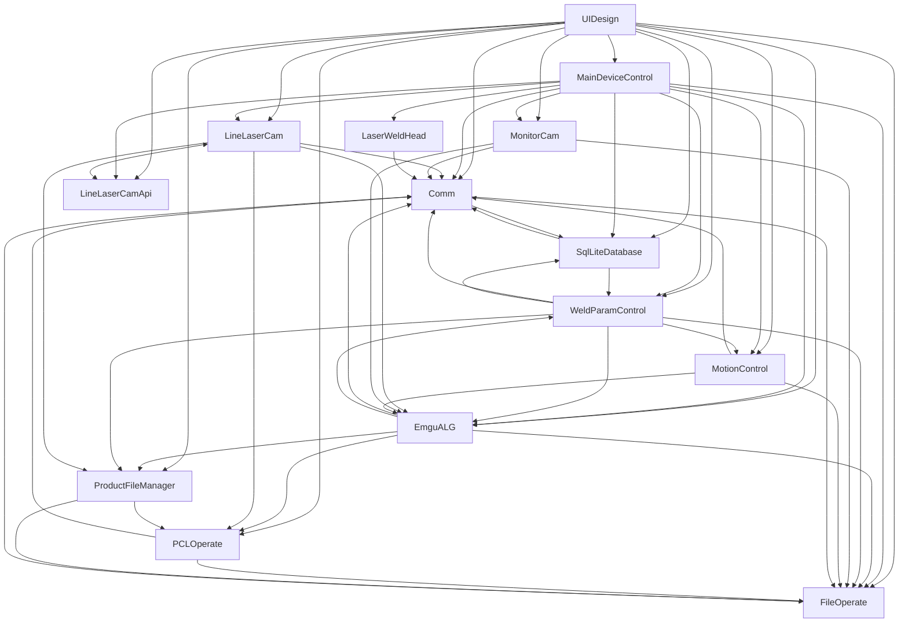

# 设备控制架构 — MainDeviceControl

> **本页是设备控制架构的唯一规范页**，也是全项目架构的唯一真相源。
> **架构原档（唯一修改入口，共 3 份）**：`LLMWiki/raw/architecture/` 下 `主控设计.xlsx` + `焊接设备工作流程图.pdf` + `焊接系统工作流程业务流向图.pdf`。**改架构先改原档，再同步本页**（约定见 [[decisions/ADR-050-ArchitectureRawSource]]）。
>
> **三份原档分工**：
>
> | 原档 | 模式 | 回答的问题 |
> |---|---|---|
> | 主控设计.xlsx | 静态结构 | 「有什么」——目录 / 类职责 / 三态枚举真值 |
> | 焊接设备工作流程图.pdf | 类协作时序 | 「谁调谁」——MainPage → ControlWork/StatusWork → 5 流程的方法级调用链 |
> | 焊接系统工作流程业务流向图.pdf | 业务状态流 | 「怎么走」——整机业务主链 NoReset→Reseting→Reset OK→Running→PreWorking/WeldWorking→Stop/Alarm 与横向常驻通道 |
>
> 冲突裁决：**原档 > 本页 > 源码注释**；源码与原档不一致须交用户裁定（ADR-050 §3）。
> **不按版本代际（V1/V2/V3）描述架构**——所有历史代际页面已于 2026-09-01 删除，架构只维护「当前事实」这一份，变更直接改本页。
> 目录：`AdaWeldSystem/MainDeviceControl/`
> 目标平台：.NET Framework 4.8（C# 7.3，[[decisions/ADR-002-CS73-Constraint]]）；离线构建（[[decisions/ADR-028-NuGetLocalization]]）
> UI：WinForms + AntdUI（[[decisions/ADR-021-UIFrameworkMigration]]）

**章节导航**

| 章 | 内容 | 章 | 内容 |
|---|---|---|---|
| §1 | 核心概念：三态模型（ADR-049） | §8 | 焊接工艺控制流程 |
| §2 | 目录结构 + 继承链 | §9 | 安全互锁与故障恢复（ADR-044） |
| §3 | 三态基座 `DeviceStateBase` | §10 | 运动控制（CAMBOX 硬件实时跟踪） |
| §4 | 运行基类 `DeviceWorkflowBase`（非泛型） | §11 | 模块依赖与调用链（代码层事实） |
| §5 | 工作流契约与执行步（ADR-047） | §12 | 与其他模块的关系 |
| §6 | 各工作流与焊接过程态映射 | §13 | UI 接入约定 |
| §7 | 整机主控 `DeviceControlWork` | §14 | 维护约定 |

---

## 1. 核心概念：三态模型（ADR-049）

这是整套架构最根本的语义，所有工作流都必须遵守。**旧「设备四态 `DeviceState` + 流程态」模型已删除**（ADR-041/042 已被取代），改为三个正交状态 + 一个内部执行步层。

### 1.1 连接态 `SubDeviceState`（子设备，2 态）

所有子设备**共有**、**不可扩展**：

| 状态 | 值 | 含义 |
|---|---|---|
| `Disconnected` | 0 | 未连接 / 未初始化 |
| `Connected` | 1 | 已连接 / 待机 |

### 1.2 焊接过程态 `SubDeviceWeldStatus`（子设备，7 态，对外名片）

| 状态 | 值 | 含义 |
|---|---|---|
| `Standby` | 0 | 待机 |
| `PreWork` | 1 | 焊接前准备 |
| `Starting` | 2 | 启动中 |
| `Working` | 3 | 工作中 |
| `Stopping` | 4 | 停止中（转回 Standby） |
| `ErrorAborted` | 5 | 异常终止 |
| `ManualStopped` | 6 | 手动停止 |

### 1.3 主设备运行态 `MainDeviceStatus`（6 态，过程状态）

原「整机流程态」不再存在，改为主设备过程状态，由 `DeviceControlWork.Status` 承载：

| 状态 | 值 | 含义 |
|---|---|---|
| `Running` | 0 | 运行中 |
| `Alarm` | 1 | 报警 |
| `EStop` | 2 | 急停 |
| `Stop` | 3 | 停止 |
| `NoReset` | 4 | 未复位 |
| `Reseting` | 5 | 复位中 |

### 1.4 状态写入唯一入口（强制）

| 方法 | 承载 | 触发事件 |
|---|---|---|
| `SetState(SubDeviceState, reason)` | 连接态（基类 `protected`） | `StateSwitched`(`SubDeviceStateChangedEventArgs`) |
| `SetWeldStatus(SubDeviceWeldStatus, reason)` | 焊接过程态（基类 `protected`） | `WeldStatusChanged`(`WeldStatusChangedEventArgs`) |
| `DeviceControlWork.SetStatus(MainDeviceStatus, reason)` | 主设备运行态 | `StatusChanged`(`MainDeviceStatusChangedEventArgs`) |

**强制约束**：**禁止手工 `State = ...` / `WeldStatus = ...` / `Status = ...` 赋值**（唯一例外是基类生命周期方法内部的语义赋值与 `FaultRecord` 初始化器中的快照记录）。旧 `MapToDeviceState()` 已废弃删除。

> **为什么**：连接态/过程态/运行态是三个正交的"对外承诺"（UI/其他模块据此判断设备能否用），各工作流的私有相位枚举（`_phase`/`_flowState`）是"内部进度"，不对外暴露。状态写入收敛单一入口后，状态恒定可预测，且每次变更都带 reason 与事件通知。

> **步骤驱动（ADR-047）与三态并存**：执行步 `WorkStep`（int）仍由基类承载，`GoStep(n)` 是唯一改步入口，见本页 §5。

---

## 2. 目录结构

```
MainDeviceControl/
├── DeviceStateApiCore/               ← 状态机与工作流基类 API 核心（2026-09-01 由 DeviceState/ + FlowState/ 合并）
│   │                                   ※ 目录合并但**命名空间不跟随改名**，仍为两个：
│   │                                     ...DeviceState（前 2 个文件）/ ...FlowState（DeviceWorkflowBase.cs）
│   ├── DeviceStateBase.cs            ← 三态基座（命名空间 ...DeviceState）：
│   │                                    SubDeviceState / SubDeviceWeldStatus / MainDeviceStatus
│   │                                    State / StateSwitched / WeldStatus / WeldStatusChanged / IsAlarm
│   ├── CommandTable.cs               ← 机器人握手协议表（命名空间 ...DeviceState）：
│   │                                    RobotPose / RobotCommand / DeviceCommand
│   └── DeviceWorkflowBase.cs         ← 非泛型工作流基类（命名空间 ...FlowState）：
│                                        六抽象契约 + 执行步层 + 步骤驱动三件套（ADR-047）
│
├── DeviceControlWork.cs              ← 主设备运行管控（独立单例，不继承 DeviceWorkflowBase）
│                                      整机运行编排、机器人信号交互、级联 5 子设备、模拟模式
├── DeviceStatusWork.cs               ← 安全/IO/状态管控（独立单例，不继承 DeviceWorkflowBase）
│                                      三线程 IOWork / EMGWork / StatusWork（参考 MachineStatusWork.cs）
│
├── DeviceWorkflow/                   ← 具体工作流（命名空间 ...DeviceWorkflow）
│   ├── LineLaserWorkflow.cs          ← 线激光工作流（全实现）
│   ├── MonitorCameraWorkflow.cs      ← 监控相机工作流（全实现）
│   ├── MotionControlWorkflow.cs      ← 运控工作流（CAMBOX 跟踪，全实现）
│   ├── WeldParamControlWorkflow.cs   ← 焊接工艺控制流程（全实现）
│   └── LaserWeldHeadWorkflow.cs      ← 焊接头工作流（骨架）
│   ※ 2026-09-01 `FaultRecoveryManager.cs`（故障恢复管理器 + FaultCategory/FaultRecord 数据载体）
│     已迁出至 `ProductFileManager/` 归口（ADR-046 §3），本目录 5 个工作流 + 2 个管控类均为其消费方，
│     调用需 `using AdaWeldSystem.ProductFileManager`；持久化仍在 `SqlLiteDatabase/FaultRecordManager`
```

> **已删除文件/目录（勿再引用）**：`WorkflowStateBase.cs`、`MainDeviceWorkflow.cs`、`SafetyWorkflow.cs`、`SimulationWorkflow.cs`（2026-09-02 ADR-049 删除或归并）；`SafetyFlow.cs`、`SafetyInterlock.cs` 于 2026-08-31 合并进 `SafetyWorkflow.cs` 后再归并为 `DeviceStatusWork.cs`（[[decisions/ADR-044-SafetyCheckConsolidation]]）；`DeviceStateMachine/`、`Workflow/Device/`、`DataModels/` 三目录于 2026-08-28 整目录删除（[[decisions/ADR-041-MainDeviceControlArchitecture]]）；**`DeviceState/` 与 `FlowState/` 两目录于 2026-09-01 合并为 `DeviceStateApiCore/`**（文件本身未删，仅改路径）。

> **命名空间约定（2026-08-28 收敛，2026-09-01 目录再收敛）**：`MainDeviceControl/` 下全部代码统一收敛为三个命名空间——`...DeviceState` / `...FlowState` / `...DeviceWorkflow`；状态契约内联各工作流文件，`AdaWeldSystem.Workflow` 命名空间不复存在。
>
> ⚠️ **目录 ≠ 命名空间（2026-09-01 起）**：`DeviceStateApiCore/` 是**物理目录**名，其下文件仍分属 `...DeviceState`（前 2 个）与 `...FlowState`（后 1 个）两个命名空间——**目录合并时刻意不改命名空间**，避免 5 个工作流与全部消费方的 `using` 连锁改动。因此**不能**由目录名反推命名空间，也**不要**新增 `AdaWeldSystem.MainDeviceControl.DeviceStateApiCore` 命名空间。

### 继承链（单继承线性基类链，ADR-049 非泛型化）

```
DeviceStateBase            （连接态/焊接过程态：State / StateSwitched / WeldStatus / WeldStatusChanged / IsAlarm）
    ↓
DeviceWorkflowBase         （非泛型工作流：六抽象契约 + 执行步层）
    ↓
具体 Workflow               （LineLaserWorkflow : DeviceWorkflowBase 等）
```

**独立管控类（不在上述继承链中）**

| 类 | 职责 | 关系 |
|---|---|---|
| `DeviceControlWork` | 主设备运行态 `MainDeviceStatus` + 整机编排 + 机器人信号交互 | 持有 5 个子工作流单例并级联调用；拉起/关闭 `DeviceStatusWork`；运行自身 `RunLoop` |
| `DeviceStatusWork` | 安全/IO/状态管控（三线程） | 被 `DeviceControlWork.StartMachine`/`StopMachine`/`Dispose` 拉起/关闭；`DeviceControlWork.IsRobotPoseSafe` 读取其 `IsSafe` |

**易误判点**：`State`/`StateSwitched`/`WeldStatus`/`WeldStatusChanged`/`IsAlarm` 由 `DeviceStateBase` 提供；`WorkStep`/`GoStep`/`BeatMs`/`FlowProcess` 由 `DeviceWorkflowBase` 提供。具体工作流文件内 grep 不到是**正常的**，不构成编译错误。

---

## 3. 三态基座 `DeviceStateBase`

`DeviceStateBase` 是连接态与焊接过程态的公共承载，位于命名空间 `AdaWeldSystem.MainDeviceControl.DeviceState`。

| 成员 | 说明 |
|---|---|
| `State` | 连接态 `SubDeviceState`（`Disconnected`/`Connected`），`protected set`，经 `SetState` 变更 |
| `StateSwitched` | 连接态变更事件（`EventHandler<SubDeviceStateChangedEventArgs>`） |
| `WeldStatus` | 焊接过程态 `SubDeviceWeldStatus`（7 态），`protected set`，经 `SetWeldStatus` 变更 |
| `WeldStatusChanged` | 焊接过程态变更事件（`EventHandler<WeldStatusChangedEventArgs>`） |
| `IsAlarm` | 是否处于报警态（`WeldStatus == ErrorAborted`） |
| `EmergencyStop()` | 急停（可被子流程调用，但整机急停统一走 `DeviceControlWork.EStopMachine`） |
| `CheckDeviceIOSafe()` | 设备 IO 安全检查钩子 |
| `OnStateSwitched(old, new)` / `OnWeldStatusSwitched(old, new, reason)` | 状态切换钩子 |

> **写入唯一入口**：连接态走 `SetState(SubDeviceState, reason)`，焊接过程态走 `SetWeldStatus(SubDeviceWeldStatus, reason)`；子类禁止直接 `State = ...` / `WeldStatus = ...`。

## 4. 工作流基类 `DeviceWorkflowBase`（非泛型，ADR-049）

非泛型基类，位于命名空间 `AdaWeldSystem.MainDeviceControl.FlowState`，继承 `DeviceStateBase, IDisposable`。各工作流不再对外暴露私有枚举，只对外暴露 `State`/`WeldStatus`/`WorkStep`。

### 4.1 六抽象契约（各工作流必须实现）

| 抽象方法 | 语义 |
|---|---|
| `FlowProcess()` | 单步分派 `switch(WorkStep)`，监听线程按节拍调用，**自动运行唯一执行器** |
| `bool ResetProcess()` | 复位流程（急停/报警后回待机） |
| `ClearStatus()` | 清除报警（仅清报警态回就绪态，与复位正交） |
| `ResetWorkTime()` | 复位工作时间计时 |
| `bool ConnectOn()` | 手动连接（子类内部自起后台线程，UI 开关直调，返回是否受理） |
| `ConnectOff()` | 手动断开（子类内部自起后台线程） |
| `protected abstract string GetStepName(int)` | 执行步号 → 中文名映射表 |

> `ConnectOn`/`ConnectOff` 联动 `SubDeviceState`；`FlowProcess`/`ResetProcess`/`ClearStatus`/`ResetWorkTime` 联动 `SubDeviceWeldStatus`（xlsx 原档 §DeviceWorkflow）。

### 4.2 基类包装的生命周期方法

| 方法 | 行为 |
|---|---|
| `Initialize()` | 模板方法：记日志 → `ConnectOn()`（阻塞同步），结果驱动 `State` |
| `Reset()` | 模板方法：记日志 → `ResetProcess()` |
| `ClearAlarm()` | 模板方法：记日志 → `ClearStatus()` |
| `ManualStart()` / `ManualStop()` | 模板方法：记日志 → `ConnectOn()`/`ConnectOff()` |
| `Dispose()` | 模板方法：记日志 → `StopRunLoop()` → 子类 `DisposeManaged()` |

> 生命周期公共入口**不要**在子类以 `new` 隐藏；子类只重写/实现抽象/虚方法。

## 5. 步骤驱动三件套（ADR-047）

基类统一承载，与三态模型并存而非替换：

| 成员 | 说明 |
|---|---|
| `WorkStep` | 当前 int 执行步号（内部游标） |
| `WorkStartTime` | 当前步进入时间戳 |
| `GoStep(int step)` | **唯一改步入口**：成对刷新步号 + 时间戳 + 记日志 |
| `ResetStepTime()` | 复位当前步计时 |
| `IsStepTimeout(double ms)` | 当前步是否超时 |
| `FailFlow(string reason)` | 失败收尾：`IsAlarm = true` + `FailReason`/`FailStep` + `GoStep(900)` |
| `BeatMs` | 监听线程节拍（默认 10ms，子类可设） |
| `RunLoopPriority` | 监听线程优先级 |
| `StartRunLoop()` / `StopRunLoop()` | 启停常驻监听线程 |
| `IsRunLoopActive` | 监听线程是否存活（骨架期 `LaserWeldHeadWorkflow.IsRunLoopActive=false`） |

> **红线**：单步内禁止无界阻塞等待；改步 `GoStep(...)` 后必须立即 `return`，否则下一条语句会覆盖刚复位的 `WorkStep`。

---

## 6. 各工作流与焊接过程态映射

各工作流内部保留私有枚举（`_phase`/`_flowState`）驱动 `FlowProcess()`，对外统一经 `SetWeldStatus(MapWeldStatus(...))` 刷新。

| 工作流 | 私有枚举 | `Standby` | `PreWork` | `Working` | `ErrorAborted` | `ManualStopped` |
|---|---|---|---|---|---|---|
| `LineLaserWorkflow` | `LineLaserWorkflowState` | `Uninitialized`/`Standby`/`ManualStopped` | `PreWork` | `Initializing`/`PreWork`/`Starting`/`Working`/`Stopping` | `ErrorAborted` | `ManualStopped` |
| `MonitorCameraWorkflow` | `MonitorWorkflowState` | `Uninitialized`/`Standby`/`ManualStopped` | — | `Acquiring`/`Analyzing`/`Completed` | `ErrorAborted` | `ManualStopped` |
| `MotionControlWorkflow` | `LaserCamBoxWorkflowState` | `Idle` | — | `Initializing`/`WaitingForMaster`/`Tracking`/`Paused`/`Stopping` | `Error` | — |
| `WeldParamControlWorkflow` | `WeldParamControlWorkflowState` | `Uninitialized`/`Standby` | — | `Initializing`/`Computing`/`Outputting`/`Holding` | `ErrorAborted` | — |
| `LaserWeldHeadWorkflow` | `LaserWeldHeadWorkflowState` | `Uninitialized`/`Standby` | — | `Working` | `ErrorAborted` | — |

> **`MotionControlWorkflow.Idle` 一态两义**：按初始化标记区分，实际 `MapWeldStatus(LaserCamBoxWorkflowState.Idle) = SubDeviceWeldStatus.Standby`；未初始化时由 `DeviceControlWork` 判定是否允许进入运行。
> **预工作态 `PreWork`**：目前主要由 `LineLaserWorkflow` 使用；其余工作流无此阶段时直接 `Standby` → `Working`。

---

## 7. 整机主控 `DeviceControlWork`（独立单例，不继承 `DeviceWorkflowBase`）

`DeviceControlWork` 是整机运行编排中心：持有 `MainDeviceStatus`（6 态），运行自身 `RunLoop`，消费机器人信号，级联 5 个子工作流，并拉起/关闭 `DeviceStatusWork`。

### 7.1 主设备运行态 `MainDeviceStatus`

| 状态 | 值 | 含义 | 典型进入原因 |
|---|---|---|---|
| `Running` | 0 | 运行中 | 机器人请求焊前准备，级联连接完成 |
| `Alarm` | 1 | 报警 | 子设备报警、互锁失败（非急停） |
| `EStop` | 2 | 急停 | 急停按钮、机器人 Abort |
| `Stop` | 3 | 停止 | 机器人归零位/安全停止位、整机停止 |
| `NoReset` | 4 | 未复位 | 上电后待整机复位 |
| `Reseting` | 5 | 复位中 | `ResetMachine()` 执行中 |

状态写入唯一入口：`SetStatus(MainDeviceStatus, reason)`，触发 `StatusChanged` 事件。

### 7.2 上电初始化：`InitializeMachine()` 5 步同步顺序执行

```
[1/5] 焊接头      → LaserWeldHeadController.Instance.Initialize()
[2/5] 运动控制器  → MotionManager.Initialize() + CAMBOX 跟踪初始化（取 zmController.GetHandle()）
[3/5] 线激光      → LineLaserWorkflow.Initialize()（阻塞同步 connect→readConfig→reset→verify）
[4/5] 监控相机    → MonitorCameraWorkflow.Initialize()
[5/5] 机器人通讯  → RSI / EKI 二选一
        ↓
EvaluateInitializationResult()
```

**聚合判定口径**：子设备 `State == SubDeviceState.Connected` 且 `WeldStatus != SubDeviceWeldStatus.ErrorAborted` 视为正常；否则计为未就绪。

### 7.3 运行线程与命令变量

`DeviceControlWork` 拥有自己的 `_runLoopThread`（`BeatMs=10`），每拍：

1. `ConsumeCommand()` —— 消费命令变量（`_pendingAbort` > `_pendingCommand` > `_pendingPose`）
2. `FlowProcess()` —— 单步分派内部执行步（`StepIdle` / `StepPreworkConnect` / `StepWaitPreWeldPose` / ... / `StepFinishOk` / `StepFinishFail`）

**命令变量三槽分存**：`RobotPose.StartSafePose=1` 与 `RobotCommand.PreWeldRequest=1` 编码重叠，单槽必丢指令：

| 变量 | 用途 |
|---|---|
| `_pendingAbort` | 急停请求（优先级最高） |
| `_pendingCommand` | 机器人主动指令（`PreWeldRequest` 等） |
| `_pendingPose` | 机器人 Pose 上报（`HomePose`/`PreWeldPose`/...），空值 `NoPendingPose = -1` |

### 7.4 关键边界：机器人/PLC 连接不属于本类

**机器人和 PLC 的连接是外部设备通讯，由顶层 `Comm`（`CommunicationManager`）管控**。

`DeviceControlWork` 只做**信号交互**：
- 接收：`RobotPose`（机器人状态上报，经 `GlobalCommData.CommunicationCommandReceived` / `RobotManager.DataReceived`）
- 下发：`DeviceCommand`（`CmdGoXxx` 对齐 Pose + `CmdOK` + `CmdAbort`），经 `GlobalCommData.mCommunicationManager.RobotManager.SendRobotData(...)`

不直接持有连接、不直接操作 socket。

### 7.5 公共操作契约

| 方法 | 行为 |
|---|---|
| `InitializeMachine()` | 上电初始化 5 步级联 |
| `StartMachine()` | 拉起 `DeviceStatusWork.StartWork()` + 启动自身 `RunLoop` + 置 `Status = Running` 相关准备 |
| `StopMachine()` | 停运行线程 → **级联 5 子流程 `ClearStatus()`**（清报警回就绪，单流程失败记日志不中断）→ `CascadeDisconnect()` → `DeviceStatusWork.CloseWork()`；Running 时置 `Stop` |
| `ResetMachine()` | 整机复位：①**机器人在位检测**（`IsRobotReachable`：RSI/EKI 任一连接），不通过 → 置 `Alarm` + `RecordFault(ROBOT_OFFLINE, Communication)` + **阻断返回 false**；②清命令变量 + `GoStep(StepIdle)`；③置 `Reseting` → **级联 5 子流程 `ResetProcess()`** → 置 `Stop`。运行中不可复位 |
| `ClearAlarm()` | 仅清报警标志：`Alarm` → `NoReset`（待重新复位），与复位正交，不做任何级联 |
| `EStopMachine(reason)` / `EStopCancel()` | 急停/急停解除；急停由 `DeviceStatusWork.EMGWork` 专责检测 |
| `ReportAlarm` / `ReportAlarmCleared` | 供 `DeviceStatusWork.IOWork` 调用，驱动 `Status = Alarm` |
| `ReceiveRobotPose` / `ReceiveRobotCommand` | 通讯回调入口，只写命令变量不做业务 |

> **模拟模式（ADR-048）**：原 `SimulationWorkflow` 已删除，全部模拟 API（`EnableSimulation`/`DisableSimulation`/`LoadSimulation`/`SaveSimulation`/`IsSimulationEnabled`/`CurrentMode`/`ShouldMoveAxis`/`SimStartX`/`SimSpeed` 等）归并到 `DeviceControlWork`。

### 7.6 业务状态流主链（业务流向图 → 代码映射）

原档 `焊接系统工作流程业务流向图.pdf` 描述的整机业务主链与代码落点：

```
NoReset ──InitializeMachine（5 步级联 + 4×ConnectOn）──▶ Reseting
Reseting ──ResetMachine（在位检测阻断 + 清命令变量 + 级联 ResetProcess×5）──▶ Reset OK
Reset OK ──StartMachine（拉起 DeviceStatusWork + RunLoop）──▶ 设备状态 Running
Running ──PreWorking：Standby → 4 子流程预备（ConnectOn / 参数载入）──▶ Starting
Starting ──WeldWorking：Working → 4 焊接子流程──▶ 判定 ──▶ Stop / Alarm
Alarm ──▶ ErrorAborted（子流程）/ Stopping
```

**两条语义映射（原档用语 ≠ 枚举值，不得据此加态）**：

| 原档用语 | 代码落点 | 说明 |
|---|---|---|
| `Reset OK` | `MainDeviceStatus.Stop`（复位完成=停止就绪） | 6 态枚举不设 ResetOK |
| 「设备状态：Running」 | 业务运行语义（`PreWorking` 置位），非枚举新增态 | 枚举 `Running` 由焊前准备级联完成时进入 |

**三条横向常驻通道**（贯穿主链，不在主链单向流上）：通讯 Open→机器人服务器；Command→IO Work→Pose Information（命令三槽分存）；EMG Work（复位失败分支 N→Reset Fail）→ 急停/互锁；机器人客户端报警判断（故障树）→ `FaultRecoveryManager`。

**存疑待确认**：设备工作流程图中 `StartMachine` 的一条横线疑似连向 `ResetProcess×5`，用户裁定**暂不实现**、仅记录；若原档后续确认，在 `StartMachine()` 内补级联即可。

---

## 8. 焊接工艺控制流程（WeldParamControlWorkflow）

### 8.1 定位（易错，务必注意）

**不是有连接动作的设备**，而是**设备内部控制焊接工艺的一个流程**。

- **输入**：机器人信息 + 线激光结果信息
- **计算**：焊接功率、送丝速度、振镜摆幅、焊接速度
- **输出**：下发给机器人

### 8.2 数据链路（焊缝信息 = 英莱线激光的结果）

```
英莱线激光相机取像
  ↓ 回调 IlInspectResult 直接携带：FeatureY/FeatureZ（特征点）、Width0/Width1（宽度）
LineLaserWorkflow.OnContourFrameReady
  ↓ 构造 SeamFeatureResult：sf.CenterY=ir.FeatureY, sf.CenterX=ir.FeatureZ,
    sf.SeamWidth=(ir.Width0+ir.Width1)*0.5, sf.SeamArea=ir.Area
PipelineManager.Instance.ReportExternalResult(sf, robotX, null)
  ↓
WeldProcess.OnAlgorithmCompleted
  ↓ 暂存 _lastSeamFeature / _lastRobotX
WeldParamControlWorkflow.ComputeAndOutput()
  ↓ 调用 WeldProcess.TriggerAdjustment()【无参，用上一步暂存值】
  ↓ 滑动平滑 + 查找表匹配 + 灵敏度判定
WeldParamOutput（功率/送丝/速度/摆幅）
  ↓ SendToRobot → 下发机器人
```

**关键点**：
- 英莱回调**本就含特征点与宽度**，链路本就通；本工作流补的是「计算后下发到机器人」这一环
- `WeldProcess.TriggerAdjustment()` 是**无参**方法（内部用 `OnAlgorithmCompleted` 暂存的 `_lastSeamFeature`/`_lastRobotX`），**不要给它加参数**

### 8.3 不入上电级联

`WeldParamControlWorkflow` **不纳入** `MainDeviceWorkflow` 自动初始化（`InitializeAllSubDevices`）级联，由 `LineLaserWorkflow` 在连续成功帧达到阈值时触发，保持单一驱动源（见 [[decisions/ADR-013-WorkflowAsAdjustmentDriver]]）。

### 8.4 振镜摆幅待实现

`CalcGalvoAmplitude` 当前 TODO 占位返回 0.0。`WeaveWidth` 规划为**查表项**（新增 WeaveWidth 分段表，与焊缝宽度关联），**不是公式推导**——不要自行发明公式。

---

## 9. 安全互锁与故障恢复

### 9.1 文件归属（ADR-044 合并 + ADR-049 归并）

**安全检查只有一个文件**：`MainDeviceControl/DeviceWorkflow/DeviceStatusWork.cs`（由 `SafetyWorkflow` 重命名归并，参考 `PcomDeviceInterface/MachineStatusWork.cs` 的 IOWork/EMGWork/StatusWork 三线程模型，见 `主控设计.xlsx` 的「设备安全/IO/状态管控」泳道）。

`DeviceStatusWork` 是**独立管控类，不继承 `DeviceWorkflowBase`/`DeviceStateBase`**，由三个常驻监控线程内聚而成，各自经 `DeviceControlWork` 单一控制源变更主设备运行态（权责边界见 ADR-043）：

| 线程 | 入口方法 | 优先级 | 职责 |
|---|---|---|---|
| IO 轮询 | `IOWork()` | AboveNormal | 周期安全互锁检查（急停除外）与设备态轮询；失败首次 `ReportAlarm(reason)` + `FaultRecoveryManager.RecordFault`，恢复 `ReportAlarmCleared` |
| 急停处置 | `EMGWork()` | Highest | 急停按钮轮询；按下 `EStopMachine("急停按钮按下")`，释放后 `EStopCancel()` + `ReportAlarmCleared` |
| 状态反射 | `StatusWork()` | Normal | 反射 `DeviceControlWork.Status`（MainDeviceStatus）到三色灯（`WriteBit`，地址待标定），状态切换才写 |

启动 `StartWork()`（由 `DeviceControlWork.StartMachine` 拉起）/ 停止 `CloseWork()`（由 `DeviceControlWork.StopMachine`/`Dispose` 调用）。

| 类型 | 定义 | 职责 |
|---|---|---|
| `DeviceStatusWork` | 单例管控类 | 三线程安全/IO/状态管控；`IsSafe` / `LastResult` / `Config` 对外只读暴露；`StartWork` / `CloseWork` / `Check` / `Reset` / `Dispose` |
| `SafetyFlow` | 阈值与 PLC 地址配置 | `MinGasPressure=40` / `MinCoolantFlow=10` / `MaxCoolantTemperature=35` / `MaxHeadTemperature=60`；PLC 点位 `PlcDb=1`、急停 bit0、安全门 bit1、气压 word10、水流量 word12、水温 word14、枪温 word16、模式 word20；三色灯输出 `StatusLamp*` 待标定 |
| `SafetyInterlockResult` | 检查结果 | `IsPassed` / `FailedItems` / `Reason` / `CheckTime` |
| `SafetyInterlockChecker` | 检查器工具类 | 由 `DeviceStatusWork` 持有调用，`Thresholds` 暴露配置；急停由 `EMGWork` 专责，故 `CheckPlc` 不再检查急停位 |

`FaultRecoveryManager.cs`：**2026-09-01 已迁出本层**，现位于 `ProductFileManager/`（命名空间 `AdaWeldSystem.ProductFileManager`），是故障恢复数据的归口使用方。单例，持有 `FaultCategory` / `FaultRecord` 数据载体，提供 `RecordFault`；SQLite 落库经 `SqlLiteDatabase/FaultRecordManager`（表 `FaultRecord`，`DataBase\FaultRecord.db`）。本层 8 个工作流是其消费方，记录 key 须与注册 key 同源，见 [[lessons/FaultRecoveryDeviceKey]]。

> **已删除（不要再引用）**：`SafetyFlow.cs`、`SafetyInterlock.cs` 两个独立文件已并入 `SafetyWorkflow.cs`，后整体重命名为 `DeviceStatusWork.cs`（ADR-049）。旧 `SafetyWorkflowState` 枚举、旧四态 `DeviceState` 映射均已删除。
> **门控口径**：`DeviceControlWork.IsRobotPoseSafe()` → `DeviceStatusWork.Instance.IsSafe`；**监控未启动时不门控（返回 true）**，避免 PLC 未标定环境阻断整机。
> **启动方式**：`StartWork()` 由 `DeviceControlWork.StartMachine` 调用，随整机启动而启动；PLC 未连接时 `Check()` 恒定失败，启动监控即会门控整机（与 ADR-044 口径一致）。
> **急停专责**：急停按钮由 `EMGWork` 线程独占处置（置 `EStop`），与 `IOWork` 的互锁报警（`Alarm`）分离，避免两态互相翻转。
> **待办**：PLC 点位（含三色灯输出）须按现场点位表标定；`IoPollIntervalMs/EmgPollIntervalMs/StatusPollIntervalMs=50`（20Hz）接入真实 PLC 后评估是否调整。

> 模块级细节（两类互锁的判定分支、机器人在线判定、SQLite 持久化分工）见 [[modules/Safety]]。

### 9.2 互锁检查清单

| 类别 | 检查项 | 通过条件 |
|---|---|---|
| 硬件 | 急停按钮 | 未按下（PLC I 区位，bit0） |
| 硬件 | 安全门 | 关闭且锁定（bit1） |
| 硬件 | 保护气压 | ≥ 阈值（默认 40，word10） |
| 硬件 | 冷却水流量 | ≥ 阈值（默认 10，word12） |
| 硬件 | 冷却水温度 | ≤ 上限（默认 35，word14） |
| 硬件 | 焊接头温度 | ≤ 上限（默认 60，word16） |
| 模式 | 自动模式 | `RequireAutoMode` 为真时 PLC 模式字 = Auto（word20） |
| 设备 | 子设备在线/就绪 / 运控已回零 / 心跳正常 | 由各设备态与互锁扩展项判定 |

### 9.3 故障分类与恢复策略

| 故障类别 | 说明 | 恢复方式 | 最大重试 |
|---|---|---|---|
| 通讯故障 | 连接中断、心跳超时 | 自动重连 | 3 次，间隔 5s |
| 相机丢帧 | 抓图失败 | 停止并重新抓图 | 2 次 |
| 线激光测量异常 | 结果无效 | 重新触发测量 | 3 次 |
| 设备故障 | 硬件/SDK 报错 | 设备自复位 + 人工确认 | 按注册策略 |
| 工艺故障 | 参数异常、送丝堵塞 | 停止焊接，调整后重试 | 按注册策略 |
| 安全故障 | 急停、安全门、气压不足 | **不自动恢复**，排除后人工复位 | 0 次 |
| 系统故障 | 软件异常 | 记录日志 + `FaultRecord` 持久化，重启软件 | 0 次 |

**恢复闭环**：故障检测 → 安全停机（`EmergencyStop`：关激光/停送丝/机器人停）→ `RecordFault` 持久化（时间、设备、状态、错误码、参数快照）→ 操作员逐条确认 → 人工排除 → 设备复位 → 整机复位验证（所有子设备就绪 + 互锁通过）。

> **已知坑（P0）**：故障恢复设备键名必须用**英文 key**，`RecordFault` 需传入与 `RegisterRecoveryStrategy` 注册一致的 key。历史 Bug：用中文设备名匹配英文 key，`IndexOf` 子串匹配永远失败，自动恢复永不触发。详见 [[lessons/FaultRecoveryDeviceKey]]

---

## 10. 运动控制（CAMBOX 硬件级实时跟踪）

**核心理念**：运动实时链路 100% 硬件总线化，PC 退化为非实时轨迹规划器。决策依据 [[decisions/ADR-030-RSICamBoxTrackingArchitecture]]。

### 10.1 数据流（全链路）

```
KUKA 机器人运动内核（RSI FastIPO，4ms 硬实时）
    ToolRelX + TimeStamp  ──EtherCAT TxPDO（4ms 等时同步）──▶
正运动 ZMC 控制器（EtherCAT 主站）
    AXIS 8（ATYPE=25 通讯编码器主轴）──▶ CAMBOX 电子凸轮（硬件查表插值）──▶ AXIS 0（Y 伺服从轴）
                                              ▲
                                              │ ZAux_CamBox_AddPoint（原始焊缝轨迹点）
                                              │
上位机 PC（以太网，非实时）
    ① 时序缓存（RSIPositionBuffer） ② 插值对齐 ③ 写入凸轮表
    PC 不参与实时运动控制、不滤波、不平滑
```

### 10.2 轴定义

| 轴号 | ATYPE | 名称 | 角色 |
|---|---|---|---|
| AXIS 8 | **25** | 通讯编码器主轴 | 机器人进给主轴（CAMBOX 主轴）；不跑电机、不输出脉冲，完全由 EtherCAT 总线周期刷新 MPOS，等效「虚拟光栅尺主轴」 |
| AXIS 0 | 0 | Y 纠偏伺服从轴 | 焊缝横向纠偏（CAMBOX 从轴） |
| AXIS 1 | 0 | 振镜轴 | 焊缝宽度摆幅（第二阶段） |
| AXIS 2 | 0 | 送丝伸缩臂轴 | 外部压力信号（第二阶段） |
| AXIS 3 | 0 | Z 轴自动对焦轴 | 送丝臂位置（第二阶段） |

### 10.3 Z-BASIC 初始化（参考）

```basic
'========== 通讯编码器主轴 AXIS8 ==========
BASE(8)
ATYPE=25          ' EtherCAT 通讯编码器轴（官方指定用法）
UNITS=1.0         ' 1unit = 1mm，与机器人单位对齐
SPEED=0
ACCEL=0
DECEL=0
RESET

'========== Y 纠偏伺服轴 AXIS0 ==========
BASE(0)
ATYPE=0
UNITS=1.0
SPEED=1000
ACCEL=2000
DECEL=2000
RESET

'========== CAMBOX 电子凸轮 ==========
CAMBOX_RESET(0)
CAMBOX_MASTER(0, 8)      ' 主轴绑定 ECAT 通讯编码器轴
CAMBOX_MODE(0, 1)        ' 位置跟随模式
CAMBOX_DIR(0, 1)         ' 仅正向跟随，禁止回退错乱
CAMBOX_START(0)
```

### 10.4 KUKA 机器人端

- **必需授权**：`KUKA.RSI`（实时传感器接口）、`KUKA.EtherCAT Slave`（从站功能）
- **RSI 配置**：`<CycleTime>4</CycleTime>`、`<FastIPO>true</FastIPO>`、`<EtherCAT>true</EtherCAT>`，输出 `ToolRelX`(REAL32) + `TimeStamp`(UINT32)。数据不经 KRL、不经 SPS，直接由运动内核输出
- **PDO 映射**：机器人 = 从站，正运动 = 主站；TxPDO 输出 REAL32 ToolRelX + UINT32 时间戳，4ms 等时同步
- **启停**：`G_WELD_TOOL_START = $POS_ACT_TCP_RSI` → `RSI_START()` … `RSI_STOP()`
- **PC 侧 `RSICommunication` 为非实时辅助通道**，仅用于状态监控与可选时间戳采样，不参与实时纠偏

### 10.5 线激光接入与时序对齐（精度基石）

**安装规范**：光斑沿机器人 Tool-X 正向；光斑中心距 TCP **50mm（现场实测标定）**；激光 Y 轴与外部伺服 Y 轴严格平行；配压缩空气防飞溅防尘。

**输出数据要求**：`Y_offset`（float，焊缝横向偏移） + **`T_laser`（uint64，传感器硬件采集时间戳）**——**必须使用硬件时间戳，禁止用 PC 系统时间**。

**PC 端只做三件事**：① 接收机器人时间戳 + 主轴位置 S，建立时序环形缓存；② 接收激光帧，按时间戳插值算出激光真实采集时刻的机器人位置 `S_meas`；③ 前置补偿后写入凸轮表 `ZAux_CamBox_AddPoint(0, Cam_Key, Y_offset)`。

```
T1 ─── S1 ─── T2 ─── S2 ─── T3 ─── S3 ─── ...  （机器人 PDO 时序）
                    ↑
                    T_laser（激光采集时刻）

插值：S_meas = S1 + (S2 - S1) × (T_laser - T1) / (T2 - T1)
前置：Cam_Key = S_meas + LaserFrontOffset
```

> **杜绝**「PC 收到数据的瞬间读轴位置」的老旧做法——传输延迟会直接转化为纠偏误差。

### 10.6 异常保护

| 异常类型 | 检测方式 | 保护动作 | 恢复方式 |
|---|---|---|---|
| EtherCAT 断连 | 正运动 ECAT 状态检测 | CAMBOX 立即停止，Y 轴锁止，报警停机 | 人工排查后复位重启 |
| 机器人停止运动 | 主轴位置长时间不变 | Y 轴保持当前位置，不晃动 | 机器人恢复后自动继续 |
| 激光丢帧/无轮廓 | 帧超时 / 算法无结果 | 停止加点，延续原有轨迹，不突变 | 恢复出帧后自动继续加点 |
| 超偏 | \|Y_offset\| > MaxDeviation | 丢弃当前点，保留上一有效位置 | 偏差回落范围内自动恢复 |
| 时序异常 | 插值失败 / 时间戳回绕 | 丢帧处理，不影响整体跟踪 | 时序恢复正常后自动继续 |
| CAMBOX 表满 | 凸轮表写指针越界 | 循环覆盖（长焊缝模式）或停止 | 按工艺配置选择模式 |

### 10.7 职责划分

| 层 | 组件 | 职责 |
|---|---|---|
| 流程编排 | `MainDeviceControl/DeviceWorkflow/MotionControlWorkflow.cs` | 启停编排与状态管理（状态枚举 `LaserCamBoxWorkflowState`），**不参与实时调整** |
| 硬件引擎 | `MotionControl/ZMotion/CamBoxTracker.cs` | 轨迹点追加、前置补偿、启停控制、超偏保护 |
| 主轴封装 | `MotionControl/ZMotion/EncoderAxis.cs` | ATYPE=25 通讯编码器轴：位置读取、清零、单位设置 |
| 时序缓存 | `MotionControl/ZMotion/RSIPositionBuffer.cs` | RSI 位置 + 时间戳环形缓冲，供激光帧时间插值对齐 |
| 运控入口 | `MotionControl/MotionManager.cs` | 提供控制器实例与句柄（`GetHandle()`），供上电初始化与工作流获取 |
| 配置 | `MotionControl/MotionConfig.cs` | 前置距离、最大纠偏量、轴映射、CAMBOX 参数 |

详见 [[api/CamBoxTracker]]、[[api/EncoderAxis]]、[[api/RSIPositionBuffer]]、[[api/MotionControlWorkflow]]、[[modules/MotionControl]]。

---

## 11. 模块依赖与调用链（代码层事实）

> **推导方法**：扫描 `AdaWeldSystem/` 下 127 个 `.cs`（排除 `obj`/`bin`/`*.Designer.cs`），取每个文件的 `namespace AdaWeldSystem.X` 为源模块、`using AdaWeldSystem.Y` 为目标模块，聚合为模块级依赖边。**改了模块依赖请重跑推导更新本页**（2026-09-01 首次推导，替代 2026-07-20 人工审计版——旧版含 `Workflow` / `DataModels` / `DeviceStateMachine` / `PointCloudData` / `InteliWeld` 五个已删除模块节点）。

### 11.1 顶层模块（13 个）

| 模块 | 职责 | 备注 |
|---|---|---|
| `MainDeviceControl` | 设备控制中枢：设备态/流程态基类 + 7 个工作流 | 依赖最广，见本页 §2 目录结构 |
| `LineLaserCam` | 线激光相机（SmartRay / HikRobot / VirtualCam / IntelligentLaserCam + `Api` 接口层） | `Api` 子层为独立命名空间 `LineLaserCamApi` |
| `MonitorCam` | 监控相机（`MonitorCameraRun` + `Api` 算法管理） | 健康巡检已下沉 `MonitorCameraRun` |
| `MotionControl` | 运控（正运动 ZMotion / CAMBOX / MoveControlData / MotionManager） | CAMBOX 见本页 §10 |
| `WeldParamControl` | 焊接工艺（`WeldProcess` + `WeldDataManager`） | 由 `WeldParamControlWorkflow` 驱动 |
| `Comm` | 顶层通讯（`CommunicationManager` / PLC / Robot / KUKA / Modbus） | 机器人与 PLC 连接唯一持有者 |
| `EmguALG` | 算法管道（`PipelineManager` / 焊缝识别 / ROI / 实时监视） | |
| `UIDesign` | UI 层，含三个子命名空间 `Sub1UI` / `Sub2UI` / `Sub3UI` | AntdUI，见 [[decisions/ADR-021-UIFrameworkMigration]] |
| `LaserWeldHead` | 焊接头（接口 + 控制器 + 数据模型） | |
| `FileOperate` | 文件与日志 | |
| `SqlLiteDatabase` | SQLite 持久化（含 `FaultRecord.db`） | |
| `PCLOperate` | 3D 点云数据处理（模块名沿用 `PointCloudData`，见 [[modules/PointCloudData]]） | |
| `ProductFileManager` | 产品文件管理 | |

> **已删除目录（勿再出现在依赖图中）**：`Workflow/`、`DataModels/`、`DeviceStateMachine/`（2026-08-28 并入 `MainDeviceControl`，见 [[decisions/ADR-041-MainDeviceControlArchitecture]]）；`PointCloudData/`、`InteliWeld/`（能力分别并入 `EmguALG` / `WeldParamControl`）。

---

### 11.2 依赖关系图



> **`LineLaserCam <--> LineLaserCamApi` 是同模块内的接口/实现双向引用**（`Api/` 子层为独立命名空间），非跨模块环，属设计内正常。

---

### 11.3 循环依赖（当前事实）

| 循环 | 涉及 | 风险 | 建议 |
|---|---|---|---|
| `Comm` ↔ `FileOperate` | 通讯 ↔ 文件/日志 | 低 | 日志系统收敛为只写接口，通讯不再反向依赖 |
| `Comm` ↔ `SqlLiteDatabase` | 通讯 ↔ 持久化 | 低 | 提取共享数据模型到独立层 |
| `EmguALG` ↔ `WeldParamControl` | 算法管道 ↔ 焊接工艺 | 中 | 算法结果经 `SeamFeatureResult` 单向上报，工艺层不再反向 using 算法管道 |
| `SqlLiteDatabase` ↔ `WeldParamControl` | 持久化 ↔ 焊接工艺 | 低 | 焊接数据仓储上提为接口 |
| `ProductFileManager` ↔ `MainDeviceControl` | 记录归口 ↔ 设备控制层 | 低 | **2026-09-01 新增且刻意保留**：`DeviceWorkflow/` 8 个工作流引用本模块记故障，`FaultRecord.State` 反向引用 `MainDeviceControl.DeviceState` 四态枚举。仅限枚举级，不涉及工作流层；断开须改 State 为 string 或下沉枚举，已评估后放弃 |

> 上述环由 `using` 静态推导得出，**改造前须确认是真实耦合还是冗余 using**（冗余 using 应直接删除而非重构）。
> 环数由 4 组增至 5 组（2026-09-01，ADR-046 §3），新增的 `ProductFileManager` ↔ `MainDeviceControl` 为**有意设计**，非待清理项。

---

### 11.4 核心调用链（当前事实）

1. **图像采集链**：`LineLaserCam`（`CameraSelector` 选 SmartRay / HikRobot / VirtualCam / IntelligentLaserCam）→ `MainDeviceControl/LineLaserWorkflow` → `EmguALG.PipelineManager`
2. **焊缝特征链**：`EmguALG.PipelineManager` → `SeamFeatureResult` 上报 → `WeldParamControl.WeldProcess` → `WeldParamControlWorkflow.ComputeAndOutput()` → 下发机器人
3. **运控纠偏链**：`MainDeviceControl/MotionControlWorkflow` → `MotionControl.MotionManager` 取控制器句柄 → `CamBoxTracker` / `EncoderAxis` / `RSIPositionBuffer` → CAMBOX 硬件输出 Y 纠偏
4. **监控链**：`MonitorCam.MonitorCameraRun` → `MonitorCameraWorkflow`（健康巡检在 `MonitorCameraRun` 内）→ UI `Sub2UI/MonitorCamPage`
5. **模拟链（[[decisions/ADR-017-SimulationModeThroughThreeWorkflows]]）**：`DeviceControlWork`（`SimTestMode`，ADR-048 归并 SimulationWorkflow）→ `LineLaserWorkflow` 选虚拟相机 + 共享 robotX → 同生产链路上报 → `MotionControlWorkflow` 切「运动/仅记录」
6. **安全链**：`DeviceStatusWork`（三线程：IOWork 50ms 互锁轮询 → `SafetyInterlockChecker.Check()`；EMGWork 50ms 急停轮询 → `EStopMachine`；StatusWork 50ms 反射）→ 失败 `ReportAlarm` + `FaultRecoveryManager.RecordFault`；`DeviceControlWork.IsRobotPoseSafe()` 读取 `IsSafe` 做焊前门控
7. **自动初始化链**：`DeviceControlWork.InitializeMachine()`（ADR-049）→ 级联子设备连接并等待就绪 5 步顺序执行（焊接头 → 运控 → 线激光 → 监控相机 → 机器人通讯）→ `EvaluateInitializationResult()` 聚合判定后置就绪

---

### 11.5 分层约定

| 层 | 模块 | 约束 |
|---|---|---|
| UI | `UIDesign`（Sub1/2/3UI） | 只依赖下层，**不被任何非 UI 模块反向 using** |
| 流程编排 | `MainDeviceControl` | 可依赖所有设备与算法模块；**不得被设备/算法模块反向依赖**（权责边界见 [[standards/WorkflowResponsibilityBoundary]]） |
| 设备/算法 | `LineLaserCam` / `MonitorCam` / `MotionControl` / `LaserWeldHead` / `EmguALG` | 只产出数据与结果，**不引用流程层** |
| 工艺 | `WeldParamControl` | 接收算法结果，输出焊接参数 |
| 基础 | `Comm` / `FileOperate` / `SqlLiteDatabase` / `PCLOperate` / `ProductFileManager` | 被上层依赖，尽量不反向依赖业务模块 |

---

---

## 12. 与其他模块的关系

| 模块 | 关系 |
|---|---|
| [[modules/Comm]] | 顶层通讯。机器人/PLC 连接由 `CommunicationManager` 管控，主控只做信号交互 |
| [[modules/WeldParamControl]] | `WeldProcess` 提供工艺计算能力，由 `WeldParamControlWorkflow` 驱动 |
| [[modules/LineLaserCam]] | 英莱线激光相机，焊缝信息源头 |
| [[modules/EmguALG]] | 算法管道 `PipelineManager`，承载 `SeamFeatureResult` 上报 |
| [[modules/MotionControl]] | 运控硬件层，CAMBOX 跟踪依托正运动控制器 |
| [[modules/UIDesign]] | UI 层，读 `Instance.Step`（流程态）与 `Instance.State`（设备态） |

---

## 13. UI 接入约定

UI 读取状态时须区分三个层级（ADR-049 三态模型）：

| 属性/事件 | 含义 | 用途示例 |
|---|---|---|
| `DeviceControlWork.Instance.Status` / `StatusChanged` | **整机状态**（`MainDeviceStatus`：Running/Alarm/EStop/Stop/NoReset/Reseting） | 判断整机能否操作、状态栏整机标签 |
| `Instance.WeldStatus` / `WeldStatusChanged` | **焊接过程态**（`SubDeviceWeldStatus`：Standby/PreWork/Starting/Working/Stopping/ErrorAborted/ManualStopped） | 判断"是否在运行中"、显示分步进度 |
| `Instance.State` / `StateChanged` | **连接态**（`SubDeviceState`：Disconnected/Connected） | 判断"能否操作"、销毁前是否需要断开 |

**注意**：`WeldStatus` 与 `State` 是两个**不同**的属性，不要混淆。UI 文件中同时出现两者是正常的。

**变更事件统一契约（ADR-042/ADR-049）**：整机状态订阅 `DeviceControlWork.Instance.StatusChanged`（参数 `MainDeviceStatusChangedEventArgs`）；子设备订阅 `Instance.WeldStatusChanged`（参数 `WeldStatusChangedEventArgs`）与 `Instance.StateChanged`。原 `WorkflowStepChangedEventArgs<TStep>` / `LineLaserWorkflowStateChangedEventArgs` 等自有参数类已删除。

> **权责边界（ADR-043，2026-08-31）**：流程只输出「进度」，不输出「数据」。图像/连接态/健康度由子设备对象输出（如 `MonitorCameraRun.FrameCompletedEvent` / `StatusChanged`），算法结果由流程以只读属性暴露（如 `MonitorCameraWorkflow.LastResult`）。流程不得转发子设备事件（订阅方直接订阅 `MotionControlWorkflow.Instance.Tracker`），不得自造 `XxxCompleted` / `ErrorAborted` / `ManualStopped` 事件。执行细则见 [[standards/WorkflowResponsibilityBoundary]]。

**UI 侧范式（推状态 + 拉数据）**：先订阅设备与流程的状态事件，状态转完成后再拉取流程只读属性渲染数据。

各 UI 文件须引入 `using AdaWeldSystem.MainDeviceControl.DeviceWorkflow;`（读设备态/事件参数时另需 `using AdaWeldSystem.MainDeviceControl.DeviceState;`）。

当前接入的 UI 文件：`FormMain.cs`、`ILCamPage.cs`、`MonitorCamPage.cs`、`MotionControlPage.cs`、`MainPage.cs`

---

## 14. 维护约定

- **本页只写当前事实**，不做版本代际对比、不保留历史方案描述。架构演进的「为什么」记在 [[decisions/ADR-041-MainDeviceControlArchitecture]]、[[decisions/ADR-042-WorkflowStateBaseGeneric]]、[[decisions/ADR-043-WorkflowResponsibilityBoundary]]、[[decisions/ADR-044-SafetyCheckConsolidation]] 等 ADR 里，本页只给结论。
- **改架构先改本页再改代码**；代码与本页冲突时以代码为准并立即回改本页。
- 2026-09-01 起全库**不再保留历史架构页**（原 `V2-Architecture` / `V3-Architecture` / `V3-MotionControlArchitecture` 等代际页面已删除，其仍有效的技术内容已并入本页第 9、10 章）。
- **本页是架构唯一真相源**：原 `project/architecture.md`（模块依赖图）与 `archive/` 分类已于 2026-09-01 合并入本页 / 移出，全库不再保留第二个架构页。历史归档内容（SunnyUI 迁移、代码精简进度快照）归 [[project/SunnyUI-Legacy]]、[[project/CodeSimplification-Progress-20260826]]。
