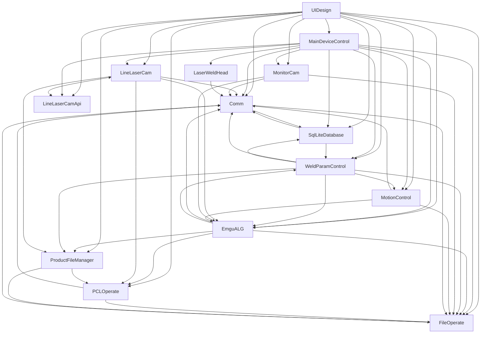

# 设备控制架构 — MainDeviceControl

> **本页是设备控制架构的唯一规范页**，也是全项目架构的唯一真相源。
> **架构原档（唯一修改入口，共 3 份）**：`LLMWiki/raw/architecture/` 下 `主控设计.xlsx` + `激光焊接系统业务流程图20260904.md`（**业务流主源**）+ `激光焊接系统业务流程图.pdf`（图形备份）。2026-09-04 起业务流以 **md 版为主源**（PDF 文本层提取不全，用户人工全量转写）。**改架构先改原档，再同步本页**（约定见 [[decisions/ADR-032-ArchitectureRawSource]]）。
>
> | 原档 | 模式 | 回答的问题 | 判读方式 |
> |---|---|---|---|
> | 主控设计.xlsx | 静态结构 | 「有什么」——目录 / 类职责 / 三态枚举真值 / 基类契约（17 项）/ 两个独立管控类的成员级清单 | openpyxl 直读（Sheet 名 `主控程序文件层级设计`，列：根文件夹/子文件夹·文件/文件/主要内容描述/实现） |
> | 激光焊接系统业务流程图20260904.md（主源） | 业务状态流 + 检查清单 + **IO 统一触发架构 + 机器人命令全表** | 「怎么走」——上电→复位→Preworking 五项检查→Working 四路子流程→三终止分支→急停锁止；另含 §2 三触发源统一收敛、§3.4 双态映射、§10 共 21 条命令设计 | **md 为人工校对全量转写**（706 行），优先读它 |
>
> **2026-09-03 完全重写（ADR-030）**：本页按原档细化后的**全新设计整体重写**，不是对旧版内容的补充。旧版中由早期「步骤驱动」「自动/手动双流程」「三态模型」三项决策建立、且与新原档冲突的框架已由用户裁定清除，**本页不再保留其表述**：
>
> | 已清除的旧设计 | 取代它的新设计 | 见 |
> |---|---|---|
> | 基类 `DeviceWorkflowBase` 自带常驻监听线程（`StartRunLoop` / `BeatMs` / `RunLoopPriority`） | 子流程无自带线程，由 `DeviceControlWork` 的 5 条常驻线程驱动 `FlowProcess()` | §4.5、§7.2 |
> | 改步唯一入口 `GoStep(n)`；`SetStep()` 后立即 `return` | `RunStep` 由每个 `case` 内的 bool 判断推进，`true` 才进入下一步 | §5 |
> | `CommandTable.cs` 用 `const int` + 三个枚举（`RobotPose` / `RobotCommand` / `DeviceCommand`）+ `RobotPoseCode` | `CommandCore.cs` 用 `const string` 固定指令，**机器人指令按字符串解析** | §3.1 |
> | 命令三槽分存（`_pendingAbort` > `_pendingCommand` > `_pendingPose`），含机器人 pose 监控 | **不再监控机器人 pose**——设备由机器人指令驱动，无权限管理机器人状态 | §3.1、§7.3 |
> | `SubDeviceWeldStatus.Starting` | 删除 `Starting`，新增 `NoReset`（值 0） | §1.2 |
> | 基类统一 `Log` 出口 | 每个子流程各自重写 `SubDeviceLog()`（`public`） | §4.1、§2「日志出口约定」 |
>
> 冲突裁决：**原档 > 本页 > 源码注释**；源码与原档不一致须交用户裁定（ADR-029 §3）。
> **不按版本代际（V1/V2/V3）描述架构**——架构只维护「当前事实」这一份，变更直接改本页。
> 目录：`AdaWeldSystem/MainDeviceControl/`
> 目标平台：.NET Framework 4.8（C# 7.3，[[decisions/ADR-002-CS73-Constraint]]）；离线构建（[[decisions/ADR-021-NuGetLocalization]]）
> UI：WinForms + AntdUI（[[decisions/ADR-018-UIFrameworkMigration]]）

**章节导航**

| 章 | 内容 | 章 | 内容 |
|---|---|---|---|
| §1 | 核心概念：三态模型 | §8 | 焊接工艺控制流程 |
| §2 | 目录结构 + 继承链 | §9 | 安全互锁与状态管控（ADR-025/037/038） |
| §3 | 三态基座 `DeviceStateBase` | §10 | 运动控制（CAMBOX 硬件实时跟踪） |
| §3.1 | 机器人指令协议 `CommandCore` | §11 | 模块依赖与调用链（代码层事实） |
| §4 | 流程基类 `DeviceWorkflowBase`（17 项契约） | §12 | 与其他模块的关系 |
| §5 | `RunStep` 驱动与超时控制 | §13 | UI 接入约定 |
| §6 | 五个子工作流与差异化职责 | §14 | 维护约定（原档驱动流程） |
| §7 | 运行编排 `DeviceControlWork`（7 线程） | **§15** | **落地清单（改码 Plan，改码前必读）** |
| §7.6~7.8 | 业务主链 / Preworking / Working | **§16** | **参考实现与代码模板（改码前必读）** |

> 本页已超 600 行，**改码前请先按上表定位章节**。
> **§15 是「原档已定、代码未改」的唯一登记处；§16 是「照着什么写」的模板出处。**
> 动 §4 / §5 / §7 / §9 的代码前，**先读 §16 对应小节再动手**。

---

## 1. 核心概念：三态模型

整套架构最根本的语义。三个**正交**状态 + 一个内部执行步层（`RunStep`），**互不顶替**：

| 层 | 枚举 | 回答的问题 | 归属 |
|---|---|---|---|
| 连接态 | `SubDeviceState`（2 态） | 这个子设备连上了吗 | 子设备共有 |
| 焊接过程态 | `SubDeviceWeldStatus`（7 态） | 这个子设备焊接走到哪一步了 | 子设备共有 |
| 主设备运行态 | `MainDeviceStatus`（6 态） | 整机当前处于什么运行阶段 | `DeviceControlWork` 独有 |
| 执行步 | `int RunStep` | 流程内部当前执行到哪个步骤 | 各子流程私有 |

### 1.1 连接态 `SubDeviceState`（子设备，2 态）

所有子设备**共有**、**不可扩展**。原档 R004 明确「子设备 4 态修改为 2 态」：

| 状态 | 值 | 含义 |
|---|---|---|
| `Disconnected` | 0 | 未连接 / 未初始化 |
| `Connected` | 1 | 已连接 / 待机 |

### 1.2 焊接过程态 `SubDeviceWeldStatus`（子设备，7 态，对外名片）

原档 R005 给定**完整顺序与语义**（用户裁定 C2：删除 `Starting`，新增 `NoReset`，其余值顺延）。枚举值按原档顺序从 0 起：

| 值 | 状态 | 含义 | 说明 |
|---|---|---|---|
| 0 | `NoReset` | 未复位 | **新增**。上电初始化后 / 复位前的默认态 |
| 1 | `Standby` | 待机 | 原档拼写 `Stanby`，按正确英文落地为 `Standby`。复位成功后由 `NoReset` 转入 |
| 2 | `PreWork` | 焊接前 | Preworking 五项运行检查阶段 |
| 3 | `Working` | 工作中 | 焊接进行中 |
| 4 | `Stopping` | 停止中 | 正常停止动作执行中 |
| 5 | `ErrorAborted` | 异常终止 | 故障导致的终止 |
| 6 | `ManualStopped` | 手动停止 | 人工触发的停止 |

> ⚠️ `SubDeviceWeldStatus.NoReset` 与 `MainDeviceStatus.NoReset` **同名但分属两个枚举**，语义层次不同（前者是子设备焊接态，后者是整机运行态），不可复用为同一常量。

### 1.3 主设备运行态 `MainDeviceStatus`（6 态，过程状态）

原档 R006 **显式给定了数值**，必须严格遵守（不是按声明顺序隐式推导）：

| 值 | 状态 | 含义 |
|---|---|---|
| 0 | `Running` | 运行中 |
| 1 | `Alarm` | 报警 |
| 2 | `EStop` | 急停 |
| 3 | `Stop` | 停止 |
| 4 | `NoReset` | 未复位 |
| 5 | `Reseting` | 复位中 |

> 原档拼写 `Reseting`（单 t），因原档显式给出数值而非依赖顺序，此处**保留原档拼写**以维持与工艺文档的一致性。

### 1.4 状态写入唯一入口（强制）

| 状态 | 唯一写入方法 | 所在类 |
|---|---|---|
| `SubDeviceState` | `SetState(...)` | `DeviceStateBase` |
| `SubDeviceWeldStatus` | `SetWeldStatus(...)` | `DeviceStateBase` |
| `MainDeviceStatus` | `SetStatus(...)` | `DeviceControlWork` |

**禁止直接对状态字段赋值**，以保证状态变更事件、UI 刷新与故障记录不被绕过。

---

## 2. 目录结构

```
AdaWeldSystem/MainDeviceControl/
├── DeviceControlWork.cs        运行编排单例（不继承任何基类，7 条常驻线程）
├── DeviceStatusWork.cs         安全 / IO / 状态管控单例（不继承任何基类，3 条常驻线程）
├── DeviceStateApiCore/
│   ├── DeviceStateBase.cs      三态基座：三个枚举 + 状态写入方法
│   ├── CommandCore.cs          机器人指令协议：const string 固定指令（原 `CommandTable.cs`）
│   └── DeviceWorkflowBase.cs   流程基类：5 公共属性 + 12 抽象方法
└── DeviceWorkflow/
    ├── LineLaserWorkflow.cs          线激光（基准实现）
    ├── LaserWeldHeadWorkflow.cs      激光焊接头
    ├── MonitorCameraWorkflow.cs      监控相机
    ├── MotionControlWorkflow.cs      运动控制器
    └── WeldParamControlWorkflow.cs   焊接工艺控制
```

### 继承链

```
DeviceStateBase                   三态枚举 + SetState / SetWeldStatus
    └── DeviceWorkflowBase        流程基类：属性 + 17 项契约
            ├── LineLaserWorkflow
            ├── LaserWeldHeadWorkflow
            ├── MonitorCameraWorkflow
            ├── MotionControlWorkflow
            └── WeldParamControlWorkflow

DeviceControlWork                 独立单例，不继承任何基类
DeviceStatusWork                  独立单例，不继承任何基类
```

> ⚠️ **目录名 ≠ 命名空间**：`DeviceStateApiCore/` 下的类分属 `...DeviceState` 与 `...FlowState` 命名空间，**禁止新增 `...DeviceStateApiCore` 命名空间**。详见 [[guides/Namespace-Compilation]]。

### 日志出口约定（用户裁定 C7）

**每个子流程各自重写 `SubDeviceLog()`**（`public abstract`，基类不提供统一实现）。理由：整机层面统一 `Log` 会让各设备的差异化日志需求堆积在基类，造成臃肿。

| 类 | 日志方式 |
|---|---|
| 5 个子工作流 | 各自 `override SubDeviceLog()`，输出本设备的差异化日志（温度阈值 / 轴状态 / 送丝位置 / 工艺参数 / 线激光结果） |
| `DeviceControlWork` / `DeviceStatusWork` | 直连 `GlobalCommData.ShowLog`（本类私有 `Log(...)` 带 `_tag`，无中间封装） |

### 独立管控类的步机制同源约束

`DeviceControlWork` 与 `DeviceStatusWork` **不继承** `DeviceWorkflowBase`，因此没有 `RunStep`。二者的「步骤」体现在：

- `DeviceControlWork`：业务状态链（Initialize → Reset → Preworking → Working → Stop/Alarm/Complete），由 `MainDeviceStatus` 表达
- `DeviceStatusWork`：三条线程各自的循环体，无步骤概念

二者**禁止**自行实现一套与基类 `RunStep` 平行的步机制，避免语义分裂。

---

## 3. 三态基座 `DeviceStateBase`

职责：定义三个状态枚举 + 提供状态写入唯一入口。**不持有任何设备对象、不包含任何业务逻辑**。

| 成员 | 说明 |
|---|---|
| `enum SubDeviceState` | 2 态（§1.1） |
| `enum SubDeviceWeldStatus` | 7 态（§1.2） |
| `enum MainDeviceStatus` | 6 态（§1.3） |
| `SetState(SubDeviceState)` | 连接态唯一写入入口，触发状态变更事件 |
| `SetWeldStatus(SubDeviceWeldStatus)` | 焊接过程态唯一写入入口，触发状态变更事件 |

### 3.1 机器人指令协议表 `CommandCore`

原档 R002/R003 定义（用户裁定 C3：**以新档为准**）：

> 原档命名 `CommandCore.cs`；现行代码为 `CommandTable.cs`，按裁定**改名**。

| 成员 | 说明 |
|---|---|
| `ReceiveCommand` | 接受指令。原档拼写 `ReciveCommand`，按正确英文落地为 `ReceiveCommand` |
| `SendCommand` | 发送指令 |
| 指令常量 | **const string 方式固定**住机器人指令，**不允许自定义赋值** |

**裁定要点（用户原话）**：

1. **机器人指令就是 String 方式解析得到**——不再使用 `const int` + 枚举映射。
2. **原定义完全删掉**：删除 `RobotPose` / `RobotCommand` / `DeviceCommand` 三个枚举与 `RobotPoseCode` 映射表，以及 `CommandTable.cs` 中全部 `const int` 指令码。
3. **不再监控机器人的 pose**——**设备运行全靠机器人指令驱动，设备无权限管理机器人状态**。
4. 消费方（原先读取指令分派动作的代码点）**先以 `// todo` 占位**，待指令协议细化后接入。

> ⚠️ 该改动同时废除了旧设计中为解决 `RobotPose.StartSafePose=1` 与 `RobotCommand.PreWeldRequest=1` 编码重叠而设计的**命令三槽分存**（`_pendingAbort` > `_pendingCommand` > `_pendingPose`）——pose 槽位已不存在。详见 §7.3。

---

## 4. 流程基类 `DeviceWorkflowBase`（非泛型）
> **代码模板**：见 §16.2 基类模板（`StationProcess.cs` → `DeviceWorkflowBase.cs`）。

流程基类为 5 个子工作流提供统一契约。原档 R007 给出**完整的成员清单**，分三个区：**5 公共属性 + 全阻塞流程 10 项 + 非阻塞流程 2 项**（共 17 项）。

### 4.1 公共属性（5 项）

| 属性 | 类型 | 说明 |
|---|---|---|
| `Tag` | `string` | 流程名，用于日志与 UI 显示 |
| `IsEnable` | `bool` | 是否启用。未启用的流程不参与编排 |
| `RunStep` | `int` | 流程步控，驱动 `FlowProcess()` / `ResetProcess()` 的执行位置 |
| `StepWorkTime` | `TimeSpan` | 步骤用时。原档写 `DateTimespan`，C# 中对应 `TimeSpan` |
| `TimeOutSeconds` | `int` | 超时计时（**秒**） |

### 4.2 全阻塞流程（10 项）

「全阻塞」指：**由外部线程调用，方法同步执行完成后才返回**。这些方法**不自带常驻线程**——它们是被 `DeviceControlWork` 的常驻线程反复调用的执行体。

| 方法 | 签名 | 说明 |
|---|---|---|
| `FlowProcess` | `public abstract void` | 以 `RunStep` 驱动的运行流程。**每行步骤由 bool 判断后执行，防止空转** |
| `ResetProcess` | `public abstract bool` | 以 `RunStep` 驱动的复位流程，同样按 bool 判断推进 |
| `ClearStatus` | `public abstract void` | 状态清理，**做设备复位前的状态清理** |
| `ResetWorkTime` | `public abstract void` | 清除步骤用时，**防止暂停 / 停止期间的时间被计入步骤时长导致异常超时** |
| `InitializeOn` | `public abstract bool` | 设备连接，**同步等待**（阻塞至连接完成或超时） |
| `InitializeOff` | `public abstract bool` | 设备断开，**异步等待**（内部异步执行释放，调用方仍阻塞至完成） |
| `SubDeviceLog` | `public abstract void` | 设备日志。**由每个子流程各自重写**（见 §2 日志出口约定） |
| `LoadConfig` | `public abstract void` | 加载配置。**无参**，内部走本项目的 `XdocumentReaderWriter`（裁定 D1，见 §4.6、§16.8） |
| `SaveConfig` | `public abstract void` | 保存配置。**无参**，末尾须调用 `Config.SaveXdocument()` 落盘（原档描述误写为「加载配置」，按语义修正） |
| `WeldStatusTrans` | `public abstract void` | 焊接工作状态切换管控方法（原档拼写 `WledStatusTrans`，按正确英文落地） |

### 4.3 非阻塞流程（2 项）

「非阻塞」指：**非常驻后台线程，实现动作即退出释放**。发出连接 / 断开命令后立即返回，**不等待结果**；实际连接结果由 `SubDeviceState` 反映。

| 方法 | 签名 | 说明 |
|---|---|---|
| `ConnectOn` | `public abstract bool` | 设备连接，动作即退出释放 |
| `ConnectOff` | `public abstract bool` | 设备断开，动作即退出释放 |

### 4.4 `InitializeOn/Off` 与 `ConnectOn/Off` 的职责边界（用户裁定 C4）

**两组不重叠**，区别仅在阻塞语义：

| | `InitializeOn` / `InitializeOff` | `ConnectOn` / `ConnectOff` |
|---|---|---|
| 阻塞性 | **阻塞**——调用方等待动作完成才返回 | **非阻塞**——动作即退，不等待结果 |
| 使用阶段 | **上电初始化 / 停机清理**（`InitializeMachine`） | 运行期的重连 / 断连 |
| 结果获取 | 返回值 `bool` 直接给出成败 | 不返回成败，由 `SubDeviceState` 异步反映 |
| 线程占用 | 调用方线程被占用至完成 | 不占用线程 |

- `InitializeOn()`：设备连接，**同步等待**至连接完成或超时。
- `InitializeOff()`：设备断开，**异步等待**——内部以异步方式执行释放动作，调用方阻塞至其完成。
- `ConnectOn()` / `ConnectOff()`：**非常驻后台线程，实现动作即退出释放**。

> 这样设计的原因：初始化阶段必须确认连接成败才能进入复位，因此用阻塞接口；运行期重连若阻塞会拖住编排线程，因此用非阻塞接口由状态机异步收敛。

### 4.5 基类提供的非抽象成员

除 17 项契约外，基类还负责：

| 成员 | 说明 |
|---|---|
| 状态字段与 `SetState` / `SetWeldStatus` | 继承自 `DeviceStateBase`（§3） |
| `StateChanged` 事件 | 状态变更统一出口，供 UI 订阅 |

> ⚠️ 基类**不再提供**常驻监听线程（`StartRunLoop` / `BeatMs` / `RunLoopPriority` 已按裁定 C1 全部删除）。线程的唯一归属是 `DeviceControlWork`（§7.3）。

### 4.6 子设备配置路径约定（裁定 D1）

`LoadConfig()` / `SaveConfig()` 在基类中**只有契约、不持有路径**。路径由**每个子设备 workflow 各自持有**：

| 层 | 职责 |
|---|---|
| 基类 `DeviceWorkflowBase` | 只声明 `public abstract void LoadConfig()` / `SaveConfig()`，**不知道配置文件叫什么、在哪** |
| 子设备 workflow | 定义自己的配置名 / 路径成员（如 `ConfigFileName` + `Config`），并重写两个方法 |

- 落盘位置统一为 `Config/XML/`（沿用 [[decisions/ADR-007-ConfigLayout]] 的 `Config` 分层约定），由 `XdocumentReaderWriter` 内部拼装，**子设备只给文件名**。
- 参考实现（§16.2）里的 `LoadConfig(XmlReader)` / `SaveConfig(XmlWriter)` **不作为模板**——那是流式 API，与本项目配置体系不一致。
- 完整模板与四条铁律见 **§16.8**。
- `ClearProduct()`（清料）按裁定 D2 **不入基类契约**。

---

## 5. `RunStep` 驱动与超时控制
> **代码模板**：见 §16.3 子流程模板 S1~S8（`RollPressProcess.cs / AssemblyProcess.cs` → `5 个 Workflow`）。

原档 R007 对 `FlowProcess` / `ResetProcess` 的执行模型有明确表述：

> 「以 `RunStep` 驱动的运行流程，**每行步骤由 bool 判断后执行，防止空转**」

含义：每个步骤的执行体返回 `bool`；**返回 `true` 才推进 `RunStep` 到下一步**，返回 `false` 则停留在当前步等待下次调用重试。这与「调用一次就必须走完」的写法相反——流程是被外部线程**反复调用**的，靠 bool 决定是否前进。

```csharp
public override void FlowProcess()
{
    switch (RunStep)
    {
        case 0:
            if (DoConnectCheck()) { ResetWorkTime(); RunStep = 10; }
            break;
        case 10:
            if (DoPreWork()) { ResetWorkTime(); RunStep = 20; }
            break;
        // ...
    }
    // 超时：单步停留超过 TimeOutSeconds 秒即判超时
}
```

**配套约束**：

| 约束 | 说明 |
|---|---|
| 推进即清零 | 每次推进 `RunStep` 前调用 `ResetWorkTime()`，否则暂停 / 停止期间的时间会被计入下一步导致误判超时 |
| 超时单位为秒 | `TimeOutSeconds` 是**秒**；与基底节拍换算时注意：5 ms 节拍下连续 5 次重试只有 25 ms |
| 步号自定义 | 各子流程自行定义步号，**基类不规定统一段位** |
| 空转防护 | bool 返回 `false` 时不做忙等，直接结束本次调用，由外部线程的下一次循环再次进入 |

> ⚠️ 这与已清除的旧机制（改步唯一入口 `GoStep(n)`、`SetStep()` 后立即 `return`）不同。新设计中**不存在** `GoStep` / `SetStep` / `FailFlow` / `FailReason` / `FailStep` 等基类成员。

---

## 6. 五个子工作流与差异化职责

5 个子工作流**同构**：均继承 `DeviceWorkflowBase`，均实现 §4 的 17 项契约，均以 `RunStep` 驱动。差异只在**各自的业务检查职责**。

原档 R008~R012 以 `LineLaserWorkflow` 为**基准实现**，其余 4 个「同 `LineLaserWorkflow`，区别：……」。参考实现为外部项目 `PcomDeviceInterface/Work/Process/` 下的 `RollPressProcess.cs`（线激光 / 焊接头 / 监控相机 / 工艺）与 `AssemblyProcess.cs`（运控）。

### 6.1 基准实现 `LineLaserWorkflow`

原档 R008 标注的两个重点：

**① `FlowProcess` 与 `ResetProcess` 的步骤联动**

两个流程联动 `SubDeviceState` 与 `SubDeviceWeldStatus`：

1. 子设备状态为 **ON**（`Connected`）时，`ResetProcess` 才可执行
2. 子设备 `ResetProcess` **成功后**，`SubDeviceWeldStatus` 由 `NoReset` → `Standby`
3. 进入 `Standby` 后，**接受机器人指令修改工作状态**
4. **每一步反馈 OK 才能执行等待下一步指令**——即等待机器人下发下一步指令，而非自动连续推进

**② `ClearStatus`**

执行默认状态（复位前的状态清理）。

**自有成员**：接收到的指令；声明子设备对象（线激光对象 / 控制器对象 / 焊接头对象 / 监控相机）；实例化值判断（线激光结果阈值等，原档标注「暂时空缺」）、流程状态判断。

### 6.2 差异化职责对照（原档 9-03 细化）

| 子工作流 | 参考实现 | 差异化职责 | 代码现状 |
|---|---|---|---|
| `LineLaserWorkflow` | `RollPressProcess.cs` | 基准。分析得到 Y 偏移值和焊缝宽度 | 现役 |
| `LaserWeldHeadWorkflow` | `RollPressProcess.cs` | **监控温度阈值** | 骨架类，无实现 |
| `MonitorCameraWorkflow` | `RollPressProcess.cs` | **实现轴控制行为** | 现役，无轴控制 |
| `MotionControlWorkflow` | `AssemblyProcess.cs` | **检测送丝位置和焊接质量阈值** | 现役，无该检测 |
| `WeldParamControlWorkflow` | `RollPressProcess.cs` | **无实体设备，连接 / 断开直接执行 bool 变量即可** | 仍走完整流程方法，需简化 |

> `WeldParamControlWorkflow` 的特殊性：它没有硬件实体，**不参与上电级联**（ADR-027 权责边界），`InitializeOn` / `ConnectOn` 只需置一个 bool 变量即可返回，不应走真实的设备连接流程。

---

## 7. 运行编排 `DeviceControlWork`（独立单例）
> **代码模板**：见 §16.4 编排层模板（`MachineControlWork.cs` → `DeviceControlWork.cs`）。

**不继承任何基类**（原档 R013 明确：「实现设备的运行单例，不继承任何基类」）。它是整机的运行编排者：持有 5 个子工作流实例、驱动它们的 `FlowProcess()`、管理整机状态链、对接机器人指令。

### 7.1 私有属性（原档 R013）

| 成员 | 说明 |
|---|---|
| `MontionManager` | 私有的运动管理器实例，构造函数中获取 |
| `IsReseting` | 复位中标志位 |
| `IsWorking` | 工作中标志位 |
| `IsAlarmstop` | 报警停止标志位 |
| `IsCloseWork` | 关闭工作标志位 |
| `Current` / `Last` | **双份 `MainDeviceStatus` 快照**，用于状态变化检测 |

### 7.2 常驻线程（7 条）

原档 R013 给出**完整线程清单**（用户裁定 C1：**以新档为准，旧设计的线程机制全部清除**）：

| 线程 | 类别 | 职责 |
|---|---|---|
| `thLaserHeadWork` | 子设备工作线程 | 循环驱动 `LaserWeldHeadWorkflow.FlowProcess()` |
| `thLineLaserWork` | 子设备工作线程 | 循环驱动 `LineLaserWorkflow.FlowProcess()` |
| `thMonitorCamWork` | 子设备工作线程 | 循环驱动 `MonitorCameraWorkflow.FlowProcess()` |
| `thMotionControlWork` | 子设备工作线程 | 循环驱动 `MotionControlWorkflow.FlowProcess()` |
| `thWeldParamControlWork` | 子设备工作线程 | 循环驱动 `WeldParamControlWorkflow.FlowProcess()` |
| `thHeartInspectWork` | 通讯线程 | 机器人通讯**心跳检测** |
| `thCommCommandWork` | 通讯线程 | 机器人**指令交互**（常驻循环判断） |

**5 条子设备工作线程**的循环体（`LaserHeadWork` / `LineLaserWork` / `MonitorCamWork` / `MotionControlWork` / `WeldParamControlWork`）执行约定：

1. 循环调用对应子流程的 `FlowProcess()`
2. **判断设备状态，未 `Running` 不执行**
3. **不执行时 `Thread.Sleep(10)`，防止空转速度太快、进程爆炸**

**`CommCommandWork`** 执行约定：

1. 接受机器人通讯指令
2. **等待子流程抛出完成结果**
3. **反馈机器人完成结果**
4. **未执行动作时 `Thread.Sleep(100)`**（比子设备线程的 10 ms 更长）

### 7.3 私有方法（原档 R013）

| 方法 | 说明 |
|---|---|
| `CommWork()` | 通讯开启线程，**开启动作完成即释放**（非常驻） |
| `OnCommRecived()` | 机器人通讯指令**回调和解析** |
| `CommCommandWork()` | 常驻循环判断指令交互，见 §7.2 |
| `MachineStatusTrans()` | **设备状态合法控制接口**——校验状态迁移是否合法 |
| `WeldStatusTrans()` | **焊接设备状态控制接口**——管控焊接工作态切换 |
| `LaserHeadWork()` 等 5 个 | 常驻后台流程循环，见 §7.2 |

> **关于机器人指令的分派**：裁定 C3 已确定「不再监控机器人 pose」，因此**不存在** pose 相关字段。当前的指令消费点先以 `// todo` 占位，待 `CommandCore` 的字符串协议细化后接入。

### 7.4 关键边界：机器人 / PLC 连接（用户裁定 C5）

| 角色 | 职责 |
|---|---|
| `Comm` 模块 | **提供**机器人 / PLC 的**通讯方法和管理**（连接、断开、收发、心跳） |
| `DeviceControlWork` | **实际使用方**——调用 `Comm` 提供的方法完成通讯建立 |

业务流程图把「通讯 Open + Connect On」画在 `InitializeMachine` 内，含义是 `DeviceControlWork` **在初始化阶段调用 `Comm` 的方法**完成通讯建立，**不是**自己实现通讯协议或另起通讯管理职责。

### 7.5 公共方法（原档 R013，9 项）

| 方法 | 说明 |
|---|---|
| `MachineFlowWorkOpen()` | 实例化**所有子设备工作线程（5 个）并 Start** |
| `MachineCommandWorkOpen()` | 实例化**通讯工作线程（1 个）并 Start** |
| `InitializeMachine()` | 设备初始化加载：**子设备实例化 → 连接子设备 → 开启通讯** |
| `ClearMachine()` | 执行所有子设备的 `ClearStatus()`，**强制设备状态 `NoReset`**（初始化默认加载、复位前强制加载） |
| `ResetMachine()` | 执行所有子设备的 `ResetProcess()` + 设备状态链，**链路不对则退出**：`NoReset → Reseting → Stop`。**单次执行线程** |
| `StartMachine()` | 切换设备状态链 `Stop → Running`，**真正执行由常驻子线程判断** |
| `ClearAlarm()` | 清除当前报警，设备进入停止 |
| `EstopMachine()` | 执行急停动作 |
| `EstopCancel()` | 清除急停状态，设备进入停止 |

### 7.6 业务状态流主链（`激光焊接系统业务流程图.pdf` → 代码映射）

```
开始
  │
  ▼
程序载入
  │
  ▼
InitializeMachine ─────────────────────────────────────────┐
  ├─ 焊接头   Connect On                                   │
  ├─ 控制器   Connect On                                   │
  ├─ 线激光   Connect On                                   │
  ├─ 监控相机 Connect On                                   │
  ├─ 通讯 Open + Connect On  ── 调用 Comm 提供的方法（§7.4）│
  ├─ Runing IO Work                                        │
  └─ Alarm IO Work + 机器人服务器 Command                   │
  │                                                        │
  ▼                                                        │
所有子设备已连接？                                          │
  ├─ N ──► Initialize Fail ────────────────────────────────┘
  └─ Y
     ▼
ResetMachine（设备复位）────────────────────────────────────┐
  ├─ 控制器：复位轴 / IO                                    │
  ├─ 焊接头：复位轴 / IO                                    │
  └─ 线激光 / 监控相机：直接复位 OK                          │
  │                                                        │
  ▼                                                        │
子设备复位成功？                                            │
  ├─ N ──► Reset Fail ─────────────────────────────────────┘
  └─ Y
     ▼
设备待机（Standby）
  │
  ▼
StartMachine: Preworking ── 设备运行检查（五项，见 §7.7）
  │
  ▼
子设备运行检测 OK？
  ├─ N ──► Pre-Working Fail
  └─ Y
     ▼
StartMachine: Working ── 子设备焊接开始（四路，见 §7.8）
     │
     ├──────────► 子设备手动终止 ──────────► Stop
     ├──────────► 子设备异常终止 ──────────► Alarm
     ├──────────► StartMachine: Robot Alarm ► Alarm
     └──────────► 焊接完成 ──► StopMatchine：Complete
                                    │
                                    ▼
                        子设备焊接完成动作 → 子设备正常停止
                                    │
                                    ▼
                        报警判断：故障树和代码

旁路（任意时刻）：
EMG IO Work → EMG STOP / SAFE IO → 设备急停 → EMG Stop → 子设备停机锁止
```

**语义映射说明**：

| 原档节点 | 代码落点 | 备注 |
|---|---|---|
| `StartMachine:Preworking` | `StartMachine()` 后进入 `SubDeviceWeldStatus.PreWork` | 不是三个独立方法，是同一方法的不同状态标记 |
| `StartMachine:Working` | 同上，进入 `Working` | |
| `StartMachine:Robot Alalrm` | 同上，进入 `Alarm` | 原档拼写 `Alalrm` → `Alarm`；**非新增状态**，复用 `MainDeviceStatus.Alarm` |
| `StopMatchine：Complete` | 焊接完成后的正常停止动作 | 原档拼写 `StopMatchine` → `StopMachine` |

### 7.7 Preworking 五项设备运行检查（原档细化）

| # | 检查项 | 具体内容 | 代码落点 |
|---|---|---|---|
| 1 | **控制流程检查** | ① 实时监控机器人坐标，写入寄存位 | `DeviceControlWork`（写寄存位） |
| 2 | **线激光设备检查** | ① 线激光传感器启动 & 激光启动 ② 追踪信号 | `LineLaserWorkflow` |
| 3 | **焊接头使能** | 焊接启动信号发送机器人 | `LaserWeldHeadWorkflow` |
| 4 | **监控相机检查** | 送丝距离合规检查 | `MonitorCameraWorkflow` |
| 5 | **运动控制器检查** | ① Y 轴在位检测信号 ② 送丝 Z 轴在位检测信号 ③ 振镜轴在位检测信号 ④ 对焦 Z 轴在位检测信号；出丝 / 光斑偏移；光斑对中检测 | `MotionControlWorkflow` |

> 五项**全部通过**才进入 `Working`；任一失败 → `Pre-Working Fail`。

### 7.8 Working 四路焊接子流程（原档细化）

| 子流程 | 步骤 |
|---|---|
| **线激光** | ① 分析得到 Y 偏移值和焊缝宽度 ② 组装机器人 X 坐标 ③ 得到 Y 轴调整轨迹 |
| **Motion** | ① 得到 Y 轴调整轨迹 ② 得到实时机器人坐标 ③ 执行连续移动 ④ 送丝轴控制 + 位置传感器信号 + 对焦 Z 轴控制 ⑤ 振镜摆动控制 |
| **WeldParamControl** | ① 焊缝宽度组装数据 ② 得到实时机器人坐标 ③ 执行工艺调整：振镜摆幅中点、送丝速度、激光功率 |
| **监控相机** | ① 工作模式判断 ② 输出结果 |

---

### 7.9 IO 统一触发架构（原档20260904 §2，2026-09-04 新增）

> 原档 md 版补齐了 PDF 文本层完全丢失的这一整章。**现行实现以本节为准。**

#### 7.9.1 三种触发源统一收敛

硬件按钮 / 机器人命令 / 软件 UI 三条路径**最终都表现为某个 IO 的置位**，
扫描线程**只关心 IO 状态，不关心触发源**（原档 §2.3①）：

| 触发源 | 置位方式 | 典型来源 |
|---|---|---|
| 硬件按钮 | 物理 IO 由**控制器 / PLC** 给出，扫描线程读取后置位同名虚拟 IO | 复位 / 启动 / 停止 / 消报 / 急停按钮 |
| 机器人命令 | `OnCommRecived` → `CommCommandWork` 线程 → `MapCommandToIo` → 置位虚拟 IO | `RxAbort` / `RxPreWeldRequest` / `RxHomePose` 等 |
| 软件 UI | UI 直接调 `DeviceControlWork` 公共方法 → 置位虚拟 IO | `InitializeMachine()` / `StartMachine()` 等 |

#### 7.9.2 扫描线程分工（用户 2026-09-04 裁定）

| 线程 | 归属 | 扫描内容 | 优先级 |
|---|---|---|---|
| `thEMGWork` | `DeviceStatusWork` | **急停**：物理急停位（反逻辑：无信号=急停；无虚拟 IO，2026-09-08 裁定，单线程） | Highest |
| `thIOWork` | `DeviceStatusWork` | **Running IO + Alarm IO**：虚拟 IO + 物理 IO（**一个线程**） | AboveNormal |
| `thLightStatusWork` | `DeviceStatusWork` | 三色灯反射（状态切换才写 PLC） | Normal |

> ⚠️ **不新建 .cs 文件、不新建扫描线程**（用户硬约束）。虚拟 IO 常量与置位表定义在
> `DeviceControlWork.cs` 内部（`#region 虚拟IO常量` + `_virtualIoSet`），
> 两个扫描线程同时监控**虚拟 IO 与物理 IO**，物理 IO 由控制器给出。

#### 7.9.3 虚拟 IO 常量（原档 §2.4 / §10.3）

**系统级 6 条**（`DeviceControlWork` public const string）：

| 常量 | 值 | 原档映射 | 触发的命令 |
|---|---|---|---|
| `IoInit` | `IO_INIT` | Init_IO | `InitializeMachine` |
| `IoReset` | `IO_RESET` | Reset_IO | `ResetMachine` |
| `IoStart` | `IO_START` | Start_IO | `StartMachine` |
| `IoStop` | `IO_STOP` | Stop_IO | `StopMachine` |
| `IoClearAlarm` | `IO_CLEAR_ALARM` | ClearAlarm_IO | `ClearAlarm` |
| `IoMotionBusFault` | `IO_MOTION_BUS_FAULT` | —— | `DoMotionBusFault`（电平型，IOWork 监督置位） |

**子设备级 7 条**：`IoSubConnect` / `IoSubReset` / `IoSubPrework` / `IoSubWork` /
`IoSubStop` / `IoSubManualStop` / `IoSubAlarmStop`。

> `IoSubConnect` 与 `IoSubReset` 属 InitializeMachine / ResetMachine **内部自动调用**（原档 §10.3），
> 不单独走扫描；其余 5 条由 `ExecuteIo` 分派到 `CascadeWeldStatus`。

#### 7.9.4 命令 → 执行的分层

```
触发源 ──> SetVirtualIo(ioName)                 [DeviceControlWork]
                │
                ▼
        thIOWork / thEMGWork 扫描               [DeviceStatusWork]
        · 脉冲型 TakeVirtualIo  命中即清位，保证只执行一次
        · 电平型 IsVirtualIoSet 持续监控（急停）
                │
                ▼
        ExecuteIo(ioName)                       [DeviceControlWork 唯一执行入口]
                │
                ▼
        DoInitializeMachine / DoResetMachine / DoStartMachine /
        DoStopMachine / DoClearAlarm / DoEstopMachine / DoSub*
```

**关键设计**：扫描器**不门控整机状态**（Init / Reset 发生在非 Running 态），
改为**门控命令自身的前置条件**——正合原档 §10.1③「校验不通过则拒绝执行并返回错误码」。

#### 7.9.5 两条硬约束

1. **Running IO Work 是常驻扫描器**：`DoStopMachine` **不关闭** `thIOWork`
   （否则扫描器自杀，停机后再无线程接收命令），仅在 `DisposeComponents` 统一关闭。
2. **机器人通讯必须转到 IO**（用户硬性要求）：机器人通讯有多种形式——
   坐标类解析 string 后**仅记录**，动作类机器人可直接写 IO 量——
   两条路径最终都收敛到虚拟 IO 层，由扫描器统一执行。

#### 7.9.6 子设备焊接态的外部下发入口

`SetWeldStatus` 是 `protected`，整机层无法直接赋值。基类 `DeviceWorkflowBase` 新增
**非抽象**公共方法 `RequestWeldStatus(target, reason)` 作为唯一受控外部入口，
供 `DeviceControlWork.CascadeWeldStatus` 向 5 个子设备统一下发迁移请求。
（非抽象成员，5 个子类无需实现，不破坏 17 项抽象契约。）

---

## 8. 焊接工艺控制流程（WeldParamControlWorkflow）

### 8.1 定位（易错，务必注意）

**不是有连接动作的设备**，而是**设备内部控制焊接工艺的一个流程**。

- **输入**：机器人信息 + 线激光结果信息
- **计算**：焊接功率、送丝速度、振镜摆幅、焊接速度
- **输出**：下发给机器人

### 8.2 数据链路（焊缝信息 = 英莱线激光的结果）

```
英莱线激光相机取像
  ↓ 回调 IlInspectResult 直接携带：FeatureY/FeatureZ（特征点）、Width0/Width1（宽度）
LineLaserWorkflow.OnContourFrameReady
  ↓ 构造 SeamFeatureResult：sf.CenterY=ir.FeatureY, sf.CenterX=ir.FeatureZ,
    sf.SeamWidth=(ir.Width0+ir.Width1)*0.5, sf.SeamArea=ir.Area
PipelineManager.Instance.ReportExternalResult(sf, robotX, null)
  ↓
WeldProcess.OnAlgorithmCompleted
  ↓ 暂存 _lastSeamFeature / _lastRobotX
WeldParamControlWorkflow.ComputeAndOutput()
  ↓ 调用 WeldProcess.TriggerAdjustment()【无参，用上一步暂存值】
  ↓ 滑动平滑 + 查找表匹配 + 灵敏度判定
WeldParamOutput（功率/送丝/速度/摆幅）
  ↓ SendToRobot → 下发机器人
```

**关键点**：
- 英莱回调**本就含特征点与宽度**，链路本就通；本工作流补的是「计算后下发到机器人」这一环
- `WeldProcess.TriggerAdjustment()` 是**无参**方法（内部用 `OnAlgorithmCompleted` 暂存的 `_lastSeamFeature`/`_lastRobotX`），**不要给它加参数**

### 8.3 不入上电级联

`WeldParamControlWorkflow` **不纳入** `DeviceControlWork` 上电初始化（`InitializeMachine`）级联，由 `LineLaserWorkflow` 在连续成功帧达到阈值时触发，保持单一驱动源（见 [[decisions/ADR-011-WorkflowAsAdjustmentDriver]]）。

### 8.4 振镜摆幅待实现

`CalcGalvoAmplitude` 当前 TODO 占位返回 0.0。`WeaveWidth` 规划为**查表项**（新增 WeaveWidth 分段表，与焊缝宽度关联），**不是公式推导**——不要自行发明公式。

---

## 9. 安全互锁与状态管控
> **代码模板**：见 §16.5 状态层模板（`MachineStatusWork.cs` → `DeviceStatusWork.cs`）。
> **ADR-031/038 增补（2026-09-04）**：主设备态初始值 `NoReset`（报错置 Alarm、消除报警回 NoReset、只有复位流程成功才到 Stop）；初始化时序通讯优先；故障恢复模块已整体移除；状态切换零日志（详见 [[decisions/ADR-034-MainDeviceStateSemantics]] / [[decisions/ADR-035-ErrorReportingHierarchy]]）。

### 9.1 文件归属（ADR-025 合并 + ADR-028 归并）

**安全检查只有一个文件**：`MainDeviceControl/DeviceStatusWork.cs`（设计来源参考 `PcomDeviceInterface/MachineStatusWork.cs`（现役 `MainDeviceControl/DeviceStatusWork.cs`） 的 IOWork/EMGWork/StatusWork 三线程模型，见 `主控设计.xlsx` 的「设备安全/IO/状态管控」泳道）。

`DeviceStatusWork` 是**独立管控类，不继承 `DeviceWorkflowBase`/`DeviceStateBase`**，由三个常驻监控线程内聚而成，各自经 `DeviceControlWork` 单一控制源变更主设备运行态（权责边界见 ADR-027）：

| 线程 | 入口方法 | 优先级 | 职责 |
|---|---|---|---|
| IO 轮询 | `IOWork()` | AboveNormal | 周期安全互锁检查（急停除外）与设备态轮询；失败首次 `ReportAlarm(reason)`，恢复 `ReportAlarmCleared`（ADR-032：不再 RecordFault） |
| 急停处置 | `EMGWork()` | Highest | 急停按钮轮询；按下 `EStopMachine("急停按钮按下")`，释放后 `EStopCancel()` + `ReportAlarmCleared` |
| 状态反射 | `StatusWork()` | Normal | 反射 `DeviceControlWork.Status`（MainDeviceStatus）到三色灯（`WriteBit`，地址待标定），状态切换才写 |

启动 `StartWork()`（由 `DeviceControlWork.StartMachine` 拉起）/ 停止 `CloseWork()`（由 `DeviceControlWork.StopMachine`/`Dispose` 调用）。

**原档 9-03 命名对照（已裁定 C1：以原档命名为基准统一）**

| 原档成员 | 语义 | 现行代码落点 | 落地要求 |
|---|---|---|---|
| `thIOWork` | IO 工作线程（Running IO 和 Alarm IO） | `_thIOWork` | 去前缀下划线 |
| `thEMGWork` | 急停线程（Safe IO） | `_thEMGWork` | 去前缀下划线 |
| `thLightStatusWork` | **三色灯状态线程**（status IO） | `_thStatusWork` | ⚠️ 改名，补回「Light」三色灯语义 |
| `IsIOWorking` / `IsEMGWorking` / `IsLightStatusWorking` | 三线程循环标志位，置 false 即线程关闭 | 私有 `_ioWorking` 等同类标志 | 改为 PascalCase 并按原档命名 |
| `MachineIOWorkOpen()` | 实例化 3 个工作线程并 Start | `StartWork()` | ⚠️ 改名为 `MachineIOWorkOpen` |
| 私有 `MontionManager` | 构造函数获取运控实例 | 按需取用 | 一致（可选） |

> 原档未为 `DeviceStatusWork` 定义停止方法（`MachineIOWorkClose`），现行 `CloseWork()` 为补充，保留。
> 线程方法体命名按原档统一为 `IOWork()` / `EMGWork()` / `LightStatusWork()`；防空转约定与原档一致（`Thread.Sleep(10)`）。

| 类型 | 定义 | 职责 |
|---|---|---|
| `DeviceStatusWork` | 单例管控类 | 三线程安全/IO/状态管控；`IsSafe` / `LastResult` / `Config` 对外只读暴露；`StartWork` / `CloseWork` / `Check` / `Reset` / `Dispose` |
| `SafetyFlow` | 阈值与 PLC 地址配置 | `MinGasPressure=40` / `MinCoolantFlow=10` / `MaxCoolantTemperature=35` / `MaxHeadTemperature=60`；PLC 点位 `PlcDb=1`、急停 bit0、安全门 bit1、气压 word10、水流量 word12、水温 word14、枪温 word16、模式 word20；三色灯输出 `StatusLamp*` 待标定 |
| `SafetyInterlockResult` | 检查结果 | `IsPassed` / `FailedItems` / `Reason` / `CheckTime` |
| `SafetyInterlockChecker` | 检查器工具类 | 由 `DeviceStatusWork` 持有调用，`Thresholds` 暴露配置；急停由 `EMGWork` 专责，故 `CheckPlc` 不再检查急停位 |

`FaultRecoveryManager.cs` / `FaultRecordManager.cs`（表 `FaultRecord`）：**2026-09-04 经用户裁定整体移除**（ADR-032 D3）——架构上不存在「故障恢复」定义，所有 `RecordFault` 调用面已删除，报警语义由 `ReportAlarm` / `ReportAlarmCleared` 承载。历史设计见 [[api/FaultRecoveryManager]]（已挂 ⛔ 废弃横幅）与 [[lessons/FaultRecoveryDeviceKey]]。

> **已删除（不要再引用）**：`SafetyFlow.cs`、`SafetyInterlock.cs` 两个独立文件已并入 `DeviceStatusWork.cs`（ADR-025 + ADR-028）。旧 `SafetyWorkflowState` 枚举、旧四态 `DeviceState` 映射均已删除。
> **门控口径**：`DeviceControlWork` 直接读 `DeviceStatusWork.Instance.IsSafe`；**监控未启动时不门控（返回 true）**，避免 PLC 未标定环境阻断整机。
> 2026-09-03 按裁定 C3 移除 `IsRobotPoseSafe()`——**不再监控机器人 pose**，设备无权限管理机器人状态。`IsSafe` 反映的是**本机安全 IO**（急停 / 安全门 / 互锁），与机器人 pose 无关，门控能力不受影响。
> **启动方式**：`StartWork()` 由 `DeviceControlWork.StartMachine` 调用，随整机启动而启动；PLC 未连接时 `Check()` 恒定失败，启动监控即会门控整机（与 ADR-025 口径一致）。
> **急停专责**：急停按钮由 `EMGWork` 线程独占处置（置 `EStop`），与 `IOWork` 的互锁报警（`Alarm`）分离，避免两态互相翻转。
> **待办**：PLC 点位（含三色灯输出）须按现场点位表标定；`IoPollIntervalMs/EmgPollIntervalMs/StatusPollIntervalMs=50`（20Hz）接入真实 PLC 后评估是否调整。

> 模块级细节（两类互锁的判定分支、机器人在线判定、SQLite 持久化分工）见 [[modules/Safety]]。

### 9.2 互锁检查清单

| 类别 | 检查项 | 通过条件 |
|---|---|---|
| 硬件 | 急停按钮 | 未按下（PLC I 区位，bit0） |
| 硬件 | 安全门 | 关闭且锁定（bit1） |
| 硬件 | 保护气压 | ≥ 阈值（默认 40，word10） |
| 硬件 | 冷却水流量 | ≥ 阈值（默认 10，word12） |
| 硬件 | 冷却水温度 | ≤ 上限（默认 35，word14） |
| 硬件 | 焊接头温度 | ≤ 上限（默认 60，word16） |
| 模式 | 自动模式 | `RequireAutoMode` 为真时 PLC 模式字 = Auto（word20） |
| 设备 | 子设备在线/就绪 / 运控已回零 / 心跳正常 | 由各设备态与互锁扩展项判定 |

### 9.3 故障分类与恢复策略

| 故障类别 | 说明 | 恢复方式 | 最大重试 |
|---|---|---|---|
| 通讯故障 | 连接中断、心跳超时 | 自动重连 | 3 次，间隔 5s |
| 相机丢帧 | 抓图失败 | 停止并重新抓图 | 2 次 |
| 线激光测量异常 | 结果无效 | 重新触发测量 | 3 次 |
| 设备故障 | 硬件/SDK 报错 | 设备自复位 + 人工确认 | 按注册策略 |
| 工艺故障 | 参数异常、送丝堵塞 | 停止焊接，调整后重试 | 按注册策略 |
| 安全故障 | 急停、安全门、气压不足 | **不自动恢复**，排除后人工复位 | 0 次 |
| 系统故障 | 软件异常 | 记录日志 + `FaultRecord` 持久化，重启软件 | 0 次 |

**恢复闭环**：故障检测 → 安全停机（`EmergencyStop`：关激光/停送丝/机器人停）→ `RecordFault` 持久化（时间、设备、状态、错误码、参数快照）→ 操作员逐条确认 → 人工排除 → 设备复位 → 整机复位验证（所有子设备就绪 + 互锁通过）。

> **历史坑（机制已移除）**：故障恢复设备键名必须用**英文 key**（`RecordFault` 需与 `RegisterRecoveryStrategy` 注册 key 一致，中文设备名 `IndexOf` 子串匹配永远失败）。FaultRecoveryManager 已于 2026-09-04 整体移除（ADR-032 D3），此坑仅存档。详见 [[lessons/FaultRecoveryDeviceKey]]

---

## 10. 运动控制（台达 EtherCAT 主站）

**核心理念**：运动实时链路 100% 硬件总线化，PC 退化为非实时轨迹规划器。决策依据 [[decisions/ADR-036-MotionControllerDeltaReplacement]]、[[decisions/ADR-037-ZMotionRemovalAndDeltaLanding]]。
⚠️ 正运动（ZMotion）CAMBOX 方案已于 2026-09-07 随控制器换轨整体移除；**台达侧承接焊缝跟踪的高级运动方案 OPEN**（候选 ECAM2 电子凸轮 / 虚拟主轴 + GearIn / PVT），未定前不得照搬旧 CAMBOX 参数实施。

### 10.1 数据流（全链路）

```
KUKA 机器人运动内核（RSI FastIPO，4ms 硬实时）
    ToolRelX + TimeStamp  ──EtherCAT TxPDO（4ms 等时同步）──▶
台达 PCI-L221 EtherCAT 主站（CardNo + NodeId + SlotNo 寻址）
    主轴从站（机器人进给）──▶ 凸轮/齿轮跟随（方案 OPEN：ECAM2 / 虚拟轴+GearIn）──▶ Y 纠偏伺服从轴
                                              ▲
                                              │ 轨迹点写入（台达 API 随方案定）
                                              │
上位机 PC（非实时）
    ① 时序缓存 ② 插值对齐 ③ 写入凸轮表
    PC 不参与实时运动控制、不滤波、不平滑
```

### 10.2 从站寻址与轴定义

台达以 **四元组 `CardNo + NodeId + SlotNo + BitNo`** 定位从站与通道（区别于正运动的「句柄 + 轴号」）：

| 项 | 说明 |
|---|---|
| `CardNo` | 主站卡序号，由 `CS_ECAT_Master_Open` 返回的卡数确定 |
| `NodeId` | 从站站号，由 `DeltaSlaveScanner` 扫描并按 VendorID 识别 |
| `SlotNo` | 从站内的轴槽号 |
| `BitNo` | IO 点位号 |

| 角色 | 说明 |
|---|---|
| 主轴 | 机器人进给主轴，由 EtherCAT 总线周期刷新位置（等效虚拟光栅尺主轴） |
| Y 纠偏伺服从轴 | 焊缝横向纠偏（凸轮/齿轮跟随的从轴） |
| 振镜 / 自动对焦 | **归焊接头**，运控不承担（ADR-036 D5） |

### 10.3 初始化与使能序列（台达）

```
CS_ECAT_Master_Open            → 取 ExistCardCount
CS_ECAT_Master_Initial         → 异步初始化
轮询 CS_ECAT_Master_Check_Initial_Done  → 0=完成 / 1=进行中 / 99=失败（最长 30s）
扫描从站（OpState==3 为 Operational）→ 建立轴/IO 对象
使能：CS_ECAT_Slave_Set_Move_Mode(NodeId, SlotNo, 8=CSP) → CS_ECAT_Slave_Set_Svon(...,1) → 轮询状态字 bit2（3s 超时）
```

> ⚠️ **顺序不可颠倒**：必须先设 `Move_Mode(8)` 再 `Set_Svon(1)`；IO 为 **NPN 低电平有效**（`SetON` 写 0）。细节见 [[guides/DeltaEtherCAT-DevGuide]]。

### 10.4 KUKA 机器人端

- **必需授权**：`KUKA.RSI`（实时传感器接口）、`KUKA.EtherCAT Slave`（从站功能）
- **RSI 配置**：`<CycleTime>4</CycleTime>`、`<FastIPO>true</FastIPO>`、`<EtherCAT>true</EtherCAT>`，输出 `ToolRelX`(REAL32) + `TimeStamp`(UINT32)。数据不经 KRL、不经 SPS，直接由运动内核输出
- **PDO 映射**：机器人 = 从站，**台达 PCI-L221 = 主站**；TxPDO 输出 REAL32 ToolRelX + UINT32 时间戳，4ms 等时同步
- **启停**：`G_WELD_TOOL_START = $POS_ACT_TCP_RSI` → `RSI_START()` … `RSI_STOP()`
- **PC 侧 `RSICommunication` 为非实时辅助通道**，仅用于状态监控与可选时间戳采样，不参与实时纠偏

### 10.5 线激光接入与时序对齐（精度基石）

**安装规范**：光斑沿机器人 Tool-X 正向；光斑中心距 TCP **50mm（现场实测标定）**；激光 Y 轴与外部伺服 Y 轴严格平行；配压缩空气防飞溅防尘。

**输出数据要求**：`Y_offset`（float，焊缝横向偏移） + **`T_laser`（uint64，传感器硬件采集时间戳）**——**必须使用硬件时间戳，禁止用 PC 系统时间**。

**PC 端只做三件事**：① 接收机器人时间戳 + 主轴位置 S，建立时序环形缓存；② 接收激光帧，按时间戳插值算出激光真实采集时刻的机器人位置 `S_meas`；③ 前置补偿后写入凸轮表（台达侧 API 随 §10 开篇所述 OPEN 方案确定）。

```
T1 ─── S1 ─── T2 ─── S2 ─── T3 ─── S3 ─── ...  （机器人 PDO 时序）
                    ↑
                    T_laser（激光采集时刻）

插值：S_meas = S1 + (S2 - S1) × (T_laser - T1) / (T2 - T1)
前置：Cam_Key = S_meas + LaserFrontOffset
```

> **杜绝**「PC 收到数据的瞬间读轴位置」的老旧做法——传输延迟会直接转化为纠偏误差。

### 10.6 异常保护

| 异常类型 | 检测方式 | 保护动作 | 恢复方式 |
|---|---|---|---|
| EtherCAT 断连 | 从站 `OpState != 3` / `Check_Initial_Done` 异常 | 跟随立即停止，Y 轴锁止，报警停机 | 人工排查后复位重启 |
| 机器人停止运动 | 主轴位置长时间不变 | Y 轴保持当前位置，不晃动 | 机器人恢复后自动继续 |
| 激光丢帧/无轮廓 | 帧超时 / 算法无结果 | 停止加点，延续原有轨迹，不突变 | 恢复出帧后自动继续加点 |
| 超偏 | \|Y_offset\| > MaxDeviation | 丢弃当前点，保留上一有效位置 | 偏差回落范围内自动恢复 |
| 时序异常 | 插值失败 / 时间戳回绕 | 丢帧处理，不影响整体跟踪 | 时序恢复正常后自动继续 |
| 凸轮表满 | 凸轮表写指针越界 | 循环覆盖（长焊缝模式）或停止 | 按工艺配置选择模式 |

### 10.7 职责划分（三层架构）

| 层 | 目录 / 组件 | 职责 |
|---|---|---|
| 流程编排 | `MainDeviceControl/DeviceWorkflow/MotionControlWorkflow.cs` | 启停编排与状态管理（阶段枚举 `MotionControlPhase`），**不参与实时调整** |
| 业务层 | `MotionControl/MontionManager.cs` + `AxisRegistry.cs` / `IORegistry.cs` / `CylinderRegistry.cs` | 单例装配与按名注册/查询（轴·输入·输出·气缸），注册表负责把对象登记进控制器；**厂商具体类型 `Delta*` 仅在此出现** |
| L2 抽象 | `MotionControl/IMotion/`（8 文件） | `MontionControl`/`MontionAxis`/`MontionIO`/`InputIO`/`OutputIO`/`Cylinder`/`IPVTMotion` 等契约，**零外部依赖** |
| L3 实现 | `MotionControl/DeltaEtherCAT/`（7 文件） | 台达实现；单位换算（`Equiv` = 工程单位/脉冲）**只在此层** |
| L1 原生 | `MotionControl/DeltaEtherCAT/Native/`（7 文件） | `CS_ECAT_*` P/Invoke，只被 L3 调用 |

> 已删除的正运动组件：`CamBoxTracker` / `EncoderAxis` / `RSIPositionBuffer` / `InterpolationEngine` / `ZMotion*` / `MotionManager` / `MotionConfig`（2026-09-07，见 [[decisions/ADR-037-ZMotionRemovalAndDeltaLanding]]）。

详见 [[modules/MotionControl]]、[[api/MontionManager]]、[[api/MotionControlWorkflow]]、[[guides/DeltaEtherCAT-DevGuide]]。

---

## 11. 模块依赖与调用链（代码层事实）

> **推导方法**：扫描 `AdaWeldSystem/` 下 127 个 `.cs`（排除 `obj`/`bin`/`*.Designer.cs`），取每个文件的 `namespace AdaWeldSystem.X` 为源模块、`using AdaWeldSystem.Y` 为目标模块，聚合为模块级依赖边。**改了模块依赖请重跑推导更新本页**（2026-09-01 首次推导，替代 2026-07-20 人工审计版——旧版含 `Workflow` / `DataModels` / `DeviceStateMachine` / `PointCloudData` / `InteliWeld` 五个已删除模块节点）。

### 11.1 顶层模块（13 个）

| 模块 | 职责 | 备注 |
|---|---|---|
| `MainDeviceControl` | 设备控制中枢：三态基类 + 5 个子设备工作流 + 2 个整机管控类 | 依赖最广，见本页 §2 目录结构 |
| `LineLaserCam` | 线激光相机（SmartRay / HikRobot / VirtualCam / IntelligentLaserCam + `Api` 接口层） | `Api` 子层为独立命名空间 `LineLaserCamApi` |
| `MonitorCam` | 监控相机（`MonitorCameraRun` + `Api` 算法管理） | 健康巡检已下沉 `MonitorCameraRun` |
| `MotionControl` | 运控（台达 EtherCAT 三层：`IMotion/` L2 · `DeltaEtherCAT/` L3 · `Native/` L1；业务层 `MontionManager` + 三张注册表 / `MoveControlData`） | 见本页 §10 |
| `WeldParamControl` | 焊接工艺（`WeldProcess` + `WeldDataManager`） | 由 `WeldParamControlWorkflow` 驱动 |
| `Comm` | 顶层通讯（`CommunicationManager` / PLC / Robot / KUKA / Modbus） | 机器人与 PLC 连接唯一持有者 |
| `EmguALG` | 算法管道（`PipelineManager` / 焊缝识别 / ROI / 实时监视） | |
| `UIDesign` | UI 层，含三个子命名空间 `Sub1UI` / `Sub2UI` / `Sub3UI` | AntdUI，见 [[decisions/ADR-018-UIFrameworkMigration]] |
| `LaserWeldHead` | 焊接头（接口 + 控制器 + 数据模型） | |
| `FileOperate` | 文件与日志 | |
| `SqlLiteDatabase` | SQLite 持久化（含 `FaultRecord.db`） | |
| `PCLOperate` | 3D 点云数据处理（模块名沿用 `PointCloudData`，见 [[modules/PointCloudData]]） | |
| `ProductFileManager` | 产品文件管理 | |

> **已删除目录（勿再出现在依赖图中）**：`Workflow/`、`DataModels/`、`DeviceStateMachine/`（2026-08-28 并入 `MainDeviceControl`）；`PointCloudData/`、`InteliWeld/`（能力分别并入 `EmguALG` / `WeldParamControl`）。

---

### 11.2 依赖关系图



> **`LineLaserCam <--> LineLaserCamApi` 是同模块内的接口/实现双向引用**（`Api/` 子层为独立命名空间），非跨模块环，属设计内正常。

---

### 11.3 循环依赖（当前事实）

| 循环 | 涉及 | 风险 | 建议 |
|---|---|---|---|
| `Comm` ↔ `FileOperate` | 通讯 ↔ 文件/日志 | 低 | 日志系统收敛为只写接口，通讯不再反向依赖 |
| `Comm` ↔ `SqlLiteDatabase` | 通讯 ↔ 持久化 | 低 | 提取共享数据模型到独立层 |
| `EmguALG` ↔ `WeldParamControl` | 算法管道 ↔ 焊接工艺 | 中 | 算法结果经 `SeamFeatureResult` 单向上报，工艺层不再反向 using 算法管道 |
| `SqlLiteDatabase` ↔ `WeldParamControl` | 持久化 ↔ 焊接工艺 | 低 | 焊接数据仓储上提为接口 |
| `ProductFileManager` ↔ `MainDeviceControl` | 记录归口 ↔ 设备控制层 | 低 | **2026-09-01 新增且刻意保留**：`DeviceWorkflow/` 下 5 个子工作流 + 2 个管控类引用本模块记故障，`FaultRecord.State` 反向引用 `MainDeviceControl.DeviceState` 的 `SubDeviceWeldStatus`（七态）枚举。仅限枚举级，不涉及工作流层；断开须改 State 为 string 或下沉枚举，已评估后放弃 |

> 上述环由 `using` 静态推导得出，**改造前须确认是真实耦合还是冗余 using**（冗余 using 应直接删除而非重构）。
> 环数由 4 组增至 5 组（2026-09-01，ADR-027 §3），新增的 `ProductFileManager` ↔ `MainDeviceControl` 为**有意设计**，非待清理项。

---

### 11.4 核心调用链（当前事实）

1. **图像采集链**：`LineLaserCam`（`CameraSelector` 选 SmartRay / HikRobot / VirtualCam / IntelligentLaserCam）→ `MainDeviceControl/LineLaserWorkflow` → `EmguALG.PipelineManager`
2. **焊缝特征链**：`EmguALG.PipelineManager` → `SeamFeatureResult` 上报 → `WeldParamControl.WeldProcess` → `WeldParamControlWorkflow.ComputeAndOutput()` → 下发机器人
3. **运控纠偏链**：`MainDeviceControl/MotionControlWorkflow` → `MotionControl.MontionManager.Instance` 装配台达控制器 → `DeltaEtherCAT/` 轴对象 → 输出 Y 纠偏（跟踪用高级运动方案 OPEN：ECAM2 / 虚拟轴+GearIn / PVT）
4. **监控链**：`MonitorCam.MonitorCameraRun` → `MonitorCameraWorkflow`（健康巡检在 `MonitorCameraRun` 内）→ UI `Sub2UI/MonitorCamPage`
5. **模拟链**：`DeviceControlWork`（`SimTestMode`，归并自原 SimulationWorkflow）→ `LineLaserWorkflow` 选虚拟相机 + 共享 robotX → 同生产链路上报 → `MotionControlWorkflow` 切「运动/仅记录」
6. **安全链**：`DeviceStatusWork`（三线程：IOWork 50ms 互锁轮询 → `SafetyInterlockChecker.Check()`；EMGWork 50ms 急停轮询 → `EStopMachine`；StatusWork 50ms 反射）→ 失败 `ReportAlarm`（ADR-032：状态切换零日志）
7. **自动初始化链**：`DeviceControlWork.InitializeMachine()` → **通讯优先开启（机器人/PLC 与子设备同级）→ 焊接头 → 运控 → 线激光 → 监控相机**（ADR-031 D2）→ 全部就绪保持 NoReset 待复位，失败置 Alarm

---

### 11.5 分层约定

| 层 | 模块 | 约束 |
|---|---|---|
| UI | `UIDesign`（Sub1/2/3UI） | 只依赖下层，**不被任何非 UI 模块反向 using** |
| 流程编排 | `MainDeviceControl` | 可依赖所有设备与算法模块；**不得被设备/算法模块反向依赖**（权责边界见 [[standards/WorkflowResponsibilityBoundary]]） |
| 设备/算法 | `LineLaserCam` / `MonitorCam` / `MotionControl` / `LaserWeldHead` / `EmguALG` | 只产出数据与结果，**不引用流程层** |
| 工艺 | `WeldParamControl` | 接收算法结果，输出焊接参数 |
| 基础 | `Comm` / `FileOperate` / `SqlLiteDatabase` / `PCLOperate` / `ProductFileManager` | 被上层依赖，尽量不反向依赖业务模块 |

---

---

## 12. 与其他模块的关系

| 模块 | 关系 |
|---|---|
| [[modules/Comm]] | **提供**机器人 / PLC 的**通讯方法和管理**；`DeviceControlWork` 是**实际使用方**，在 `InitializeMachine` 中调用其方法完成通讯 Open + Connect On（裁定 C5，见 §7.4） |
| [[modules/WeldParamControl]] | `WeldProcess` 提供工艺计算能力，由 `WeldParamControlWorkflow` 驱动 |
| [[modules/LineLaserCam]] | 英莱线激光相机，焊缝信息源头 |
| [[modules/EmguALG]] | 算法管道 `PipelineManager`，承载 `SeamFeatureResult` 上报 |
| [[modules/MotionControl]] | 运控硬件层，台达 PCI-L221 EtherCAT 主站（三层架构） |
| [[modules/UIDesign]] | UI 层，读 `DeviceControlWork.Instance.Status`（整机运行态）与子设备 `Instance.WeldStatus` / `Instance.State` |

---

## 13. UI 接入约定

UI 读取状态时须区分三个层级（ADR-028 三态模型）：

| 属性/事件 | 含义 | 用途示例 |
|---|---|---|
| `DeviceControlWork.Instance.Status` / `StatusChanged` | **整机状态**（`MainDeviceStatus`：Running/Alarm/EStop/Stop/NoReset/Reseting） | 判断整机能否操作、MainPage 整机状态标签（LabelStatus，2026-09-08 自 FormMain 状态栏迁移） |
| `Instance.WeldStatus` / `WeldStatusChanged` | **焊接过程态**（`SubDeviceWeldStatus`：NoReset/Standby/PreWork/Working/Stopping/ErrorAborted/ManualStopped） | 判断"是否在运行中"、显示分步进度 |
| `Instance.State` / `StateChanged` | **连接态**（`SubDeviceState`：Disconnected/Connected） | 判断"能否操作"、销毁前是否需要断开 |

**注意**：`WeldStatus` 与 `State` 是两个**不同**的属性，不要混淆。UI 文件中同时出现两者是正常的。

**变更事件统一契约（ADR-028）**：整机状态订阅 `DeviceControlWork.Instance.StatusChanged`（参数 `MainDeviceStatusChangedEventArgs`）；子设备订阅 `Instance.WeldStatusChanged`（参数 `WeldStatusChangedEventArgs`）与 `Instance.StateChanged`。原泛型 `WorkflowStepChangedEventArgs<TStep>` / `LineLaserWorkflowStateChangedEventArgs` 等自有参数类已删除。

> **权责边界（ADR-027，2026-08-31）**：流程只输出「进度」，不输出「数据」。图像/连接态/健康度由子设备对象输出（如 `MonitorCameraRun.FrameCompletedEvent` / `StatusChanged`），算法结果由流程以只读属性暴露（如 `MonitorCameraWorkflow.LastResult`）。流程不得转发子设备事件（订阅方直接订阅 `MotionControlWorkflow.Instance.Tracker`），不得自造 `XxxCompleted` / `ErrorAborted` / `ManualStopped` 事件。执行细则见 [[standards/WorkflowResponsibilityBoundary]]。

**UI 侧范式（推状态 + 拉数据）**：先订阅设备与流程的状态事件，状态转完成后再拉取流程只读属性渲染数据。

各 UI 文件须引入 `using AdaWeldSystem.MainDeviceControl.DeviceWorkflow;`（读设备态/事件参数时另需 `using AdaWeldSystem.MainDeviceControl.DeviceState;`）。

当前接入的 UI 文件：`FormMain.cs`、`ILCamPage.cs`、`MonitorCamPage.cs`、`MotionControlPage.cs`、`MainPage.cs`

---

## 14. 维护约定

- **本页只写当前事实**，不做版本代际对比、不保留历史方案描述。架构演进的「为什么」记在 [[decisions/ADR-027-WorkflowResponsibilityBoundary]]、[[decisions/ADR-028-SafetyCheckConsolidation]] 等 ADR 里，本页只给结论。
- **改架构先改原档，再同步本页，最后改代码**（ADR-029）。冲突裁决链：**原档 > 本页 > 源码注释**；代码与本页不一致时**不得直接以代码为准回改本页**，须先确认是「原档已改待落地」还是「代码擅自偏离」——前者登记 §15，后者改回代码。
- 2026-09-01 起全库**不再保留历史架构页**（原 `V2-Architecture` / `V3-Architecture` / `V3-MotionControlArchitecture` 等代际页面已删除，其仍有效的技术内容已并入本页第 9、10 章）。
- **本页是架构唯一真相源**：原 `project/architecture.md`（模块依赖图）与 `archive/` 分类已于 2026-09-01 合并入本页 / 移出，全库不再保留第二个架构页。历史归档内容（SunnyUI 迁移、代码精简进度快照）归 [[project/SunnyUI-Legacy]]、[[project/CodeSimplification-Progress-20260826]]。
- **原档驱动（ADR-029）**：架构变更入口是 `raw/architecture/` 原档，**2026-09-04 起为 3 份**（`主控设计.xlsx` + `激光焊接系统业务流程图20260904.md` 主源 + `激光焊接系统业务流程图.pdf` 图形备份）。改动流程：用户改原档 → 告知 AI → AI 重读原档 → 同步本页 → 交叉更新 modules/api/standards/index → 跑 `tools/` 三脚本 → log.md 记录。
- **原档与代码不一致时的处理**：按 ADR-029 §3 **必须交用户裁定**，AI 不得单方改码或改原档。裁定结论记入 ADR-030 后更新本页；已裁定但未改码的项统一登记在 §15，**落地一项划掉一项**。
- **完全重构原则（用户 2026-09-03 确立）**：新结构文档是**全新设计与细化**，不是对旧文档的补充。改码与改文档时**不得沿用旧设计思维填补空缺**——原档未覆盖处才参考现有代码事实，原档已改处一律以新表述为准。

---

## 15. 落地清单（改码 Plan）

> 本节是**唯一登记「原档已定、代码未改」的地方**。原档 > 本页 > 源码注释（ADR-029 §3）。
> 2026-09-03：C1~C7 七项冲突**已由用户裁定**（记录见 [[decisions/ADR-033-RawDesignRefinement20260903]]），本页已按裁定完全重写。
> **元原则（用户 2026-09-03 明确）**：新结构文档是**全新设计与细化**，不是对旧文档的补充，**是完全的重构**。改码时不得沿用旧设计思维填补空缺，一律以本页 §1~§7 的新表述为准。

### 15.1 七项冲突的裁定结论（已生效）

| # | 冲突点 | 裁定 | 落地要求 |
|---|---|---|---|
| **C1** | 子设备 `FlowProcess` 驱动线程归属 | **以新档为准，旧设计全部清除** | `DeviceControlWork` 起 7 条常驻线程（5 子设备 + 2 通讯）；**删除**基类 `DeviceWorkflowBase` 的常驻监听线程机制（`StartRunLoop` / `BeatMs` / `RunLoopPriority`） |
| **C2** | `SubDeviceWeldStatus` 枚举 | **以新档为准，旧设计全部清除** | 删 `Starting`，新增 `NoReset`（值 0），其余值顺延（§1.2） |
| **C3** | 机器人指令协议 | **以新档为准** | 改名 `CommandCore.cs`；指令用 **const string**；**机器人指令按字符串解析**；**原定义完全删掉**（三个枚举 + `RobotPoseCode` + 全部 const int）；**不再监控机器人 pose**；消费方先 `// todo` |
| **C4** | `InitializeOn/Off` 与 `ConnectOn/Off` | **两者并存，不重叠** | `InitializeOn`/`InitializeOff` = **阻塞**连接 / 断开；`ConnectOn`/`ConnectOff` = **非阻塞**，动作即退出释放（§4.4） |
| **C5** | 机器人 / PLC 连接归属 | **`Comm` 提供方法和管理，`DeviceControlWork` 是使用方** | 初始化阶段 `DeviceControlWork` **调用** `Comm` 的方法完成通讯 Open + Connect On；不自行实现通讯协议 |
| **C6** | 步控 / 计时命名 | **以新档为准** | 用 `RunStep` / `StepWorkTime` / `TimeOutSeconds`（**秒**），取代 `WorkStep` / `WorkStartTime` / `_timeoutMs` |
| **C7** | `SubDeviceLog()` 可见性 | **就是 `public`**（原档笔误） | `public abstract void SubDeviceLog()`；**每个子流程各自重写**，不走基类统一 `Log` |


### 15.2 执行批次

#### 落地状态总表（2026-09-04 更新）

| 批次 | 内容 | 状态 | 备注 |
|---|---|---|---|
| 批次 0 | 枚举与指令协议（0.1~0.5） | ✅ 已落地 | `SubDeviceWeldStatus` 改 7 态；`CommandTable.cs` → `CommandCore.cs`（`.csproj` 已同步）；命令三槽拆除 |
| 批次 1 | 基类契约（1.1~1.5） | ✅ 已落地 | 17 项契约；`WorkStep`→`RunStep`（`LineLaserWorkflow` 的 `RunStep(Func<bool>)` 先行改名 `RunStepAction` 规避 CS0102）；基类常驻监听线程机制删除 |
| 批次 2 | `DeviceControlWork` 重构（7 线程，2.1~2.7） | ✅ 已落地 | 7 条常驻线程 + 9 个公共方法 + 双份状态快照 + 4 个标志位；内部执行步机制按 §2 同源约束**整体删除** |
| 批次 3 | `DeviceStatusWork` 线程命名统一（3.1~3.3） | ✅ 已落地 | `thIOWork`/`thEMGWork`/`thLightStatusWork` + 三标志位 + `MachineIOWorkOpen()`；`EStopMachine`→`EstopMachine` 同步改名 |
| 批次 4.4 | 工艺流无实体设备简化 | ✅ 已落地 | `ConnectOn/Off` 简化为 `_paramReady` bool |
| 批次 4.1 / 4.2 / 4.3 / 4.5 / 4.6 | 业务行为补全 | ⏳ 未落地 | 代码内以 `// todo` 占位，清单见 [[api/DeviceControlWork]]「遗留待办」 |

> ⚠️ **沙盒无 C# 编译器**：上述为**静态自检结论**（括号配对 / region 配对 / 抽象契约覆盖 / 跨类符号存在性 / 禁用符号残留，5 项全绿），**真编译须在 Visual Studio 验证**。
> ⚠️ **用户裁定 2026-09-04**：模拟测试改由 `DeviceControlWork` 内的后台线程 `thSimTestWork` 承载（20ms 节拍 `SimTick()`），
> 属 §7.2 的 7 条常驻线程**之外**的第 8 条按需线程；模拟设计的其余内容待用户修正后补全。

> ⚠️ **动笔前先读 §16「参考实现与代码模板」**——每个类的骨架与编码范式都从原档指定的参考实现（`HonorMachineTest`）提炼而来，改码须按模板套用，不得自由发挥。

#### 批次 0 — 枚举与指令协议（无依赖，可先行）

| # | 改动 | 落点 | 风险 |
|---|---|---|---|
| 0.1 | `SubDeviceWeldStatus` 删 `Starting`、加 `NoReset`(0)，其余顺延 | `DeviceStateBase.cs` | 10 处引用（LineLaserWorkflow 6、ILCamPage、MonitorCamPage、FormMain、枚举定义） |
| 0.2 | UI 三处状态中文映射同步 | `ILCamPage` / `MonitorCamPage` / `FormMain` | 漏改会显示空状态 |
| 0.3 | `CommandTable.cs` → `CommandCore.cs`，const int + 三枚举 → **const string** | `DeviceStateApiCore/` | `.csproj` 必须同步登记（[[guides/Namespace-Compilation]] §1.1） |
| 0.4 | 删除 `RobotPose` / `RobotCommand` / `DeviceCommand` / `RobotPoseCode` | 同上 | 20+ 消费点需改为 `// todo` 占位 |
| 0.5 | 删除 pose 监控相关字段（`_pendingPose` 等） | `DeviceControlWork.cs` | 命令三槽拆除 |

> ⚠️ 0.1 会改变 `FaultRecord.State` 的持久化历史值语义——已落库的历史故障记录按旧枚举值解读，需确认是否要做值迁移。

#### 批次 1 — 基类契约（**5 个子类连锁，最高危**）

| # | 改动 | 风险 |
|---|---|---|
| 1.1 | 属性改名：`WorkStep`→`RunStep`、`WorkStartTime`→`StepWorkTime`(TimeSpan)、`_timeoutMs`→`TimeOutSeconds`(秒) | 全部子类引用点 |
| 1.2 | **⚠️ CS0102**：`LineLaserWorkflow.cs:183` 已有 `private bool RunStep(Func<bool>, string, string)`，新增 `RunStep` 属性直接冲突 | **必须先将该私有方法改名**（建议 `RunStepAction`） |
| 1.3 | 新增 12 个抽象方法（§4.2 全阻塞 10 项 + §4.3 非阻塞 2 项） | 5 个子类必须**同时**实现，否则全项目编译失败 |
| 1.4 | `SubDeviceLog()` 声明为 `public abstract`，每个子类各自重写 | 见 §2 日志出口约定 |
| 1.5 | **删除**基类常驻监听线程机制（`StartRunLoop` / `BeatMs` / `RunLoopPriority`） | 与批次 2 的 7 条线程**必须同批落地**，否则无人驱动 `FlowProcess` |

> ⚠️ 见 [[lessons/StepDrivenWorkflowPitfalls]] 坑三（基类新增抽象成员 → 5 子类同时编译失败）与 [[lessons/StepMemberNameCollision]]（CS0102）。

#### 批次 2 — `DeviceControlWork` 重构（7 线程）

| # | 改动 |
|---|---|
| 2.1 | 新增 5 条子设备线程：`thLaserHeadWork` / `thLineLaserWork` / `thMonitorCamWork` / `thMotionControlWork` / `thWeldParamControlWork` |
| 2.2 | 新增 2 条通讯线程：`thHeartInspectWork`（心跳）、`thCommCommandWork`（指令交互） |
| 2.3 | 新增 6 个私有方法：`CommWork` / `OnCommRecived` / `CommCommandWork` / `MachineStatusTrans` / `WeldStatusTrans` + 5 个 `XxxWork()` 循环体 |
| 2.4 | 新增 9 个公共方法（§7.5）：`MachineFlowWorkOpen` / `MachineCommandWorkOpen` / `InitializeMachine` / `ClearMachine` / `ResetMachine` / `StartMachine` / `ClearAlarm` / `EstopMachine` / `EstopCancel` |
| 2.5 | 新增 `Current` + `Last` 双份 `MainDeviceStatus` 快照、4 个标志位 |
| 2.6 | 防空转：子设备线程 `Sleep(10)`、指令线程 `Sleep(100)` |
| 2.7 | 按 §7.4 调用 `Comm` 提供的通讯方法完成 Open + Connect On |

#### 批次 3 — `DeviceStatusWork` 线程命名统一

| # | 改动 |
|---|---|
| 3.1 | 三线程统一命名 `thIOWork` / `thEMGWork` / `thLightStatusWork` |
| 3.2 | 标志位 `IsIOWorking` / `IsEMGWorking` / `IsLightStatusWorking` |
| 3.3 | 公共方法 `MachineIOWorkOpen()` 实例化 3 线程并 Start |

#### 批次 4 — 业务行为补全（无冲突，可增量）

| # | 改动 | 落点 |
|---|---|---|
| 4.1 | 焊接头**温度阈值监控** | `LaserWeldHeadWorkflow` |
| 4.2 | 监控相机**轴控制行为** | `MonitorCameraWorkflow` |
| 4.3 | 运控**送丝位置 + 焊接质量阈值**检测 | `MotionControlWorkflow` |
| 4.4 | 工艺流**无实体设备**，连接 / 断开简化为 bool 变量 | `WeldParamControlWorkflow` |
| 4.5 | **Preworking 五项运行检查**（§7.7） | 5 个子工作流 |
| 4.6 | **Working 四路子流程补全**（§7.8） | Motion ②④⑤ / WeldParamControl 摆幅中点 |

#### 收口

- 沙盒无 C# 编译器（[[guides/Project-Tools]]），上述全部为**静态自检结论**；真编译须在 Visual Studio 验证
- 改码前先打 `tar.gz` 备份（排除 `bin`/`obj`）

### 15.3 跨批次硬约束

| 约束 | 说明 |
|---|---|
| **1.5 与 2.1/2.2 必须同批** | 先删基类线程、后加编排线程，中间态无人驱动 `FlowProcess` |
| **1.3 必须 5 子类同改** | 基类新增一个抽象成员，5 个子类同时编译失败；骨架类 `LaserWeldHeadWorkflow` 也要补空实现 |
| **1.2 先于 1.1** | `RunStep` 方法改名后才能加同名属性，否则 CS0102 |
| **0.3 必须同步 `.csproj`** | 新增 / 改名 `.cs` 未登记会导致编译漏文件 |
| **批次 0 先于其余** | 指令协议与枚举是其余批次的基础 |

---

## 16. 参考实现与代码模板（改码前必读）

> **用户要求（2026-09-03）**：实现代码时须以原档指定的参考实现为模板，不得自由发挥。
> 原档 `主控设计.xlsx` 在 R007~R014 的「主要内容描述」列首行**逐类标注了参考文件路径**，
> 指向既有项目 `HonorMachineTest`（`E:\SoftwareGit\HonorMachineTest\PcomDeviceInterface\Work\`）。
> 本章把 5 个参考文件的骨架与范式提炼为可复制模板，改码时**按模板套**，差异处另议。

### 16.1 参考文件映射表（原档显式指定）

| 目标类（AdaWeldSystem） | 原档指定参考实现 | 规模 | 模板要点 |
|---|---|---|---|
| `DeviceWorkflowBase.cs` | `Process/StationProcess.cs` | 12 KB | 抽象基类：公共字段 + 原语工具区 + 抽象方法区 |
| `LineLaserWorkflow.cs` | `Process/RollPressProcess.cs` | 103 KB | 子流程基准实现（switch 步控 + 结果判定） |
| `LaserWeldHeadWorkflow.cs` | `Process/RollPressProcess.cs` | 103 KB | 同上，差异仅为**温度阈值** |
| `MonitorCameraWorkflow.cs` | `Process/RollPressProcess.cs` | 103 KB | 同上，差异为**轴控制行为** |
| `WeldParamControlWorkflow.cs` | `Process/RollPressProcess.cs` | 103 KB | 同上，**无实体设备**，连接/断开直接改 bool |
| `MotionControlWorkflow.cs` | `Process/AssemblyProcess.cs` | 227 KB | 同上，差异为**送丝位置 + 焊接质量阈值** |
| `DeviceControlWork.cs` | `Work/MachineControlWork.cs` | 18 KB | 编排单例：N 条常驻线程 + 状态机公共方法 |
| `DeviceStatusWork.cs` | `Work/MachineStatusWork.cs` | 29 KB | 安全/IO/三色灯：3 条常驻轮询线程 |

> 参考仓库中另有 `Work/Process/` 下的 `LineProcess.cs`、`ScanProcess.cs`、`BatterySpaceProess.cs`
> 与一个 `RollPressProcess.cs` 同层的 `RollPressMovePoint` 点位模型，本次未作模板，仅备查。

### 16.2 基类模板（`StationProcess.cs` → `DeviceWorkflowBase.cs`）

骨架（去业务，留结构）：

```csharp
abstract class StationProcess
{
    // ── 公共字段（注意：是字段不是属性）──────────────
    public string TAG = "";                       // 流程标志
    public MontionManager moManager;               // 控制管理类（由编排层注入）
    public bool IsStationEnable = false;          // 工位是否启用
    public int WorkStep = 0;                      // 工作步数
    public DateTime WorkStartTime = DateTime.Now; // 操作开始时间

    #region 轴操作方法
    protected bool AxisCheck(IMotion.MontionAxis axis) { /* 失败：ShowLog(Error) + CurrentStatus=Alarm */ }
    protected bool AxisAbsMoveNoBlock(IMotion.MontionAxis axis, double pos, double speed = 0) { }
    protected bool AxisHomeNoBlock(IMotion.MontionAxis axis) { }
    protected bool AxisWaitHomeDone(IMotion.MontionAxis axis) { }
    protected bool AxisIsMoveOK(IMotion.MontionAxis axis) { }
    protected bool AxisCheckPos(IMotion.MontionAxis axis, double target) { }
    #endregion

    #region 气缸操作方法
    protected bool CylinderStretch(Cylinder cylinder, int timeOut, bool IsAlarm = true) { }
    protected bool CylinderRetract(Cylinder cylinder, int timeOut, bool IsAlarm = true) { }
    #endregion

    // ── 抽象方法区 ────────────────────────────────
    public abstract void FlowProcess();
    public abstract bool ResetProcess();
    public abstract void ClearStatus();
    public abstract void ResetWorkTime();
    public abstract void LoadConfig(XmlReader reader);      // ⚠️ 参考写法，本项目【不采用】→ 改无参，见 §16.8
    public abstract void SaveConfig(XmlWriter writeXml);    // ⚠️ 参考写法，本项目【不采用】→ 改无参，见 §16.8
}
```

> **§16.2 骨架的剔除项（改码时不要照抄）**
> 1. `ClearProduct()` —— 裁定 D2，**不实现**。
> 2. `LoadConfig(XmlReader)` / `SaveConfig(XmlWriter)` —— 裁定 D1，改为**无参** + 本项目 `XdocumentReaderWriter`（§16.8）。
> 3. `CylinderExtend` / `CylinderRetract` 等气缸原语、原语区中的具体硬件操作 —— 属参考项目设备语义，本项目按 §6.2 各子设备的差异化职责替换。

**可复制的范式（基类层）**

| 范式 | 说明 | 落地到 AdaWeldSystem |
|---|---|---|
| 步控用**公共字段**不用属性 | 字段可直接 `WorkStep = 12`，子类改步零样板 | `RunStep` 同此 |
| 原语统一 `protected bool` | 成功 true / 失败 false；失败时**内部已**打日志并置 Alarm | 各 Workflow 的自有原语同此 |
| 原语**自带超时循环** | `while (非急停) { if (到位) break; else if (超时) break; }` | 见 §16.3 |
| `#region` 按设备类型分组 | 轴操作方法 / 气缸操作方法 | 本项目按类型中文名（ADR-023） |
| `moManager` 由基类持有 | 构造函数不取，由编排层赋值注入 | `MontionManager` 注入点 |

### 16.3 子流程模板（`RollPressProcess.cs` / `AssemblyProcess.cs` → 5 个 Workflow）

骨架（去业务，留结构）：

```csharp
class XxxProcess : StationProcess
{
    private XxxProcess()
    {
        TAG = "XxxProcess";               // ① 构造内自报家门
        // 初始化点位对象，并登记进 dicPoints
    }
    public static XxxProcess Instance = new XxxProcess();   // ② 饿汉单例（public 字段）

    public override void ClearStatus()            // ③ 标志位全复位 + 归零步控
    {
        IsXxxRead = false; CurrentStatus = 0; IsXxxRunning = false;
        WorkStep = 0;
        WorkStartTime = DateTime.Now;
    }

    public override void FlowProcess()            // ④ 步控主循环
    {
        if (!IsStationEnable) { Thread.Sleep(100); return; }   // 未启用：防空转后直接退出
        switch (WorkStep)
        {
            case 0:
                if (触发条件)
                {
                    if (分支A)      { WorkStep = 12; WorkStartTime = DateTime.Now; }
                    else if (分支B) { WorkStep = 1;  WorkStartTime = DateTime.Now; }
                    else            { WorkStep = 31; WorkStartTime = DateTime.Now; }
                }
                break;
            case N:
                if (!原语A()) break;              // 原语未成功：停在本步，下周期重试
                if (!原语B()) break;
                WorkStep = M;                     // ⑤ 改步必同步刷新计时
                WorkStartTime = DateTime.Now;
                break;
            case M:                               // 等待型步骤：超时判定
                if (完成信号)
                {
                    WorkStep = M2; WorkStartTime = DateTime.Now;
                }
                else if ((DateTime.Now - WorkStartTime).TotalSeconds > 3)
                {
                    CommenData.ShowLog(TAG, "Xxx失败！", MessageLevel.Error);
                    CommenData.CurrentStatus = MachineStatus.Alarm;
                }
                break;
        }
    }

    public override bool ResetProcess()           // ⑥ 线性阻塞链，不是 switch
    {
        if (!CylinderRetract(moManager.CylinderXxx, CommenData.CylinderMoveTimeOut)) return false;
        if (!AxisHomeNoBlock(moManager.XxxZAxis)) return false;
        if (!AxisWaitHomeDone(moManager.XxxZAxis)) return false;
        CommenData.ShowLog(TAG, "Xxx工位复位完成！");
        return true;
    }

    public override void ResetWorkTime() { WorkStartTime = DateTime.Now; }   // ⑦ 单行

    // ⚠️ 参考用带参流式 API；本项目按裁定 D1 改无参 + XdocumentReaderWriter（§16.8）
    public override void LoadConfig() { /* Config.GetElementValue(name, default) 逐项读 */ }
    public override void SaveConfig() { /* Config.SetElementValue(...) 后必须 SaveXdocument() */ }
}
```

**可复制的范式（子流程层）—— 改码时逐条对照**

| # | 范式 | 强制程度 |
|---|---|---|
| S1 | `FlowProcess()` 首行必须是**启用门控**：未启用则 `Thread.Sleep(100); return;` | 强 |
| S2 | 步控体为 `switch (RunStep)`，**每个 `case` 内部用 bool 判定推进** | 强 |
| S3 | **每次改 `RunStep` 必须同紧跟一句刷新步骤计时**（原档 `StepWorkTime`） | 强（漏写即超时误判） |
| S4 | 原语返回 false 时 `break`（停在本步，下周期重试），**不跳失败步、不抛异常** | 强 |
| S5 | 超时判定统一 `(Now - StepWorkTime).TotalSeconds > TimeOutSeconds`；超限打日志 + 置 Alarm | 强 |
| S6 | `ResetProcess()` 为**线性 `if (!原语()) return false;` 链**，阻塞式，非步控 | 强 |
| S7 | `ClearStatus()` 复位全部业务标志位 + `RunStep = 0` + 刷新步骤计时 | 强 |
| S8 | `ResetWorkTime()` 只做一件事：刷新步骤计时 | 强 |
| S9 | 单例为 `public static XxxProcess Instance = new XxxProcess();` 饿汉式，私有构造 | 中 |
| S10 | 构造内 `TAG = "XxxProcess";`，日志全部走 `ShowLog(TAG, ...)` | 中 |
| S11 | 失败路径：先 `ShowLog(..., MessageLevel.Error)` 再置 Alarm，顺序不可颠倒 | 中 |

> **与原档的差异（见 §16.7）**：参考用 `WorkStep` / `WorkStartTime`，原档要求 `RunStep` /
> `StepWorkTime` + `TimeOutSeconds`；参考的超时常量是全局 `CommenData.CylinderMoveTimeOut`，
> 原档把超时提升为基类属性 `TimeOutSeconds`（int，秒）。

### 16.4 编排层模板（`MachineControlWork.cs` → `DeviceControlWork.cs`）

骨架（去业务，留结构）：

```csharp
public class MachineControlWork
{
    private MachineControlWork()                  // ① 私有构造：取 MontionManager 并注入子流程
    {
        motionManager = MontionManager.Instance;
        LineProcess.Instance.moManager = motionManager;
        ScanProcess.Instance.moManager = motionManager;
        AssemblyProcess.Instance.moManager = motionManager;
        RollPressProcess.Instance.moManager = motionManager;
    }
    private static MachineControlWork instance = new MachineControlWork();
    public static MachineControlWork GetInstance() { if (instance == null) instance = new MachineControlWork(); return instance; }

    private MontionManager motionManager;
    private bool IsReseting = false;    // 复位中
    private bool IsClose = false;       // 关闭标志位
    private bool IsWorkStart = false;   // 已启动
    public  bool IsAlarmStop = false;   // 报警停机（供状态层读写）

    Thread thLineWork; Thread thScanWork; /* ...每条子流程一条... */

    public void StartWork()             // ② 实例化所有工作线程并 Start
    {
        if (!IsWorkStart)
        {
            IsWorkStart = true;
            thLineWork = new Thread(LineWork);
            thLineWork.IsBackground = true;
            thLineWork.Start();
            // ...其余同此
        }
    }
    public void CloseWork() { IsClose = true; }   // ③ 只置标志位，由线程体自行退出

    #region 启动
    public void StartMachine()          // ④ Stop -> Running，其余态拒绝并打日志
    {
        if (CommenData.CurrentStatus == MachineStatus.Running) return;
        if (CommenData.CurrentStatus == MachineStatus.Stop) { CommenData.CurrentStatus = MachineStatus.Running; }
        else { CommenData.ShowLog("MachineControlWork", "设备当前状态无法启动"); }
    }
    #endregion

    #region 复位
    public void ResetMachine()          // ⑤ 单次执行 Task + 内部两步机
    {
        if (!IsReseting)
        {
            IsReseting = true;
            CommenData.CurrentStatus = MachineStatus.Reseting;
            new Task(() =>
            {
                int resetStep = 0;
                while (CommenData.CurrentStatus == MachineStatus.Reseting)
                {
                    switch (resetStep)
                    {
                        case 0:
                            if (ClearMachineStatus()) { resetStep = 1; }
                            else { CommenData.CurrentStatus = MachineStatus.NoReset; }
                            break;
                        case 1:
                            if (StationReset()) { resetStep = 0; CommenData.CurrentStatus = MachineStatus.Stop; }
                            else { CommenData.CurrentStatus = MachineStatus.Alarm; }
                            break;
                    }
                }
                IsReseting = false;
            }).Start();
        }
    }
    public bool ClearMachineStatus()    // ⑥ 调各子流程 ClearStatus + IO 置 OFF
    {
        LineProcess.Instance.ClearStatus();
        ScanProcess.Instance.ClearStatus();
        // ...
        return true;
    }
    public bool StationReset()          // ⑦ Task 分组并发 + WaitAll + 每步后查状态是否被中止
    {
        bool LineOK = false, ScanOK = false;
        Task taLine = new Task(() => { LineOK = LineProcess.Instance.ResetProcess(); });
        Task taScan = new Task(() => { ScanOK = ScanProcess.Instance.ResetProcess(); });
        taLine.Start(); Task.WaitAll(taLine);
        if (CommenData.CurrentStatus != MachineStatus.Reseting) { ShowLog("复位过程被中止，复位失败！"); return false; }
        if (!LineOK) { ShowLog("流水线复位失败！", Error); return false; }
        taScan.Start(); Task.WaitAll(taScan);
        if (!ScanOK) { ShowLog("扫码工位复位失败！", Error); return false; }
        return true;
    }
    #endregion

    #region 报警急停处理
    public void ClearAlarm()            // ⑧ 依 LastStatus 决定回落 Stop 还是 NoReset
    {
        if (CommenData.CurrentStatus == MachineStatus.EStop) return;
        if (CommenData.CurrentStatus != MachineStatus.Alarm) return;
        if (CommenData.LastStatus == MachineStatus.Running) { CommenData.CurrentStatus = MachineStatus.Stop; }
        else { CommenData.CurrentStatus = MachineStatus.NoReset; }
    }
    public void EStopMachine()  { /* 置 EStop + 全部轴 AxisStop(1) + 输出置 OFF + SetEmergencyStop(true) */ }
    public void EStopCancel()   { /* EStop -> NoReset + SetEmergencyStop(false) */ }
    #endregion

    #region 流程
    void LineWork()                     // ⑨ 常驻线程体标准写法
    {
        while (!IsClose)
        {
            if (CommenData.CurrentStatus != MachineStatus.Running)
            {
                Thread.Sleep(100);                              // 非运行态：慢节拍
                LineProcess.Instance.ResetWorkTime();           // 清步骤计时，防暂停时长被计入超时
                continue;
            }
            LineProcess.Instance.FlowProcess();                 // 运行态：驱动一步
            Thread.Sleep(10);                                   // 运行态：快节拍防空转
        }
    }
    // ...其余子流程线程同此
    #endregion
}
```

**可复制的范式（编排层）**

| # | 范式 | 强制程度 |
|---|---|---|
| M1 | 线程体固定五段：`while(!IsClose)` → 非 Running 分支（Sleep(100) + `ResetWorkTime()` + `continue`）→ `FlowProcess()` → `Sleep(10)` | 强 |
| M2 | 线程一律 `IsBackground = true` | 强 |
| M3 | `CloseWork()` 只置 `IsClose = true`，**不 Abort 线程** | 强 |
| M4 | 复位走**一次性 `new Task(...)` + 内部 `while` 两步机**，不用常驻线程 | 强 |
| M5 | 复位完成判定：每步 `WaitAll` 后复查状态仍为 Reseting，否则判「被中止」 | 强 |
| M6 | `StartMachine()` 只切状态（`Stop → Running`），**真正执行靠常驻线程轮询** | 强 |
| M7 | `ClearAlarm()` 依 `LastStatus` 回落：原 Running → Stop；否则 → NoReset | 强 |
| M8 | 私有构造内 `MontionManager.Instance` 并注入各子流程 `moManager` | 中 |
| M9 | 子流程复位按**依赖关系分组**并发（无依赖的同组 `WaitAll`，有依赖的串行） | 中 |

### 16.5 状态层模板（`MachineStatusWork.cs` → `DeviceStatusWork.cs`）

骨架（去业务，留结构）：

```csharp
public class MachineStatusWork
{
    private MachineStatusWork() { }
    private static MachineStatusWork instance = new MachineStatusWork();
    public static MachineStatusWork GetInstance() { ... }

    private MontionManager montionManager;
    private MachineControlWork machineControlWork;
    public bool IsIOCheckRunning = false;    // 线程运行标志：进入置 true、退出置 false
    public bool IsStatusRunning  = false;
    public bool IsClose          = false;
    public bool EMGshow          = false;    // 急停已弹窗/已上报，防重复触发

    Thread thIOWork; Thread thEMGIOWork; Thread thStatusWork;

    public void StartWork()
    {
        montionManager = MontionManager.Instance;
        machineControlWork = MachineControlWork.GetInstance();
        if (!IsIOCheckRunning && !IsClose)
        {
            IsIOCheckRunning = true;
            thIOWork    = new Thread(IOWork);    thIOWork.IsBackground    = true; thIOWork.Start();
            thEMGIOWork = new Thread(EMGIOWork); thEMGIOWork.IsBackground = true; thEMGIOWork.Start();
        }
        if (!IsStatusRunning && !IsClose)
        {
            IsStatusRunning = true;
            thStatusWork = new Thread(StatusWork); thStatusWork.IsBackground = true; thStatusWork.Start();
        }
    }
    public void CloseWork() { IsClose = true; }

    private void EMGIOWork()                 // 急停轮询：边沿触发，不重复上报
    {
        IsIOCheckRunning = true;
        while (!IsClose)
        {
            if (所有急停按钮均正常 && SoftwareEMGOff) { EMGshow = false; machineControlWork.EStopCancel(); }
            else if (!EMGshow) { EMGshow = true; machineControlWork.EStopMachine(); ShowLog(..., Error); }
            Thread.Sleep(30);
        }
        IsIOCheckRunning = false;
    }

    private void IOWork()                    // 运行 IO / 报警 IO 轮询
    {
        IsIOCheckRunning = true;
        while (!IsClose) { /* 传感器 -> 指示灯 直映射 */ Thread.Sleep(30); }
        IsIOCheckRunning = false;
    }

    private void StatusWork()                // 三色灯：switch (CurrentStatus)
    {
        IsStatusRunning = true;
        while (!IsClose)
        {
            switch (CommenData.CurrentStatus)
            {
                case MachineStatus.Running:  /* 绿灯常亮 */ break;
                case MachineStatus.Stop:     /* 绿灯闪 + 黄灯 */ Thread.Sleep(500); /*灭*/ Thread.Sleep(500); break;
                case MachineStatus.NoReset:  /* 黄灯常亮 */ break;
                case MachineStatus.Reseting: /* 绿灯闪 */ break;
                case MachineStatus.Alarm:
                case MachineStatus.EStop:
                    if (!machineControlWork.IsAlarmStop && CommenData.LastStatus == MachineStatus.Running)
                    { machineControlWork.IsAlarmStop = true; machineControlWork.StopMachine(); }
                    /* 红灯 + 蜂鸣 */ Thread.Sleep(1000); break;
            }
            Thread.Sleep(30);
        }
        IsStatusRunning = false;
    }
}
```

**可复制的范式（状态层）**

| # | 范式 | 强制程度 |
|---|---|---|
| T1 | 线程进出成对维护标志位：进入置 `true`、**退出前置 `false`**，供 `StartWork()` 判重 | 强 |
| T2 | 急停用**边沿触发**（`EMGshow` 记忆位），避免每周期重复调用 `EStopMachine()` | 强 |
| T3 | 三色灯由 `switch (CurrentStatus)` 直接驱动，闪烁用内联 `Thread.Sleep` 实现 | 强 |
| T4 | Alarm/EStop 分支内**回调 `machineControlWork.StopMachine()`** 停机（状态层→编排层单向调用） | 强 |
| T5 | 轮询节拍 `Thread.Sleep(30)` | 中 |
| T6 | `StartWork()` 内取 `MontionManager` 与 `MachineControlWork` 实例，不依赖构造顺序 | 中 |

### 16.6 全局状态与日志的对应物（`CommenData` → 本项目）

参考项目用静态类 `CommenData` 承载全局状态与日志，本项目对应物如下：

| 参考实现（`CommenData`） | 本项目对应物 | 说明 |
|---|---|---|
| `public static MachineStatus CurrentStatus` | `DeviceControlWork` 的 `_status`（Current） | **setter 内自动把旧值存入 `LastStatus`** |
| `public static MachineStatus LastStatus` | `DeviceControlWork` 的 `_lastStatus`（Last） | 由 Current 的 setter 维护，禁手工赋值 |
| `public static void ShowLog(TAG, msg, level)` | `Comm/GlobalCommData.ShowLog` | 统一日志出口，签名含来源标识（MainDeviceControl 直连） |
| `public static int CylinderMoveTimeOut = 6000` | 基类 `TimeOutSeconds`（原档） | 由全局常量提升为**每流程可配**的基类属性 |
| `public static Log MachineLog` | `Comm/GlobalCommData.MachineLog` | 日志文件输出（`ShowLog` 内部实际落盘对象） |

> 参考实现 `CurrentStatus` 的 setter 是**唯一写入口**且自动维护 `LastStatus`：
> ```csharp
> public static MachineStatus LastStatus = MachineStatus.NoReset;
> public static MachineStatus CurrentStatus
> {
>     get { return machineStatus; }
>     set { LastStatus = machineStatus; machineStatus = value; /* + 事件通知 */ }
> }
> ```
> 本项目 `DeviceControlWork.SetStatus()` 应保持同等语义：**赋值即快照，禁外部直接改字段**。

### 16.7 参考实现与原档的差异（改码时以原档为准，差异项须留意）

| 项 | 参考实现 | 原档要求 | 处置 |
|---|---|---|---|
| 步控字段 | `WorkStep` | `RunStep` | **改名**，语义不变 |
| 步骤计时 | `WorkStartTime`（`DateTime`，单一字段） | `StepWorkTime` + `TimeOutSeconds`（拆分） | **按原档拆两个成员** |
| 超时来源 | 全局 `CommenData.CylinderMoveTimeOut`（ms） | 基类属性 `TimeOutSeconds`（int，**秒**） | 按原档；注意**单位换算** |
| 配置读写 | `LoadConfig(XmlReader)` / `SaveConfig(XmlWriter)`（**流式 API**） | `LoadConfig()` / `SaveConfig()` 无参 | ✅ **已裁定 D1**：采用**本项目 XML 写法**（`XdocumentReaderWriter`），不引入 `XmlReader`/`XmlWriter`；子设备各自持有配置路径。见 §16.8 |
| 设备连接 | 无（参考项目无此契约） | `InitializeOn`/`InitializeOff`/`ConnectOn`/`ConnectOff` | **新增**，见 §4.4 |
| 子设备日志 | 无（统一走 `CommenData.ShowLog`） | `SubDeviceLog()`，**public**，每个子流程各自重写 | **新增**（裁定 C7） |
| 焊接态切换 | 无 | `WeldStatusTrans()` | **新增** |
| 清料流程 | `ClearProduct()` 抽象成员 | 原档未提及 | ✅ **已裁定 D2**：**暂不保留、暂不实现**。待结合 `ProductFile` 一并设计，基类与 5 子类**均不新增**此成员 |
| 单例暴露 | `public static Instance` 字段 / `GetInstance()` 混用 | — | 沿用各文件现有风格，不强行统一 |
| 抽象成员可见性 | `abstract class`（internal） | — | 本项目基类须与现有 `DeviceWorkflowBase` 一致 |

**已裁定项（2026-09-03，见 [[decisions/ADR-033-RawDesignRefinement20260903]]）**

| # | 裁定 | 落地口径 |
|---|---|---|
| **D1** | **用本项目的 XML 文档写法**，不引入参考的 `XmlReader`/`XmlWriter`；**子设备 workflow 中增加配置路径** | `LoadConfig()` / `SaveConfig()` 无参，内部走 `FileOperate/XdocumentReaderWriter`；每个子设备 workflow 自带一个配置路径成员（见 §4.6、§16.8） |
| **D2** | **`ClearProduct()` 暂不保留、暂不实现** | 清料需结合 `ProductFile` 一并设计；基类与 5 子类均不新增该成员，避免 5 个空实现污染契约 |

### 16.8 D1 落地模板：本项目 XML 配置读写

**为什么不用参考的 `XmlReader`/`XmlWriter`**：参考项目是流式读写（调用方持有读取器逐个节点解析），本项目已有统一的配置读写器 `AdaWeldSystem/FileOperate/XMLfile.cs`（`XdocumentReaderWriter`，基于 `XDocument` / LINQ to XML），**默认目录 `AppDomain.CurrentDomain.BaseDirectory + "Config\XML\"`**，构造时传入文件名（无扩展名自动补 `.xml`），目录不存在自动创建、文件不存在自动新建并保存。引入两套 XML 体系会分裂配置管理，故统一走本项目写法。

**子设备 workflow 增加的配置路径成员（每个子设备各一个）**

```csharp
/// <summary>子设备配置文件名（不含扩展名），落在 Config/XML/ 下。</summary>
protected virtual string ConfigFileName { get { return "LineLaserWorkflow"; } }

/// <summary>子设备配置读写器，惰性创建。</summary>
private XdocumentReaderWriter _config;

/// <summary>配置读写器（首次访问时按 ConfigFileName 创建）。</summary>
protected XdocumentReaderWriter Config
{
    get { return _config ?? (_config = new XdocumentReaderWriter(ConfigFileName)); }
}
```

**重写范式（5 个子流程各自实现，方法本身无参）**

```csharp
/// <summary>加载本子设备的配置。</summary>
public override void LoadConfig()
{
    TimeOutSeconds = Config.GetElementValue("TimeOutSeconds", "30").ToInt();  // 按实际类型解析
    // 其余阈值 / 参数逐项读取
}

/// <summary>保存本子设备的配置。</summary>
public override void SaveConfig()
{
    Config.SetElementValue("TimeOutSeconds", TimeOutSeconds.ToString());
    Config.SaveXdocument();   // 必须显式保存，否则只改内存
}
```

> **铁律**
> 1. `SaveConfig()` 末尾**必须调用 `Config.SaveXdocument()`** —— `SetElementValue` 只改内存中的 `XDocument`，不落盘。
> 2. 配置路径**只在本子设备 workflow 内定义**，不在基类硬编码具体文件名；基类只暴露 `LoadConfig()` / `SaveConfig()` 契约。
> 3. 读值一律走**带默认值的重载**（`GetElementValue(name, defaultValue)`），避免首次运行文件为空时抛异常。
> 4. `XdocumentReaderWriter` 非线程安全；配置读写只在初始化 / 停机等非并发阶段调用，运行期 **禁止**在 `FlowProcess()` 内读写配置。

---
