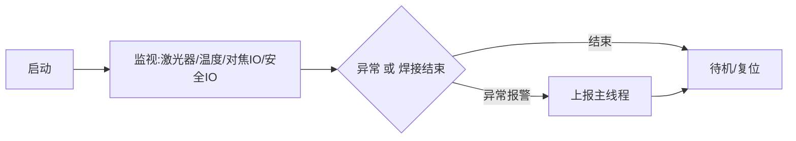

# LaserWeldHead 模块 — 激光焊接头

> **当前状态：已实现**。包含完整的接口定义、控制器实现、数据模型；设备态与流程态由 `MainDeviceControl/DeviceWorkflow/LaserWeldHeadWorkflow.cs` 承载（骨架）。
> 负责整枪激光头的本地信号监视与异常上报，是上电初始化级联的第 1 步（见 [[architecture/DeviceControlArchitecture]] §7.1）。
> 数据模型（`LaserHeadTemperatureData` / `AutoFocusPositionData` / `SafetyIOStatus`）随 `DataModels/` 目录删除后迁入本模块 `LaserWeldHeadData.cs`。

## 核心职责

- **激光器状态监视**：激光器握手、出光/功率状态
- **焊接头各镜片温度模块温度监视**：多路温度采集（准直镜/聚焦镜/保护镜/QBH 接口）与超阈报警
- **自动对焦电机控制模块 IO**：送丝电机 / 对焦电机位置 IO（力矩控制模式）
- **安全 IO 监视**：安全回路状态、急停/互锁/光栅/冷却水/气路

## 目录结构

```
LaserWeldHead/
├── API/
│   └── ILaserWeldHeadController.cs    ← 控制器接口
├── LaserWeldHeadController.cs         ← 控制器实现
└── LaserWeldHeadData.cs               ← 配置类 + 枚举 + 事件参数
```

> **2026-08-04 层级更新**：接口文件归入 `API/` 子目录。`LaserWeldHeadStateMachine.cs` 已移除（状态机逻辑已内嵌于 `LaserWeldHeadController.cs`，由控制器委派管理）。

## 核心文件

| 文件 | 职责 |
|------|------|
| `API/ILaserWeldHeadController.cs` | 激光焊接头控制器接口：`IsInitialized`/`IsLaserReady`/`ReadTemperature`/`SetAutoFocusPosition`/`EnableLaser` 等 + 3 事件 |
| LaserWeldHeadController.cs | 激光焊接头控制器实现：委派状态机管理状态，`Timer` 轮询温度，实现 `IDisposable` |
| LaserWeldHeadData.cs | 配置类 `LaserWeldHeadConfig` + 专用枚举 `LaserWeldHeadStateEnum` + 事件参数 `LaserWeldHeadEventArgs` + 事件类型 `LaserWeldHeadEventType` |

## 状态机

> **2026-08-04 更新**：原独立文件 `LaserWeldHeadStateMachine.cs` 已移除，状态机逻辑内嵌于 `LaserWeldHeadController.cs` 中委派管理。状态转换规则保持不变：

复用 `IsValidTransition` 校验范式（见 [[modules/DeviceControl]]）。

状态转换规则：

```
Uninitialized → Initializing → Standby ⇄ Working → Alarm → Resetting → Standby
```

| 当前状态 | 合法目标状态 |
|----------|-------------|
| Uninitialized | Initializing |
| Initializing | Standby, Alarm |
| Standby | Working, Alarm |
| Working | Standby, Alarm |
| Alarm | Resetting |
| Resetting | Standby, Alarm |

提供 `LaserWeldHeadStateExtensions.ToLaserWeldHeadState()` 扩展方法映射通用 `DeviceState` 到专用枚举。

## 子线程模型



- `LaserWeldHeadController.Initialize()`: 激光器握手 → 温度模块枚举 → IO 映射 → 启动温度轮询 → Standby（上电阶段调用）
- `StartWorking()`: Standby → Working，打开激光器（Go 指令时调用）
- `StopWorking()`: Working → Standby，关闭激光器但保持初始化（Done 指令时调用）
- 温度轮询 `Timer`: 每秒（`TemperaturePollIntervalMs=1000`）读取温度，超阈触发 `TemperatureAlarm` 事件并状态机 → Alarm
- `Shutdown()`: 停止轮询 → 关闭激光器 → 状态机 `Reset`（程序退出时调用）

> 四段式 API（Initialize/StartWorking/StopWorking/Shutdown）分离上电初始化与工作态，见 [[guides/WinForms-UI-Threading]]。

## 初始化参数（LaserWeldHeadConfig）

| 参数 | 默认值 | 说明 |
|------|--------|------|
| LaserComPort | COM1 | 激光器通讯端口 |
| LaserBaudRate | 115200 | 激光器波特率 |
| TemperaturePollIntervalMs | 1000 | 温度采集间隔（ms） |
| CollimatorTempThreshold | 60.0 | 准直镜温度阈值（°C） |
| FocusLensTempThreshold | 60.0 | 聚焦镜温度阈值（°C） |
| ProtectionLensTempThreshold | 80.0 | 保护镜温度阈值（°C） |
| QBHInterfaceTempThreshold | 70.0 | QBH 接口温度阈值（°C） |
| AutoFocusMaxTravel | 50.0 | 自动对焦电机最大行程（mm） |
| WireFeedTorqueLimit | 5.0 | 送丝电机力矩限制（N·m） |

## 对外协作

- → [[modules/Comm]]（异常/状态上报）
- 被 `DeviceControlWork.InitializeMachine()` 上电初始化级联调用 `LaserWeldHeadController.Instance.Initialize()`（第 1 步，见 [[architecture/DeviceControlArchitecture]] §7.1，ADR-049）
- 输出进入追溯数据（本模块 `LaserWeldHeadData.cs`：`LaserHeadTemperatureData` / `AutoFocusPositionData` / `SafetyIOStatus`）
- 状态由 `LaserWeldHeadWorkflow` 按三态模型输出：连接态 `SubDeviceState` + 焊接过程态 `SubDeviceWeldStatus`（`SetStep` 映射，[[modules/DeviceControl]]）

## 相关文档

- [[api/LaserWeldHeadController]] — 激光焊接头控制器 API
- [[architecture/DeviceControlArchitecture]] — 设备控制架构（唯一规范页）
- [[modules/DeviceControl]] — 设备控制模块
- [[decisions/ADR-041-MainDeviceControlArchitecture]] — 架构重构决策

## 待办

- 自动对焦「送丝电机 ↔ 对焦电机」协同标定流程（几组对应关系的标定 UI/数据）
- 真实 SDK 接口对接（当前为框架占位实现）

---

*来源：AdaWeldSystem/LaserWeldHead/ 模块源码*