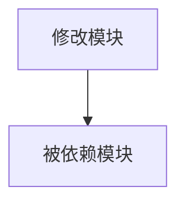

# VibeCoding 工作流 — LLMWiki 原生版


## 章节导航

- [目录](#目录)
- [流程总览](#流程总览)
- [核心规则（强制，不可绕过）](#核心规则强制不可绕过)
- [Phase 0: Query — 强制知识检索](#phase-0-query--强制知识检索)
- [Phase 0: Query 结果](#phase-0-query-结果)
- [Phase 1: Plan — 规划与约束确认](#phase-1-plan--规划与约束确认)
- [Phase 1: Plan 结果](#phase-1-plan-结果)
- [Phase 2: Code — 编码执行](#phase-2-code--编码执行)
- [Phase 3: Ingest — 强制知识沉淀](#phase-3-ingest--强制知识沉淀)
- [核心文件](#核心文件)
- [背景](#背景)
- [决策](#决策)
- [备选方案](#备选方案)
- [后果](#后果)
- [相关页面](#相关页面)
- [YYYY-MM-DD HH:mm:ss] coding | 一句话描述](#yyyy-mm-dd-hhmmss-coding--一句话描述)
- [Phase 3: Ingest 结果](#phase-3-ingest-结果)
- [Phase 4: Lint — 健康检查](#phase-4-lint--健康检查)
- [Phase 4: Lint 结果](#phase-4-lint-结果)
- [工作流责任矩阵](#工作流责任矩阵)
- [附录：与传统 6 步流程对照](#附录与传统-6-步流程对照)

> **核心理念**：LLMWiki 是唯一真相源。编码前从 Wiki Query 获取上下文，编码后向 Wiki Ingest 沉淀知识。Skill 规范退化为 `raw/` 层的参考资料，不再是流程指挥中心。
>
> **与传统 Skill-Centric 流程的区别**：
> | 维度 | Skill-Centric（旧） | LLMWiki-Native（新） |
> |------|-------------------|---------------------|
> | 真相源 | Skill 文件（分散在 Skills/ 文件夹） | LLMWiki `wiki/` 目录（结构化、交叉引用） |
> | 编码前 | 读 Skill 文件获取规范 | Query LLMWiki 获取模块架构 + 决策约束 + 历史教训 |
> | 编码后 | 可选更新 history.md | **强制 Ingest** 回 LLMWiki（modules/api/decisions/lessons） |
> | 约束来源 | Skill 中的文字描述 | Wiki `decisions/` 中的 ADR（架构决策记录） |
> | 避坑来源 | Skill 中的注释提醒 | Wiki `lessons/` 中的踩坑记录（含索引、可检索） |
> | 知识复利 | 无，每次从零读 Skill | 有，Query 时自动交叉引用，越用越丰富 |

---

## 目录

> **章节导航**（本页约 590 行，接近 600 行阈值，超长页请先按章节定位再读）：
>
> - [流程总览](#流程总览)
> - [核心规则（强制，不可绕过）](#核心规则强制不可绕过)
> - [Phase 0: Query — 强制知识检索](#phase-0-query--强制知识检索)
> - [Phase 1: Plan — 规划与约束确认](#phase-1-plan--规划与约束确认)
> - [Phase 2: Code — 编码执行（含 Step 2.6 正确性验证）](#phase-2-code--编码执行)
> - [Phase 3: Ingest — 强制知识沉淀](#phase-3-ingest--强制知识沉淀)
> - [Phase 4: Lint — 健康检查](#phase-4-lint--健康检查)
> - [工作流责任矩阵](#工作流责任矩阵)
> - [附录：与传统 6 步流程对照](#附录与传统-6-步流程对照)

1. [流程总览](#流程总览)
2. [核心规则（强制，不可绕过）](#核心规则强制不可绕过)
3. [Phase 0: Query — 强制知识检索](#phase-0-query--强制知识检索)
4. [Phase 1: Plan — 规划与约束确认](#phase-1-plan--规划与约束确认)
5. [Phase 2: Code — 编码执行](#phase-2-code--编码执行)
6. [Phase 3: Ingest — 强制知识沉淀](#phase-3-ingest--强制知识沉淀)
7. [Phase 4: Lint — 健康检查](#phase-4-lint--健康检查)
8. [工作流责任矩阵](#工作流责任矩阵)
9. [附录：与传统 6 步流程对照](#附录与传统-6-步流程对照)

---

## 流程总览

```
┌─────────────────────────────────────────────────────────────────────────────┐
│                        LLMWiki-Native VibeCoding                            │
├─────────────────────────────────────────────────────────────────────────────┤
│                                                                             │
│  ┌─────────────┐    ┌─────────────┐    ┌─────────────┐    ┌─────────────┐  │
│  │  Phase 0    │ → │  Phase 1    │ → │  Phase 2    │ → │  Phase 3    │  │
│  │   Query     │    │    Plan     │    │    Code     │    │   Ingest    │  │
│  │ 知识检索    │    │ 规划约束    │    │ 编码实现    │    │ 知识沉淀    │  │
│  └─────────────┘    └─────────────┘    └─────────────┘    └─────────────┘  │
│        ↑                                                    ↓               │
│        └────────────────  Phase 4: Lint ────────────────────┘               │
│                              健康检查                                       │
│                                                                             │
└─────────────────────────────────────────────────────────────────────────────┘
```

**入口唤醒词**：`/vibeCoding`（或用户明确表达"开发某功能"、"实现某需求"、"修复某 Bug"）

**前提条件**：默认知识库路径 `Vicoding管理平台/LLMWiki/` 必须存在。不存在时禁止开始编码，必须先初始化 LLMWiki。

---

## 核心规则（强制，不可绕过）

> 流程执行规则正文在 `wiki/rules/`（`KR-001~KR-013`，编号唯一权威 = [[rules/Rules-Index]]）；本页只保留 Phase 0~4 的流程定义。
> **两者冲突时以 Skill 文件为准**——Skill 通常领先本页；Phase 3 Ingest 应把 Skill 的新规则回灌到这里。

1. **禁止跳过 Query**：编码前必须执行 Phase 0 从 LLMWiki 检索上下文。禁止仅凭记忆或 Skill 文件编码。
2. **Skill 降级为参考**：`raw/skills/` 下的 Skill 文件是**参考资料**，不是**指挥源**。流程权威属于 LLMWiki。
3. **ADR 是硬约束**：`wiki/decisions/` 中的架构决策记录是编码前必须遵守的约束，编码后须复查是否违规。
4. **Lessons 是门禁**：`wiki/lessons/` 中的踩坑记录是编码前的强制检查项（注意：多个历史 lesson 页已并入 `guides/`，见 Skill 文件的 Lessons 对照表）。
5. **Ingest 强制**：Phase 3 不可跳过，没有 Ingest 的编码视为未完成。
6. **新决策必须记录**：编码若涉及新架构选择，必须在 `wiki/decisions/` 建立 ADR。
7. **时间戳规则**：Phase 3 追加 `logs/log.md` 的时间戳必须用 Bash `date "+%Y-%m-%d %H:%M:%S"` 或 PowerShell `Get-Date -Format "yyyy-MM-dd HH:mm:ss"` 获取，**禁止猜测**；无法执行时标注 `[No.]`。
8. **新建 .cs 必须注册 .csproj**：见 [[guides/Namespace-Compilation]] §1.1。文件**移动/改名**时必须就地更新已有条目的路径，并以**逐条 `os.path.exists`** 核验，不得仅凭 grep 命中判断（见 Step 2.4）。
9. **Step 级展示（不可绕过）**：每个 Phase 内的每个 Step 都必须向用户显式展示编号、名称与产出，禁止折叠为 Phase 级摘要。
10. **Grep 是默认的代码定位方式**：代码图谱工具已于 2026-08-19 废弃退役。用 Grep 定位符号（Step 0.7）、按行区间精确读取、多级 Grep 追溯影响（Step 2.5）。
11. **0 消费者 ≠ 死成员（2026-09-03 教训）**：审计报某符号零消费者时，**不要直接建议删除**，先确认它是否是横切关注点载体（日志标签、序列化键、权限标记、DI/注册钩子），或 `raw/` 源档是否将其列为契约成员。本项目约定：可观测性 API（`StepStatusText` / `WorkElapsedMs`）与安全钩子（`CheckDeviceIOSafe`）**永不因未使用而删除**。应建议"收紧类型 / 降低可见性"，由用户裁决。
12. **本沙盒无 C# 编译器——如实声明，不得伪造（2026-09-03）**：`dotnet` / `msbuild` / C# 编译器被安全策略拦截（Known Windows LOLBin），本机也没有 Visual Studio。不要浪费轮次去找。改用 Python 静态一致性校验（Step 2.6），并在最终交付中**显式声明"真编译待 Visual Studio"**为遗留项。**禁止把静态检查描述成"编译通过"**。
13. **Wiki 页以 LF 入库——批量改写绝不能改成 CRLF（2026-09-03 教训，2026-09-11 扩写）**：`LLMWiki/wiki/` 下所有页面在仓库中是 **LF**（`core.autocrlf=true` 只影响 checkout）。一次 Python 批量改写曾把 17 个文件悄悄转成 CRLF，diff 从约 90 行膨胀成整文件重写。规则：(a) 脚本批量编辑必须**按字节读写**并原样回写检测到的换行符，禁止 `open(p).read()` + `open(p,"w").write()`；(b) 收尾前用 `git diff --numstat` 确认没有文件的改动行数等于其总行数；(c) 若新旧内容的行尾相同就停下——文件本来就是对的。**⚠️ 整文件 diff 未必是你造成的（2026-09-11）**：某个文件的 blob 可能以 CRLF 入库而兄弟文件是 LF，于是即便只手工改了 2 行，`git diff --numstat` 也报成整文件重写。用 `git -c core.autocrlf=false diff --numstat` 复核——若计数骤降到个位数，那是**仓库卫生的历史遗留**而非本轮污染；如实上报，不要"顺手修"。
14. **行区间替换既不得吃掉换行符、也不得把它翻倍（2026-09-11 扩写）**：`lines[start:end] = new` 再 join 时，joiner 必须由文件探测得出（`raw.endswith("\r\n")` → `"\r\n"`，否则 `"\n"`）。默认成 `""` 曾把 `people/UISpecialist.md` 压成零换行的单个 3 KB 行。**⚠️ joiner 还必须与 splitter 匹配**：`text.split("\n")` 会在每行尾留下 `\r`，再用 `"\r\n"` 拼回就得到 `\r\r\n`（CRCRLF），把 2 行改动放大成整文件重写（2026-09-11 命中 35 个 ADR 页）。**首选方案：按字节操作、永不重建行终止符——`parts = raw.split(b"\n")`，再 `b"\n".join(parts)`，`\r` 留在片段内。** 断言盲区：`b"\r\r\n".count(b"\r\n") == 1`，所以"`count(b"\r\n")` 未变"**并不**证明文件干净——须断言 `\r\n` / `\r\r\n` / `\n` 三者计数**全部等于原值**（或只有目标行不同）。**比对原值而非 0**：`ADR-016`/`ADR-024` 本就合法持有原生 `\r\r\n`。一旦命中，**从编辑前的 `tar.gz` 整目录还原重做**，不要修补损坏文件。见 [[lessons/WikiDriftCorrectionPitfalls]] 坑七。
15. **退役旧规范——三档分诊，禁一刀切删除（2026-09-03）**：新架构页取代旧 wiki 内容时，**不要**批量删除或批量覆盖。先逐页分类，再施加对应处置：
    - **第 1 档——结论被完全取代 → 整页 `deprecated` + ⛔ 横幅**：frontmatter 标 `status: deprecated`，前置 ⛔ 横幅（含"旧机制 → 处置 → 现行做法"表），正文留作历史。（已施于：模拟模式 / 步骤驱动工作流 / 自动-手动双流程等已删决策页，以及 `standards/StepDrivenWorkflow.md`。）
    - **第 2 档——仅术语/符号名过时 → 加沿革横幅、保留结论**：推理仍成立，只是载体改名/移除。（已施于 ADR-028 / ADR-016 / ADR-007 / ADR-001 / `guides/Namespace-Compilation`。）
    - **第 3 档——经验类内容（`lessons/` 踩坑）→ 逐条判 ✅/⚠️/⛔**：坑可以比产生它的机制活得更久。保留不依赖该机制的观点（如"推进步后立即退出""命令值必须全局唯一""禁止在单步内阻塞"），只把机制相关部分标 ⛔。
    - 随后全库扫描指向退役页的 `[[链接]]`，逐条改为**删除线旧链 → 指向新权威页**，避免读者跟进一条死规范。
16. **任何第二次批量替换前先查自引用（2026-09-03）**：连续两次全局替换 `[[old]]` 会产生嵌套删除线垃圾——`~~~~[[old]]~~ → [[new]]~~`——因为替换文本本身含被替换文本。批量替换前确认新文本不含旧文本；若已损坏，用精确子串**成对**修复并停止重跑全局替换。
17. **`grep -n "^> ..."` 在 markdown 引用块上会静默返回 0**：BRE 中 `\>` 是**词尾锚点**，不是字面 `>`。校验引用块/横幅行一律用 `grep -nF`（固定字符串）。

---

## Phase 0: Query — 强制知识检索

**目标**：在写任何代码之前，先从 LLMWiki 检索所有相关上下文。禁止"凭记忆"或"凭 Skill 文件"直接编码。

### 执行步骤

#### Step 0.0: 查代码地图（CodeMap）—— 先于一切检索

**操作**：读取 `wiki/architecture/CodeMap.md`（**总览，一页可读**）。需要逐类定位时再查该页「模块 → 符号分片」指向的 `CodeMap-Symbols-<模块>.md`（机器生成）。

**目的**：**建立代码记忆，避免全盘重扫**。代码地图 = **机器生成的分片** + **人工判断层**（[[decisions/ADR-108-codemap-machine-generation]]）：
- **总览 `CodeMap.md`**：模块骨架（模块 → 类型数 → 方法数 → 功能域标注）+ 命名空间一览（功能 / 模块归属 / 约束 ADR）+ 定位陷阱 + 分片路由表。读这一页就能定位到模块。
- **符号分片 `CodeMap-Symbols-<模块>.md`**：逐类 → `文件:行` → 成员签名（方法 / 构造 / 属性 / 字段）。只在需要「某类型/成员在哪、什么签名」时才查。
- **关系分片 `CodeMap-Relations*.md`**：被引用类型（高置信）/ 方法（低置信）→ 调用方文件（影响面候选集）。Step 2.5 起步用。
- ⛔ **分片禁手工编辑**（页内已标注）—— 改动会被下次生成覆盖；需要改判断时改 `tools/data/namespace_meta.json` 或总览页的人工层。
- ⛔ 旧手写详表 `CodeMap-Files.md` 已退役（保留供历史追溯），不得作为现行定位依据。

**⛔ Grep 时机硬约束（2026-11-17 业主反馈后加）**：
- Phase 0 **先读总览建立记忆**，命中功能域后直接去 Step 0.7 读对应代码块；
- **禁止一上来对全项目 `AdaWeldSystem/` 做宽泛关键词扫描**（如按中文语义词扫全库）——这是 CodeMap 失效的主要问题；
- Step 0.7 的 Grep 必须带**具体符号名**且 path 收窄到 CodeMap 命中的 1~3 文件/目录；全库 Grep 仅在 CodeMap 未命中时作为回落，并在报告写明理由；
- **多层影响面 Grep（Step 2.5）只在 Phase 2 编码阶段做**。
- 需要依附关系候选时查**关系分片**（比旧 `tools/codemap_deps.py` 更全：含真实调用点与行号）。

**输出**：
```
【代码定位候选集】
- 命名空间：AdaWeldSystem.MotionControl（运控 · Manager 与从站设备，6 文件/1774 行）
- 目标文件：MotionControl/WeldHeadSlaveDevice.cs（672 行）
- 该文件做什么：WSX 焊接头从站对象字典读写（0x6000 温度 / 0x6010 振镜回读 / 0x7010 振镜写 / 0x7020 阈值）
- 现状标记：⚠️ 0x7000 电机对象待启用（LA 归属变更用）
- 对应 wiki：[[modules/MotionControl]] · [[api/MontionManager]]
- 高耦合邻居（同命名空间）：MontionManager.cs / AxisRegistry.cs / IORegistry.cs / CylinderRegistry.cs
```

**判据**：
- 命中即**直接进入 Step 0.7 精确读行**，⛔ 不做全盘扫描；
- 未命中才回退到 Step 0.1~0.5 的常规检索；
- **「未实现」要区分三态**：完全无代码 / 有代码但无消费者 / 有占位返回。三者处置不同（见 CodeMap 第三节「易踩的定位陷阱」）。

**与后续步骤的关系**：本步**不替代** Step 0.7（Grep 精确读行），只负责**把搜索范围从 166 个文件缩到 1~3 个**。行号仍以 Step 0.7 的 Grep 结果为准（CodeMap 的行号是快照，代码会变）。

#### Step 0.1: 读取索引

**操作**：读取 `wiki/index/index.md`

**目的**：快速定位与本次需求相关的 Wiki 页面。

**输出**：
```
【索引检索结果】
- 相关模块页面：`modules/XXX`, `modules/YYY`
- 相关 API 页面：`api/ZZZ`
- 相关决策记录：`decisions/ADR-NNN-XXX`
- 相关教训：`lessons/XXX`
- 相关专员：`people/XXXSpecialist`
```

#### Step 0.2: 读取决策约束（ADR）

**操作**：读取 `wiki/decisions/` 下所有与涉及模块相关的 ADR。

**目的**：获取**硬约束**——这些决策是过去经过深思熟虑的架构选择，当前编码必须遵守，除非明确推翻。

**输出**：
```
【决策约束清单】（必须遵守，否则需显式推翻并记录新 ADR）
- [ ] ADR-002（2026-09-17 删除，内容并入整合页；映射见 [[decisions/ADR-Index]]） → UI 资源释放必须使用 DisposeComponents() 模式
- [ ] [[decisions/ADR-001-CS73-Constraint]] → 语法限制 C# 7.3，禁用 C# 8.0+ 特性
- [ ] ...
```

**强制检查项**：编码完成后，Phase 3 Ingest 时必须回顾此清单，确认无违反。

#### Step 0.3: 读取历史教训（Lessons）

**操作**：读取 `wiki/lessons/` 下所有与涉及模块相关的教训。

**目的**：获取**门禁检查项**——这些是前人踩过的坑，编码前必须确认本次不会重蹈覆辙。

**输出**：
```
【历史教训门禁】（编码前必须确认避开）
- [ ] [[guides/WinForms-Designer]] → 不修改 Designer.cs 的 Dispose 方法
- [ ] [[guides/Namespace-Compilation]] → 新建 .cs 文件必须同步注册到 .csproj
- [ ] ...
```

**留痕（2026-10-14 治理）**：本 Step 命中的 lesson 页名清单必须写进 Phase 3 的 log 条目（至少页名），使「编码前确实翻阅了教训」可审计。检索入口固定两层：index.md「⚡ 场景速查路由」→ §五 lessons 门禁表；路由未命中时按模块名/坑关键词 Grep `wiki/lessons/`。

#### Step 0.4: 读取模块架构

**操作**：读取 `wiki/modules/` 下涉及的模块页面。

**目的**：理解模块边界、核心文件、协作关系、已知问题。

**输出**：
```
【模块架构上下文】
- 模块 [[modules/Comm]]：
  - 核心文件：SystemComm.cs, CommunicationManager.cs, Ethernet/TCPIPComm.cs, ...
  - 协作关系：← [[modules/DeviceControl]], → [[modules/WeldParamControl]]
  - 已知问题：与 WeldParamControl 存在循环依赖
```

#### Step 0.5: 读取 API 上下文

**操作**：读取 `wiki/api/` 下涉及的 API 页面。

**目的**：理解现有公共接口，避免重复造轮子或破坏已有契约。

#### Step 0.6: 读取历史记录（可选但推荐）

**操作**：读取 `raw/history/history.md`，检索与本次需求相关的历史修改。

**目的**：防止新增功能与历史功能矛盾、删除旧功能。

#### Step 0.7: Grep 符号定位与按行号精确读取（默认方式）

> **代码图谱工具已于 2026-08-19 废弃**：code-review-graph 因执行失败频繁、耗时久、误判多被弃用，回归**Grep 定位 + 按行号精确读取 + 人工多级调用追溯**的默认方式。

**操作**：用 Grep 定位涉及符号在代码中的文件与行号，并据此精确读取代码块（禁止无定位直接整文件通读）：
1. **定位符号落点**：`Grep(pattern="<关键符号>", path="AdaWeldSystem/", output_mode="content", -n=true)` — 输出含 `{file_path}:{line_number}`，直接给出类/方法/函数所在行与所有引用
2. **精确读取代码块**：按定位的行号用 `Read` 工具读取对应行区间（`offset=line_start`，`limit=行数`）；仅当目标为整文件结构或行区间过大时，才退化为整文件读取
3. **跨文件调用链**：对每个调用者符号递归 Grep 搜索（N 层深度），理解调用关系（调用者/被调用者）

**目的**：补充 LLMWiki 未覆盖的函数调用链、类继承树、导入依赖等代码级结构关系；显著缩小代码读取范围，避免整文件通读造成的 token 浪费与上下文污染。

**输出**：
```
【代码级关系报告】（用于指导代码读取与影响追溯）
- {文件}::{符号} → 定义于第 {n} 行
- 调用者：{文件}::{符号}（第 {n} 行调用）
- 调用链：A → B → C
```

**约束**：代码定位结果为即时上下文，**不写入 Wiki 页面**。

### Phase 0 输出模板

```markdown
## Phase 0: Query 结果

### 涉及模块
- [[modules/XXX]] —— 职责简述

### 决策约束（必须遵守）
- [[decisions/ADR-XXX]] —— 约束简述

### 历史教训（必须避开）
- [[lessons/XXX]] —— 教训简述

### 依赖关系


### 风险标记
- [ ] 无风险 / [x] 有风险：描述...
```

---

## Phase 1: Plan — 规划与约束确认

**目标**：基于 Phase 0 检索到的知识，制定编码计划，识别需要新增的知识沉淀点。

### 执行步骤

#### Step 1.1: 需求解析

用一句话概括用户核心需求，确认涉及模块和边界。

#### Step 1.2: 变更范围规划

**先查代码地图的「模块归属」列**（`wiki/architecture/CodeMap.md`）：确认目标文件属于哪个模块 → 据此判断变更是否越界，避免改到无关模块。

**对照 `wiki/modules/` 中的模块边界**，明确：
- 哪些模块需要修改
- 是否需要新增模块
- 跨模块调用是否需要调整

**变更范围控制原则**（与旧流程一致）：
| 变更类型 | 允许修改范围 | 禁止修改范围 |
|----------|-------------|-------------|
| 工业相机功能 | SmartRayCam/ 及其直接调用方 | 其他模块 |
| 图像算法功能 | EmguALG/ 及其直接调用方 | 其他模块 |
| 3D 数据处理 | PointCloudData/ 及其直接调用方 | 其他模块 |
| 通用技术功能 | FileOperate/, Comm/ | 其他模块 |
| 焊接工艺功能 | InteliWeld/, SQLiteDBControl/Helpers/AutoParamHelper.cs | 其他模块 |
| 数据库功能 | SQLiteDBControl/ 及其直接调用方 | 其他模块 |
| 运动控制功能 | MotionControl/ 及其直接调用方 | 其他模块 |
| UI 界面功能 | UIDesign/ 及其直接调用的后端接口 | 后端模块内部实现 |

#### Step 1.3: 识别新决策（ADR 预判）

**关键问题**：本次编码是否涉及新的架构选择？

如果是，在 Phase 3 中必须创建新的 `wiki/decisions/ADR-XXX-xxx.md`。

判断标准：
- 引入了新的设计模式
- 改变了模块间的协作方式
- 选择了特定的技术方案而放弃了其他方案
- 定义了新的命名规范或接口约定

#### Step 1.4: 识别新知识沉淀点

预判编码完成后需要更新或创建的 Wiki 页面：

| 沉淀类型 | 目标路径 | 触发条件 |
|----------|---------|---------|
| 模块文档更新 | `wiki/modules/{Module}.md` | 修改了模块核心文件或接口 |
| API 文档更新 | `wiki/api/{API}.md` | 新增/修改了公共类、方法、事件 |
| 新决策记录 | `wiki/decisions/ADR-XXX-{Title}.md` | 涉及新的架构选择 |
| 新教训记录 | `wiki/lessons/{Title}.md` | 踩了新坑或发现新约束 |
| 项目概览更新 | `wiki/project/overview.md` | 新增模块或重大变更 |
| 架构图更新 | `wiki/project/architecture.md` | 模块依赖关系变化 |

#### Step 1.5: Skill 参考（降级为辅助）

**操作**：如需了解专员详细职责，读取 `raw/skills/` 下的对应 Skill 文件。

**注意**：Skill 文件是**参考资料**，不是**指令源**。所有编码决策必须以 LLMWiki 检索结果为准。如果 Skill 文件与 LLMWiki 内容冲突，以 LLMWiki 为准，并标注矛盾。

### Phase 1 输出模板

```markdown
## Phase 1: Plan 结果

### 需求总结
【一句话概括】

### 涉及模块
- [[modules/XXX]]（修改）
- [[modules/YYY]]（新增）

### 变更范围
- 修改文件：...
- 新增文件：...

### 知识沉淀计划
- [ ] 更新 `modules/XXX`
- [ ] 新增 `api/YYY`
- [ ] 新增 `decisions/ADR-NNN-ZZZ`

### 风险与依赖
- 跨模块风险：...
- 设计意图冲突：...
```

---

## Phase 2: Code — 编码执行

**目标**：执行代码实现，过程中实时对照 Phase 0 检索到的约束。

### 执行步骤

#### Step 2.1: 项目备份（**只出 backup 包** · 统一压缩方式 + 按天去重）

> **统一备份要求**：本项目**唯一**的备份方式是压缩包（tar.gz），路径规则为 `AdaWeldSystem_backup_YYYYMMDD_HHMMSS.tar.gz`（排除 3rdDepend / obj / bin / .vs）。禁止改用 backup 文件夹、`.bak` 文件或其他非压缩方式另存备份。

> **备份频率（2026-09-18 调整）**：**每天最多生成一份备份**。备份前先检查工作区根目录是否已存在当天（`YYYYMMDD`）的备份 `AdaWeldSystem_backup_<今日>_*.tar.gz`；若已存在则**跳过本次备份**，不重复生成，避免同一天多次编码产生大量冗余压缩包。

> **✅ 唯一正确方式**：运行 `python Vicoding管理平台/LLMWiki/tools/backup_adaweld.py`（**无参数 = 只出 backup**）。脚本按 `__file__` 推导路径，自动完成"当天已存在则跳过 / 不存在则排除 3rdDepend/obj/bin/.vs 打包"，arcname 固定为 `AdaWeldSystem`。路径由脚本自身推导，不依赖当前工作目录，可在任意 CWD 下安全运行。

> **📦 三种产物（代码两包内容范围一致，均排除 3rdDepend/obj/bin/.vs；知识库包排除 __pycache__），触发时机各不相同（2026-10-10 拆分；2026-10-14 增知识库包）**：
>
> | 产物 | 命名 | 触发 Step | 频率 | 用途 |
> |---|---|---|---|---|
> | **backup 包** | `AdaWeldSystem_backup_YYYYMMDD_HHMMSS.tar.gz` | **Step 2.1**（改码**前**） | 每天至多一份，按天去重（当日已存在则跳过） | 日常回滚点 |
> | **output 包** | `AdaWeldSystem_output_YYYYMMDD_HHMMSS.tar.gz` | **Step 3.7**（改码**定稿后**） | 每次必生成，自动清理旧包，目录只留「最新一份」 | **现场验证** |
> | **LLMWiki 知识库包** | `LLMWiki_backup_YYYYMMDD_HHMMSS.tar.gz` | **Phase 3 收尾**（知识库定稿后，治理/编码轮皆可） | 每天至多一份，按天去重（当日已存在则跳过） | 知识库快照（整个 `LLMWiki/`，排除 `__pycache__`） |
>
> 命名规则即把 backup 包的 `backup` 前缀换成 `output`，其余（时间戳、排除项、arcname）完全相同。
>
> ⛔ **output 包不得在 Step 2.1 出**：Step 2.1 跑在改码**之前**，此刻打出的 output 装的是本轮改动**之前**的代码，现场拿它验证会验旧码，且比没有包更危险（看上去验证过了）。output 的语义是"定稿后的交付物"，见 [[project/vibecoding-workflow]] Step 3.7。
>
> **脚本模式参数**：`--backup`（默认，无参数同效）/ `--output`（只出 output）/ `--llmwiki`（只出 LLMWiki 知识库包）/ `--all`（backup+output，仅作旧行为兼容，**流程内禁用**）/ `--help`。

> **🚫 禁止手搓 tar，禁用旧"等效 Bash"片段**：旧文档里的 `(cd AdaWeldSystem && tar -czf "../...tar.gz" --exclude=bin --exclude=obj .)` 有三个致命缺陷，正是此前错误备份（把 3rdDepend/.vs 打进去、arcname 变成相对 `./`）的成因：①排除项不全（漏 3rdDepend/.vs）；②arcname 错误（相对 `./` 为根，还原撒到当前目录）；③本机 Bash `tar`/`ls` 已损坏跑不通。任何情况下都不要手搓压缩命令，以 `backup_adaweld.py` 为唯一真理来源。

#### Step 2.2: 代码实现

**阅读代码时，沿用 Phase 0 Step 0.7 的 Grep 定位与按行号精确读取**：编码前用 `Grep` 定位待改符号的文件与行号，再以 `Read(offset/limit)` 精确读取，避免直接整文件通读。

**编码时必须持续对照以下约束**：

1. **ADR 约束**：`wiki/decisions/` 中的决策是硬约束
   - 例如：ADR-001 要求使用 DisposeComponents() 模式，编码时不得直接修改 Designer.cs Dispose
   
2. **Lessons 门禁**：`wiki/lessons/` 中的教训是避坑指南
   - 例如：CodeProjectRegistration 要求新建文件必须注册到 .csproj
   
3. **Modules 边界**：`wiki/modules/` 中的模块边界不得随意跨越
   - 如需跨模块修改，必须显式记录并在 Phase 3 中更新相关模块文档

4. **API 契约**：`wiki/api/` 中的接口定义不得随意破坏
   - 如需变更公共接口，必须保持向后兼容或提供迁移路径

#### Step 2.3: 代码自审

实现完成后，对照 Phase 0 的"决策约束清单"和"历史教训门禁"逐项勾选确认。

#### Step 2.4: .csproj 注册（若新建 **或移动/改名** 文件）

若新建了 .cs 文件，**必须**在 `AdaWeldSystem/AdaWeldSystem.csproj` 中添加 `<Compile Include="..." />` 条目。

**文件移动/改名 → 原条目路径即失效**，必须就地更新该条目的路径字符串。不要因为"文件还在"就认为条目没问题——构建用的是路径字符串。

**核验方式 = 逐条存在性判断，而非 grep 命中**（2026-09-14 漏检实证）：

```python
import re, os
txt = open('AdaWeldSystem/AdaWeldSystem.csproj', encoding='utf-8-sig').read()
incs = re.findall(r'<Compile Include="([^"]+)"', txt)
miss = [i for i in incs if not os.path.exists(i.replace('\\', '/'))]
print('missing:', len(miss), miss)   # 必须为 0
```

仅在 csproj 里 `grep` 到**文件名**不能证明任何事——2026-09-14 `SeamGuideSample.cs` 移入 `Algorithms/` 后 csproj 仍留根目录旧路径，grep 判据通过但**编译必失败**。同时应反向核对（变更目录下磁盘上每个 `.cs` 都已登记）。

#### Step 2.5: 变更影响范围验证（Grep 多级追溯，默认方式）

> **代码图谱已退役**：修改代码后使用**人工多级 Grep 追溯**验证变更影响范围。

**操作**：
1. `Grep(pattern="<变更的公共符号>", path="AdaWeldSystem/", output_mode="content", -n=true)` — 找出所有引用点
2. 对每个调用者递归追溯（A→B→C：先 grep B，再 grep B 的每个调用者）
3. 交叉检查：追溯发现的每个调用者都必须审查兼容性

**目的**：捕获间接调用链断裂（A→B→C，修改 B 会破坏 A——grep B 后再 grep B 的调用者即可找到 A）。

**⚠️ 收尾前必须换 pattern 再跑一次**：Step 0.7 的第一次 Grep 正是被静默截断的那一次（2 处 vs 实际 6 处）。本步是安全网，不能因为 Phase 0 已经 grep 过该符号就跳过。

#### Step 2.6: 正确性验证（强制 —— 替代编译）

> **为什么有这一步**：本沙盒没有 C# 编译器（[[rules/KR-010-No-Compiler-Honesty]]）。不能跳过验证，也不能假装在跑构建。
> **⚠️ 本步于 2026-09-03 从 Skill 文件回灌**：SKILL.md 早已包含此步而本页长期缺失，导致按本页执行时会在无编译器环境下漏掉验证环节。

**操作**：写一个用完即删的 Python 校验脚本，**先剥离 XML 文档注释**，再断言本次变更本应建立的不变量。2026-09-03 上真实抓到过 BUG 的检查项：

- **成员遮蔽**：派生类的 `Tag` / `_tag` / `StepXxx` 重复声明了基类成员（CS0108）
- **改名残留**：改名后仍残留的旧符号（如统一到基类 `Tag` 后残留 `_tag`）
- **回流**：被禁用的调用点重新出现（如移除 `DeviceLog` 中间层后又新建类似封装）
- **无用 using**：变更遗留的、现已无用的 `using` 指令
- **csproj 路径完整性**：每条 `<Compile Include>` 路径都能在磁盘上解析到真实文件（见 Step 2.4）——**尤其是文件移动/改名之后**，缺失数必须为 0

**两轮纪律**：校验脚本的第一版必然产生误报（注释命中、仅命名空间引用）。应**迭代到精确版本**，而不是靠肉眼把噪声解释掉。

**清理**：收尾前删除所有 `_tmp_*.py` 脚本。

**输出**：静态检查结果表 + 明确声明"真编译待 Visual Studio"。

### Phase 2 输出

- 新增/修改的代码文件
- 自审清单（确认无违反 ADR 和 Lessons）
- 静态校验结果表（Step 2.6）+ 真编译遗留声明
- **backup 包**（Step 2.1 生成的改码前回滚点；当日已存在则跳过，只报「已跳过」）

---

## Phase 3: Ingest — 强制知识沉淀

**目标**：将代码变更转化为 LLMWiki 知识，实现"编码即沉淀"。

**本阶段是强制性的，不是可选的。** 没有 Ingest 的编码等于没有完成。

### 执行步骤

#### Step 3.1: 更新模块文档

**操作**：更新 `wiki/modules/` 下涉及模块的页面。

**更新内容**：
- 核心文件清单（新增/删除/重命名）
- 模块职责调整
- 协作关系变化（更新 Mermaid 图或表格）
- 已知问题更新

**示例**：
```markdown
## 核心文件
| 文件 | 职责 |
|------|------|
| SystemComm.cs | 全局通讯/状态/事件定义中心 |
| KUKARobotManager.cs | KUKA 机器人统一管理层（新增） |
```

#### Step 3.2: 更新 API 文档

**操作**：更新 `wiki/api/` 下涉及的 API 页面，或创建新页面。

**更新内容**：
- 新增公共类/方法/事件
- 接口签名变化
- 使用规范更新

#### Step 3.3: 创建或更新决策记录（ADR）

**操作**：如果 Phase 1.3 预判有新决策，创建 `wiki/decisions/ADR-XXX-{Title}.md`。

**ADR 模板**：
```markdown
---
title: ADR-XXX 标题
date: YYYY-MM-DD
tags: [决策, 标签1, 标签2]
status: proposed | accepted | deprecated
---

# ADR-XXX：标题

## 背景

为什么需要做此决策？

## 决策

选择了什么方案？

## 备选方案

考虑过哪些其他方案？为什么放弃？

## 后果

### 正面
- ...

### 负面
- ...

## 相关页面

- [[modules/XXX]]
- [[lessons/YYY]]
```

#### Step 3.4: 创建或更新教训记录（Lessons）

**操作**：如果编码过程中踩了新坑，或发现了新约束，创建/更新 `wiki/lessons/{Title}.md`。

**三处同步（强制，2026-10-14 治理；wiki_audit 第 11 项为闸门，不一致非零退出）**——lessons 不设 LSN 编号（页名即稳定标识，按主题组织、不按 ADR 序号），但登记义务对齐 ADR：

1. 页面落入 `wiki/lessons/`；
2. `wiki/index/index.md` §五 门禁表加**表行**（页面 / 摘要 / 标签）；
3. 分类摘要**计数**同步——`| [五、历史教训 lessons](...) | N 条坑 |` 的 N 须同时等于目录页数与 §五表行数。

三者任一漏改即为计数漂移（案例：2026-10-14 发现摘要「14 条坑」vs 实际 18 页，此前无任何机制可抓）。

#### Step 3.5: 更新索引

**操作**：更新 `wiki/index/index.md`。

- 新增页面添加到对应分类表格
- 更新已有页面的摘要

#### Step 3.6: 更新代码地图（CodeMap）

**操作**：**重新生成机器层 + 更新人工层**（[[decisions/ADR-108-codemap-machine-generation]]）：

1. `python tools/codemap_build.py` —— 重新生成总览与全部分片（幂等；仅变化文件被重写；模块消失时旧分片自动清理）。
2. `python tools/codemap_build.py --check` —— 必须退出 0（否则地图与源码不同步）。
3. 人工层更新（**只改这些**）：总览页的「功能域标注」与「定位陷阱」；`tools/data/namespace_meta.json` 的命名空间功能 / 模块归属 / 约束 ADR。

**为什么是强制步骤**：代码地图是**唯一按代码文件索引的功能视图**。不更新它，下一次 Phase 0 就会因为「找不到/找错功能落点」而全盘重扫——这正是 2026-10-08 建立本表的原因（当天曾三次误判功能位置）。

**何时需要更新**（本轮命中任一即须更新）：

| 触发场景 | 维护动作 |
|---|---|
| 新增 / 删除 / 移动 `.cs` | **跑生成器**（分片自动更新）；**移动或改名须同步 `drift_scan_precise.py` 的 `RENAMED`（值为纯路径，不带括注）** |
| 某文件职责变化（新增功能 / 占位转实现 / 消费者增减） | 跑生成器 + 刷新总览页「功能域标注」 |
| 新增评审需求 | 总览页「需求 → 代码落点速查」增行 |
| ADR 裁定变更硬件归属 | 更新 `tools/data/namespace_meta.json` 的「约束 ADR」 |
| 踩到新的定位误判 | 总览页「定位陷阱」增行 |

**边界**：代码地图只做**定位索引 + 一句话功能 + 现状标记**，⛔ 不写成功能说明书（那属于 `modules/`）。⛔ 机器分片**禁手工编辑**。

#### Step 3.7: 生成现场验证包（output，强制）

**⛔ 为什么 output 落在 Phase 3 而不在 Step 2.1（2026-10-10 用户纠正）**：Step 2.1 跑在改码**之前**，那一刻打出的包装的是本轮改动**之前**的代码。现场拿它做验证 ⇒ 验旧码，结论无效，**且比没有包更危险**（看上去验证过了）。output 的语义是「本轮定稿后的交付物」，只有走完 Phase 2（实现 → 自审 → 影响面 → 静态校验）之后才成立。

**操作**：运行 `python Vicoding管理平台/LLMWiki/tools/backup_adaweld.py --output`

- **每次必生成，不按天去重** —— 当日已存在的 backup 与本 Step 无关；output 只反映「本轮定稿后的最新代码」
- 生成后**自动清理旧 output 包**，工作区根始终只留「最新一份」`AdaWeldSystem_output_*.tar.gz`。⛔ 不要为省事跳过，也不要误删唯一的那份 output
- 排除项与 arcname 同 backup 包（3rdDepend / obj / bin / .vs，arcname=`AdaWeldSystem`），现场还原后用 VS 重新编译即可部署

**⚠️ 交付时必须附配置同步清单**（见 [[lessons/SimulationAutoBranching]]）：出包排除 `bin/`，故 `DeltaMotionConfig.xml` / `LineLaserConfig.xml` **不随包到现场**；凡「代码默认值 + 可被 XML 覆盖」的配置（轴名 `SeamTrackAxisName`、轴地址 `NODE_ID` 等）须逐项列出人工核对值，否则现场仍按旧配置运行。

**输出**：本轮 output 包的**文件名 + 大小**（写入 Step 3.8 的日志条目，供现场取包核对）。

#### Step 3.8: 追加日志

**操作**：追加 `logs/log.md`。

> 历史教训：[[guides/Project-Tools]] —— 曾因追加位置不统一导致时间顺序混乱，已沉淀为硬性规范。

**追加位置（严格执行）**：
- **必须**将新日志条目添加在文件**最前面**（顶部），紧接在 `---` 分隔符之后
- **禁止**追加到文件末尾
- 整个 log.md 必须保持**严格的时间倒序**——最新的条目在最前面

> ⚠️ **顶部插入的两种翻车形态（2026-09-14，跨会话已发生三次）**：① **吃掉标题**——`old_string` 锚定上一条的 `## [时间戳]` 标题行、而 `new_string` 未把它带回 → 标题被吞；② **割裂上一条**——`old_string` 锚定顶部条目的**正文首行**（如 `**触发**：…`），新条目会被插到「上一条标题」与「上一条正文」之间，标题沦为孤儿（此形态曾被视为"正确锚点"，实为错误）。**正确手法（一次编辑）**：`old_string` = 顶部条目的 `## [时间戳]` **标题行**；`new_string` = 新条目全文（标题 + 正文）+ 恰好一个空行 + **原样复制的同一条标题行**。**插入后强制读回**：`grep -n "^## \[" logs/log.md | head -3` —— 新条目须为第 1 条，上一条完整标题须紧随其后且其正文紧接该标题；同时确认条目间空行数为 **1**（本页体例）。
> ⚠️ **旧条目的「遗留项」被本轮解决时，就地划掉**（如 `① ~~旧项~~ → **2026-09-14 已处理**`），避免 Step 4.2 陈旧检测报冲突。

**日志格式**：
```markdown
## [YYYY-MM-DD HH:mm:ss] coding | 一句话描述
- 来源：用户需求 / Bug 修复 / 功能优化
- 操作：
  1. ...
  2. ...
- 新增代码文件：...
- 修改代码文件：...
- 新增 Wiki 页面：...
- 更新 Wiki 页面：...
- 矛盾检测：无 / 有（描述）
```

**时间戳必须通过 PowerShell `Get-Date -Format "yyyy-MM-dd HH:mm:ss"` 获取，严禁猜测。**

**log 截断与归档（每周任务，非每次任务）**：
> 防止 `logs/log.md` 无限膨胀。**截断是每周任务，不是每次任务**——平时 Ingest 追加日志**不截断**，
> 仅当条目数超过 **50 条** 时于**每周 Lint（Phase 4）**执行一次。
>
> **截断 = 归档，不是丢弃**（2026-11-02 更正）：旧条目按日期归档到 `logs/backup/log_YYYY-MM-DD.md`，
> 并重建 `logs/INDEX.md`（归档索引，一行一天）—— **归档文件存在却无索引 = 历史链路断裂**，
> AI 就查不到「上次是怎么处理的」。整库快照仍由 `backup_adaweld.py --llmwiki` 覆盖（工作区根）。

1. **统计条目数**：`python tools/wiki_log.py show`
2. **截断阈值**：保留最新（文件最前）的 **50 条**；其余**按日归档**到 `logs/backup/`
3. **执行时机**：仅在**每周 Phase 4 Lint** 时执行。**平时每次 Ingest 追加日志一律不截断**。若条目数 ≤ 50，跳过截断。
4. **执行命令**（在 `Vicoding管理平台/LLMWiki/` 下执行，⛔ 禁手写 PowerShell 截断片段）：
```bash
python tools/wiki_log.py truncate       # ⛔ log 截断唯一入口：保留最新 50 条 + 按日归档 + 自动重建 INDEX.md
python tools/wiki_log_tidy.py all       # 可选：sort → fixhdr → truncate（委托 wiki_log.py）→ index
```
   ⛔ **log 截断入口唯一** = `wiki_log.py truncate`；`wiki_log_tidy.py truncate` 仅是委托，⛔ 禁自建截断脚本。
5. **头部保留**：重写 log.md 时**必须保留**文件头（`# Wiki Log`、说明行、`---`），仅截断旧条目 —— 由脚本保证。
6. **索引同步**：截断后 `logs/INDEX.md` 由脚本自动重建；⛔ 禁手工在索引里加行，⛔ 禁在 wiki 页里写死 `log_2026-XX-XX.md` 文件名。

### Phase 3 输出模板

```markdown
## Phase 3: Ingest 结果

### Wiki 更新清单
- [x] `modules/XXX` —— 更新核心文件清单
- [x] `api/YYY` —— 新增 API 文档
- [x] `decisions/ADR-NNN-ZZZ` —— 新决策记录
- [ ] `lessons/AAA` —— 无新教训
- [x] wiki/index/index.md —— 更新索引
- [x] logs/log.md —— 追加变更日志

### 现场验证包（Step 3.7）
- [x] `AdaWeldSystem_output_YYYYMMDD_HHMMSS.tar.gz`（大小：xx MB）
- [ ] `LLMWiki_backup_YYYYMMDD_HHMMSS.tar.gz`（治理/知识库轮勾选，大小：xx MB）
- [ ] 配置同步清单：`DeltaMotionConfig.xml` 键值 / `LineLaserConfig.xml` 的 `SeamTrackAxisName` / 各轴 `NODE_ID`

### 矛盾检测
- [x] 无矛盾 / [ ] 有矛盾：...
```

---

## Phase 4: Lint — 健康检查

**目标**：确保 LLMWiki 知识库的健康状态。

### 检查清单

- [ ] **矛盾检测**：新 Ingest 的内容是否与已有 wiki 页面冲突？
- [ ] **过期检测**：代码变更是否推翻了旧的设计决策？如果是，更新对应 ADR 状态为 `deprecated`。
- [ ] **孤儿页面**：新创建的页面是否有入链？
- [ ] **红链检测**：页面中 `[[引用]]` 的页面是否存在？
- [ ] **双向链接**：相关页面之间是否互相引用？
- [ ] **代码漂移**：wiki/modules/ 描述是否与当前代码一致？用 Grep 抽查：搜索 Wiki 中描述的关键符号/模块，确认在代码中存在且被使用。需关注死符号/大函数重构候选时，用 Grep 人工识别（代码图谱已废弃，无需图谱工具）。
- [ ] **代码地图有效性**：抽查 [[architecture/CodeMap]] 的「文件路径」列是否仍存在（用 `Glob` / `os.path.exists` 逐条核，**不靠 grep 文件名**）。失效路径 ⇒ 本表已漂移，须修；新增/删除/移动 `.cs` 而本表未同步 ⇒ 记为漂移并补登记。
- [ ] **沉淀纯度（2026-10-14 业主裁定）**：运行 `python tools/ingest_purity_scan.py`（第四扫描器，违规非零退出）——index / ADR-Index / CodeMap / 架构页四类页面禁验证叙事（静态N/N·阴性对照·回滚点·探针）、日期沿革、日志体回灌；ADR-Index 与 CodeMap 行长 ≤600；index `最后更新` ≤1。违规 ⇒ 回灌内容移往 ADR 单页「验证」节 / `logs/log.md` / `lessons/`

### Step 4.3: 知识库卫生巡检（周期性全库审计）

> 2026-09-12 回灌。自动化扫描器只看 `[[链接]]` 与 `.cs` 名，对**从未成为链接的垃圾**完全失明。用户要求「全库审计 / 清理」时逐条执行；完整可复制清单见 [[lessons/WikiDriftCorrectionPitfalls]] 坑八 / 坑九。

- [ ] **`wiki/` 下无非 Markdown 文件**：`find wiki -type f ! -name "*.md"` 为空
- [ ] **全库无残留**：`_tmp_*` / `*.pyc` / `__pycache__/` / `*.bak` / `*~` / `*.orig`
- [ ] **`raw/` 下无构建产物**：厂商 SDK 归档不得夹带 `bin/` `obj/` 与示例 `.exe/.pdb/.tds`；按「扩展名白名单 + 目录名」清理，**先 dry-run 体积分类表、后核对源码计数不变**，禁一刀切删厂商原档（保留 `SDK/` `Drivers/` `Document/` 与全部示例**源码**）
- [ ] **无 0 字节空目录**：`find <dir> -type d -empty`
- [ ] **退役工具无物理文件残留**——退役 = 连脚本一起删，不只是文档立墓碑
- [ ] **`index.md`「来源索引」每行路径均存活**：`os.path.exists(path) == True`
- [ ] **无悬空引用**：`grep -rn "<已删文件名>"` 覆盖 `wiki/ AGENTS.md tools/`
- [ ] **`AGENTS.md` 与实况一致**：目录树与实际目录相符、无指向已不存在文件的引用
- [ ] **`.gitignore` 存在**且覆盖 `bin/ obj/ *.pyc __pycache__/ .vs/ *_backup_*.tar.gz _tmp_*.py`。⚠️ 只对**未跟踪**文件生效，已入库的须用普通 `rm`（**禁用 `git rm`**）
- [ ] **Skill 双副本一致**：`diff` 为空；**版本号相同 ≠ 内容一致**（2026-09-12 两副本同 v1.6.0 却差 4 行），以用户级为准字节覆盖

### Lint 输出

```markdown
## Phase 4: Lint 结果

- 矛盾检测：通过 / 发现 N 处矛盾
- 孤儿页面：无 / 有（列表）
- 红链：无 / 有（列表）
- 建议修复：...
```

---

## 工作流责任矩阵

| 阶段 | 主导 | 配合 | 交付物 | 是否强制 |
|------|------|------|--------|---------|
| Phase 0: Query | AI 知识库管理员 | — | 知识检索报告 | **是** |
| Phase 1: Plan | AI 知识库管理员 | 用户确认 | 编码计划 | **是** |
| Phase 2: Code | AI 编码助手 | — | 代码文件 | **是** |
| Phase 3: Ingest | AI 知识库管理员 | — | 更新后的 Wiki | **是** |
| Phase 4: Lint | AI 知识库管理员 | — | 健康检查报告 | 推荐 |

---

## 附录：与传统 6 步流程对照

| 旧流程（Skill-Centric） | 新流程（LLMWiki-Native） | 变化说明 |
|------------------------|-------------------------|---------|
| 步骤1: 需求解析与专员指派 | Phase 0: Query + Phase 1: Plan | 从"读 Skill"改为"Query Wiki"，知识源统一 |
| 步骤1.5: history.md 历史检索 | Phase 0.6: 读取历史记录 | 纳入 Query 阶段，作为可选但推荐的子步骤 |
| 步骤2: 备份与代码审查 | Phase 2.1: 项目备份 + Phase 2.3: 自审 | 合并到 Code 阶段 |
| 步骤3: 代码实现 | Phase 2: Code | 编码时实时对照 Wiki 约束 |
| 步骤4: 代码审查 | Phase 2.3: 自审 + Phase 4: Lint | 自审对照 Wiki 约束，Lint 检查 Wiki 健康 |
| 步骤5: 测试与验证 | （用户环境执行） | 不变，仍由用户在 VS 中编译验证 |
| 步骤6: history.md 更新 | Phase 3: Ingest（全面） | 从"只更新 history"升级为"全面更新 Wiki" |
| 无 | Phase 3: Ingest 中的 ADR/Lessons 创建 | 新增：编码即沉淀设计决策和教训 |
| 无 | Phase 4: Lint | 新增：确保 Wiki 知识库健康 |

---

> **迁移说明**：本规范生效后，原 SkillRoot.md 中的 `/vibeCoding` 6 步流程视为旧版参考。实际执行以本规范为准。Skill 文件（`raw/skills/`）仍作为原始资料保留，供 Ingest 时参考。
